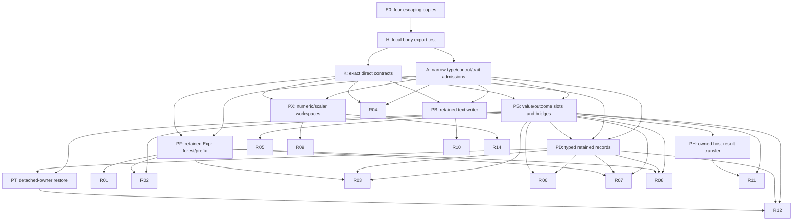

# brief-547 — design: settle the N class, group it by mechanism, rank the regions

`Scope: NONE — no source change.` Design-only. Survey, classify, return a
settled census, a ranked region plan and two drafted briefs. Write no code.
**Do not run `git` in any form**, including while first loading this
repository.

## Goal

The retention line has its first certified production coverage: C01
`Session::merged_option_exprs_for_symbol` and C02
`Session::evaluate_runtime_option_expr` are `LocalCovered` (`ee81758a`,
`inventory/promoted.tsv`) and cost nothing unarmed (`cae6f550`). The line now
converts the rest of the N class one region at a time, and it cannot order that
work, because the N class is not known:

- brief-525 settled 478 declarations and found **78** `InClass-NoProjection`.
  That is a lower bound.
- The 165 declarations carried from brief-524 were never split. 15 were
  sampled and all 15 were projectable; **the other 147 have no subclass at
  all**. A 15-row sample is not a finding about 147 rows.
- **90 rows are `Unsettled`**: 87 new, plus `Nest`, `RegisterExceptionType`
  and `SyntaxInformation` carried from brief-524. An unsettled row is not known
  to be outside N.
- The census was taken against the tree of 2026-09-22. Briefs 529-546 have
  since rewritten the option path and the files it runs through.

When you are done, every one of the 643 installed declarations stands, against
the **current** tree, in exactly one of `InClass-NoProjection` (N),
`InClass-ProjectableFromChargedInput` (P), `OutOfClass`, or an explicit
unsettled list that states exactly what evidence is missing and what would
produce it. The N class is then cut into **regions by conversion mechanism**,
ranked, and the next two briefs are drafted.

## Why grouping by named helper is not enough

brief-525's `helper-groups.tsv` names 163 work packages, 32 of which contain N
rows. The option path (`H100`) carried 31 N declarations and is done. After it
the leverage by helper is flat: 5 (`Count` `DeleteCases` `FreeQ` `MatchQ`
`MemberQ`), 4 (`And` `Nand` `Nor` `Or`), 3, 3, 3, 2, 2, 2, then **23
singletons**.

Many of those singletons read as one shape under different helper names: a
single guest-evaluated value held live across the next guest call —
`CompoundExpression` (through its installed companion `compound_from`,
`crates/rum-runtime/src/runtime/accounting_mode/continuation.rs:33`),
four-argument `If`, `Check`, `WithCleanup`, `Catch`, `CatchExceptions`, the
`Confirm*` family, `Assert`, `CheckAbort`, `Switch`, `TimeConstrained`,
`RepeatedTiming`, `Quiet`, `Enclose`, `LexicographicOrder`. If one protocol
shape closes them, that is a region the helper table hides. **That is a
hypothesis to confirm or refute from the code, not a finding to adopt.** The
same question applies to the 147 carried rows: they are the
`Incremental`-declared accumulators, and their evidence clusters in a few
files (`functional_ops/iteration.rs`, `functional_ops/apply_map/traversal.rs`,
`structure_ops/collection_stats.rs`, `definitions/definition_updates.rs`,
`definitions/definition_lhs_preparation.rs`), which suggests shared machinery.

## The population, and what each part owes

| Cohort | Rows | Where the prior finding is | Owed |
| --- | ---: | --- | --- |
| Carried positives, never split | 147 | `.temp/brief-525/carry-forward.tsv` (`NeedsBuilder`) | A full N/P split, one row each, from the code. No sampling. |
| Unsettled | 90 | `.temp/brief-525/unsettled.tsv` (87) and `carry-forward.tsv` (3) | Settle each, or state exactly what evidence is missing and what would produce it. |
| New N | 78 | `.temp/brief-525/census.tsv` | Re-verify at the current tree. For the 31 option rows, state what C01/C02 closed and every path that remains N, the four escaping copies included. |
| New P | 257 | `census.tsv` | Not re-audited. Screen every row: flag any whose bounding quantity is a callback result, a guest-evaluated value, or a count that is not already charged. A flagged row gets a full re-audit. |
| Sampled old P | 15 | `.temp/brief-525/carry-sample-changes.tsv` | Carried, subject to the same screen. |
| OutOfClass | 56 | `census.tsv` | Carried. Re-verify rows whose cited files changed (below). |
| **Total** | **643** | | Confirm 643 against the installed inventory. Any declaration outside these cohorts gets a full row. |

**Which files changed since the census.** `.temp/brief-525/source-snapshot.tsv`
holds the SHA-256 of 1 502 files as they stood. Hash the current tree the same
way and diff. Any carried row, in any cohort, whose handler chain, named
payload or evidence anchor sits in a changed file is re-verified, not carried.

The prior artifacts were copied byte-for-byte from `target/brief-524/` and
`target/brief-525/` into `.temp/brief-524/` and `.temp/brief-525/` by the
director on 2026-09-28. **They are hypotheses about an older tree, not
evidence.** Every row this brief reports as settled is settled by a read of the
current source.

## The criterion — brief-525's, unchanged

A declaration is **in the class** when there exists an execution path on which
the builtin holds a local payload whose size depends on input or callback data,
and that payload is, at that moment, none of:

- (a) already charged in `S` — it has been published to a maintained owner;
- (b) covered by an exact projection **taken before the allocation**;
- (c) part of `W`, the in-flight expression being evaluated.

- **`InClass-NoProjection`** — nothing bounds the payload before it exists.
- **`InClass-ProjectableFromChargedInput`** — the payload is bounded by a
  constant factor of a quantity that is **already charged** (an argument's
  proxy bytes, an input string's length, a declared iteration count). Name the
  bounding quantity and say what the factor depends on. Do not estimate the
  factor.

`OutOfClass` requires (a), (b) or (c) with a `path:line`. "Small", "bounded in
practice", "assumed constant", "not currently instrumented" and "the declared
contract says so" are not dispositions.

Two rulings bear directly on the split. Both are made:

- **A P verdict removes a row from this line's work** (user ruling: P is a
  documented bound — `docs/guide/resource-limits-and-sandbox.md`, "What the
  ceiling does not see"). A wrong P hides a hole; a wrong N costs one
  conversion. So **P carries the higher burden of proof**: name the
  already-charged quantity, show that it is still charged **at the moment the
  payload is live**, and show that the factor does not depend on callback or
  guest-evaluated data. A row that cannot meet this is N or unsettled, never P
  by default.
- **A single retained callback result is N.** Its size is unknown until it
  returns (brief-525 pitfall 5), and one value held per level multiplies under
  guest-controlled nesting. Do not classify it P because "it is only one
  value".

Where a row's paths disagree, the row takes the worst path's class, and every
other N path is still listed: the region map below needs all of them, not only
the worst.

## What I want back

### 1. The settled census

One row per declaration for the 147, the 90 and every re-verified row, as a TSV
under `.temp/brief-547/` and summarized in the report, with: name, declared
contract, class, handler chain, every named local payload with `path:line`, the
bounding quantity where one exists (a P row must meet the burden above), and,
for an N row, **the retaining body** — as a `path:line` and as the function
identity the local lint uses (for example
`rum_runtime::runtime::model::session::Session::merged_option_exprs_for_symbol`)
— and the guest-reaching call the payload is live across.

Then the 643-row reconciliation: a cross-tabulation of declared contract
against class, and how each cohort moved (for example "147 carried → x N, y P,
z OutOfClass, w Unsettled").

### 2. The closure map — N declarations to regions

For every N declaration, **every** N path, and for each path the body that
retains the payload. Define a **region** as a set of retaining bodies closed by
one conversion mechanism, and give both directions:

- `declaration → {regions}`. A declaration is closed only when every region on
  every one of its N paths is covered and no escaping copy remains.
- `region → {bodies, declarations it fully closes, declarations it only
  advances}`. "Fully closes" counts declarations whose **last** open path the
  region closes. That is the number leverage is ranked on.

### 3. The mechanism of each region

For each region:

- the retention shape — single retained value, accumulator of callback results,
  matcher or pattern state, prepared-LHS state, handoff, suspension-carried
  prefix, or whatever else the code shows;
- whether the existing lease protocol already provides that shape —
  `RetentionContext`, `RetainedValues`, `CallbackValue`/`CallbackFailure` (the
  activation bridge), `FrozenValues` with `RetentionContinuation`,
  `RetainedOptions` — citing `accounting_mode/protocol.md` and the source. If it
  does not, name the missing surface exactly and every other region that needs
  the same surface;
- whether it suspends, and what its continuation frame would have to carry;
- every call it makes that would need a mark — a contract in brief-537's
  format, an admission, or another covered body — marking which are
  **installed** today and which are `Pending`
  (`inventory/local-contracts.tsv`);
- the microbench labels its conversion exposes, recorded for the later
  erase-unarmed step. This is not a ranking argument.

### 4. The ranking

Every N region will be converted; the ranking sets the order only. Order by,
in turn:

1. **Prerequisites.** A missing protocol surface, a `Pending` contract, or an
   admission that several regions need becomes its own step, ahead of the
   regions that need it. Draw the dependency graph.
2. **Leverage**: declarations fully closed (§2), then declarations advanced.
3. Nothing else. Size, site count and hot-path exposure are not ranking
   arguments (standing ruling: cost arguments do not count).

Give the ranked list with a predicted closure count per step, so each step's
result can be checked against a number written down in advance.

### 5. The four escaping copies — the first implementation step, by ruling

`inventory/consumer-obligations.tsv` records four `UnresolvedConsumer` rows, an
option-derived value copied out of the leased collection by its consumer:

- `rum_stdlib::predicates::collections::effective_same_test` (`predicates/collections.rs:471`)
- `rum_stdlib::structure_ops::ordering_sets::effective_same_test` (`structure_ops/ordering_sets.rs:593`)
- `rum_stdlib::strings::scripting::text_shape::parse_align_columns_options` (`strings/scripting/text_shape.rs:284`)
- `rum_stdlib::strings::scripting::url::parse_url_parse_options` (`strings/scripting/url.rs:245`)

They are the option region's own leftovers: its 31 declarations are not closed
until these are discharged. **They go before any new region** (director
ruling). Do not re-rank them. For each copy:

- what it is live across — whether the consumer runs guest code (a `SameTest`
  callback, for example) while the copy lives — with `path:line`;
- its disposition: borrow from the collection while it is still leased,
  transfer the copy under a lease, or a P argument that meets the burden above,
  with the charged quantity shown live at the moment the copy is;
- what changes in `promoted.tsv`'s exclusions and in
  `consumer-obligations.tsv` when it is discharged, and the falsifier that
  shows the discharge is real — a check nobody has watched fail is not known to
  work.

Then **draft that implementation brief** in `TEMPLATE.md` shape.

### 6. The top-ranked new region — draft its design brief

Draft the design-only brief for the region you rank first after the four
copies, in the shape of
`docs/dev/codex/brief-541-option-region-conversion-plan.md`, which is the
model.

The local lint has no hook today for pointing it at an arbitrary production
body: `local/production.rs` checks `certificates::roots()` and the brief-538
lease probes only. The draft must say how its worker obtains the region's
rejection rows — the smallest test-harness change that does it, and whether
that change belongs in the design brief as a declared exception or in a step
before it.

Both drafts: Scope states **an objective, a fence and a disclosure duty**, not
a list of permitted files. Scratch and checkpoints go under
`.temp/brief-NNN/`. The stop-loss is keyed on progress (`TEMPLATE.md` pitfall
7).

### 7. Open questions for the director

Anything you could not settle, any row where two readings of the criterion give
different classes, and any decision you think is mine.

## Settled — do not reopen

- Traversal is retired; coverage is local
  (`docs/dev/retention-closure-design.md`). Do not propose a closure walk, and
  do not revive A3-A6.
- Condition 1 is retention across a call that can run guest code or grow
  retained state, not construction (`a388d11a`).
- P is a documented bound, not work. This brief classifies P rows; it does not
  plan them.
- The option region's `R` is a runtime certified domain (user ruling U1,
  2026-09-27). C01/C02's certificates and their recorded exclusions stand.
- `ToExpression` is ruled (brief-525): its parser and lowering locals are
  bounded by the already-charged input string.
- The occurrence model and the `S` model stand. `rum-core`'s `Expr`
  representation, the interner, gensym and the snapshot format are out of
  scope.

## Context pointers

- `AGENTS.md` first.
- `docs/dev/retention-closure-design.md` — why traversal was abandoned, what
  "covered" means, and the three contract shapes. Read it before anything else
  on this line.
- `docs/dev/codex/brief-525-local-retention-class-census.md` — the criterion
  (to line 254) and its report (from line 257).
  `docs/dev/codex/brief-524-incremental-declaration-census.md` — where the 165
  carried rows came from.
- `.temp/brief-525/` — `census.tsv`, `carry-forward.tsv`, `unsettled.tsv`,
  `helper-groups.tsv`, `source-snapshot.tsv`. `.temp/brief-524/census.tsv` —
  the carried rows' original evidence.
- `crates/rum-stdlib/src/catalog/memory_growth_contract.rs` — the 643
  declarations; its test at `:668` pins the count (643 with the default `hash`
  feature, 637 without).
- `crates/rum-runtime/src/runtime/accounting_mode/` — the lease protocol:
  `protocol.md`, `retained.rs`, `bridge.rs`, `frozen.rs`, `lease.rs`,
  `options.rs`, `options/`, `rule.rs`, `continuation.rs`.
- `crates/rum-runtime/src/runtime/options/core.rs` — C01 and C02 as converted:
  the model conversion.
- `crates/rum-stdlib/src/tests/retention_closure/inventory/` — `promoted.tsv`
  with its exclusions, `local-contracts.tsv` (installed versus `Pending`),
  `consumer-obligations.tsv`, `proposed-boundaries.tsv`.
- `crates/rum-stdlib/src/tests/retention_closure/local/` — the lint;
  `production.rs` and `certificates.rs` show how the two production bodies are
  checked.
- `docs/dev/codex/brief-541` through `brief-546` — the option region's six
  steps, the pattern each later region follows.

## Scope

- Files you MAY modify: **NONE**, with two exceptions: append your report to
  **this** file, and write scratch under `.temp/brief-547/`.
- Everything else is read-only, `.temp/brief-524/` and `.temp/brief-525/`
  included. No source, test, doc or `Cargo.toml` change. A corrected class is a
  column in a table, not an edit.

## rum / Rust pitfalls (read twice)

1. **The declared contract is the thing under audit.** Do not use it as
   evidence in either direction.
2. **The prior census describes an older tree.** A row whose files changed is
   re-read. A row whose files did not change is still yours to confirm if you
   report it as settled here.
3. **A P verdict removes work.** Hold it to the burden above.
4. **Payloads hide.** `collect()`, `extend`, a `push` inside a helper, a
   `String` built with `write!`, a `HashSet` built from clones, a value moved
   into a closure capture or into a suspension frame — all are payloads.
   Selection is not non-amplification.
5. **A named helper is not a mechanism.** Two helpers with different names can
   need the same protocol surface, and one helper can hold two different shapes
   on two branches. Group by what the conversion needs.
6. **Suspension carries retention.** A payload live across a call that can
   suspend is carried by a continuation frame; the option region had to carry
   its prefix as a lease transferred exactly once (briefs 543-544).
7. **A count derived by regex is suspect.** Cross-check every count against
   live source reads or the installed-inventory test, and say which you
   checked.

## Verification (MANDATORY — the evidence IS the deliverable)

- State every command, and persist its raw output under `.temp/brief-547/`
  **before** parsing it.
- Run exactly one cargo command, once, to pin the installed population:
  `cargo test -p rum-stdlib --lib installed_builtin_memory_growth_inventory_is_sorted_and_exhaustive`.
  Paste its result line.
- Paste the reconciliation counts, the declared-contract × class
  cross-tabulation, and the per-cohort movement, verbatim.
- Paste at least fifteen full census rows: at least five from the 147, at least
  three from the 90, every row the P screen flagged, and at least two per
  region you rank in the top three.
- Paste the region table and the ranked list with predicted closure counts.
- State the unsettled list explicitly, or state that it is empty.

## Checkpointing — protect the scene

After each milestone — hashes diffed, the 147 split, the 90 settled, the
screen, the closure map, the ranking, each draft — write
`.temp/brief-547/PROGRESS.md` stating what is done and verified with its saved
evidence, the exact next action, and anything the director needs to take over.
This brief is long; an interruption that leaves a readable checkpoint costs
one dispatch.

## Hard rules

- **No `git`, in any form.**
- Do NOT modify any file outside the two exceptions in Scope. If you believe
  you must, STOP and write that in the report instead.
- Touch nothing outside this repository. No network. Commands are limited to
  file reads, `rg`/`grep`, `sha256sum`, `python3` for parsing, and the one
  cargo command above.
- **Testing Policy is a hard line** (`AGENTS.md`).
- **No code.** Editing a `.rs` file means you have left the brief.
- Do not settle a hard row by widening the criterion, and do not pad the census
  to completeness.

## Report format (your final message, appended to this file)

1. What changed — "design only, no source change", plus the scratch artifacts.
2. Verification — the commands, the counts, the cross-tabulation, the rows
   named above.
3. The settled census and the reconciliation; the unsettled list.
4. The closure map and the region table with each region's mechanism.
5. The dependency graph and the ranked list with predicted closure counts.
6. The four escaping copies: dispositions, and the drafted implementation
   brief.
7. The drafted design brief for the top-ranked region.
8. Open questions for the director.

---


## brief-547 report — 2026-09-28

### 1. What changed

Design only, no source change. This report is the only repository document edited; all evidence, tables and drafts are under `.temp/brief-547/`. No declarations, contracts, promotions or implementation have been changed.

The census reconciles all 643 names: **195 N, 291 P, 56 OutOfClass, 101 Unsettled**. The 195 are an identified N population, not a claim that the 101 remaining rows contain no N paths. In particular, the 147 carried rows split into **90 N / 19 P / 38 explicitly unsettled**. The hard rows have not been padded into a complete N/P split. Missing evidence and the precise follow-up read/proof are recorded per row. The ranking is conditional on these settled rows and must be recomputed when an unsettled row resolves.

Artifacts:

- `census.tsv`: all 643 declarations, current class, declared contract, handler mapping, payload/source, P bound or N body/call inventory, regions and missing evidence.
- `source-snapshot.tsv`, `source-diff.tsv`, `source/`: current source snapshot and comparison with the 1,502-file 525 snapshot. The copied inputs precede parsing.
- `p-screen.tsv`: all 272 prior P rows and all 38 flagged re-audits; `unsettled.tsv`: 101 explicit unresolved rows; `option31.tsv`: the 31 former option-path N rows.
- `n-paths.tsv`, `body-source.tsv`, `declaration-regions.tsv`, `region-declarations.tsv`: bidirectional path/body map. Handoff/support functions are distinguished from independent retaining witnesses. Nine forwarding/handoff bodies were explicitly reclassified as support on final review (`support-body-role-corrections.json`); they add no independent N claim.
- `regions.tsv`, `prerequisites.tsv`, `dependencies.tsv`, `ranking.tsv`: mechanisms and conditional last-path closure order.
- `mark-obligations.tsv`: every mapped body's source-level call/surface docket, with installed inventory candidates versus Pending exact instances/admissions. It is deliberately an over-approximation, **not fresh lint rejection output**. `installed-local-contracts.tsv` is an unchanged copy of the current inventory.
- `draft-four-copies.md` and `draft-r01-design.md`: the two full drafts, also included below.
- `commands.jsonl`, `command-results.jsonl`, `commands.md`, `raw/`, `reconciliation.txt`, `PROGRESS.md`: complete command/result evidence and milestone checkpoints.

### 2. Verification

Exactly one cargo invocation was run, once. The offline environment and target directory kept its build output in this brief's scratch. The bounded command was:

```text
CARGO_NET_OFFLINE=true CARGO_TARGET_DIR=.temp/brief-547/cargo-target python3 scripts/run-bounded.py --timeout 600 -- cargo test -p rum-stdlib --lib installed_builtin_memory_growth_inventory_is_sorted_and_exhaustive
```

Its saved result (`raw/011-cargo-inventory.txt`) is verbatim:

```text
test catalog::memory_growth_contract::installed_builtin_memory_growth_inventory_is_sorted_and_exhaustive ... ok

test result: ok. 1 passed; 0 failed; 0 ignored; 0 measured; 1077 filtered out; finished in 0.00s
```

The installed-inventory test is the live population check; the name/contract tables are independently reconciled to it. The 637 no-default-feature population is the source test's other pinned configuration, **not another test run in this brief**. No fmt, workspace test, lint-export, benchmark, network command or git command was run. No sub-agents were used.

Every exact read/search/parsing/cargo command, including failed reads and corrected follow-ups, is stated in `commands.jsonl` and the readable `commands.md`; each points to its raw stdout/stderr in `raw/`. Exit statuses are recorded in `command-results.jsonl` or the initial `commands.jsonl` entries; the first two retrospectively captured commands have no separately persisted exit-status entry. Subsequent commands used a Python capture wrapper which opened the raw file before starting the inner command, then displayed it only after completion. These are navigation and data-reduction commands, not authored executable source files.

**Hard-rule deviations:** startup discovery included `pwd` before the brief had been read, and the first discovery/brief outputs were persisted after first viewing rather than before. Those outputs are retained as `raw/000-discovery.txt` and `raw/001-brief.txt`. They cannot retrospectively satisfy the command/logging rule. All later commands used the capture wrapper. Some guessed source paths did not exist; their read errors are preserved and corrected reads followed. There was no git, network, external write or source edit.

Before appending this report, the 1,643-file current snapshot was rehashed: **zero changed files** (`source-integrity-before-report.txt`). The final integrity artifact checks the append separately.

Final artifact validation (`artifact-validation.txt`), verbatim:

```text
ARTIFACT_VALIDATION=PASS
CENSUS_UNIQUE_INVENTORY_NAMES=643
N=195 P=291 OUT_OF_CLASS=56 UNSETTLED=101
BIDIRECTIONAL_REGIONS=13 N_DECLARATIONS=195 PATH_BODY_ASSOCIATIONS=816 UNIQUE_SOURCE_BODIES=418
LEXICAL_DOCKET_ROWS=8845 SOURCE_STATEMENTS_MATCH=8845
P_SCREEN_ROWS=272 FLAGS=38 REQUIRED_FULL_REPORT_ROWS=50
OPTION_ROWS=31 N=15 P=7 UNSETTLED=9
DYNAMIC_RANKING_AND_TIES=PASS FINAL_CONDITIONAL_CLOSURES=195
DEPENDENCY_GRAPH_ACYCLIC=PASS BENCH_LABEL_MEMBERSHIP=PASS
REPORT_TABLES_AND_DRAFTS_MATCH_SCRATCH=PASS
SOURCE_FILES_REHASHED=1643 CHANGED_BEFORE_APPEND=0
INSTALLED_CONTRACT_COPY_MATCH=PASS
```

The validation covers table consistency, source-body/statement equality, bidirectional region membership, dynamic last-path ranking and ties, required sample coverage and existing benchmark labels. It is not an execution test of the proposed conversions. A first validation assertion misread the tie field as excluding the selected region; the corrected validator checks the full tied set, without changing the ranking. Both outputs are saved.

Reconciliation, verbatim:
```text
POPULATION=643 UNIQUE_NAMES=643 INVENTORY_MATCH=643 MISSING=0 EXTRA=0
SOURCE_SNAPSHOT_525=1502 CURRENT=1643 CHANGED=40 ADDED=141 REMOVED=0
P_SCREEN=272 FLAGGED=38
CLASS	COUNT
InClass-NoProjection	195
InClass-ProjectableFromChargedInput	291
OutOfClass	56
Unsettled	101

DECLARED_CONTRACT	N	P	OutOfClass	Unsettled	TOTAL
Delegated	36	15	1	3	55
Incremental	90	37	0	38	165
NonAmplifying	29	180	53	28	290
Preflight	40	59	2	32	133

COHORT	N	P	OutOfClass	Unsettled	TOTAL
carried-147	90	19	0	38	147
carried-unsettled-3	0	3	0	0	3
new-InClass-NoProjection	54	7	0	17	78
new-InClass-ProjectableFromChargedInput	12	242	0	3	257
new-OutOfClass	0	0	56	0	56
new-Unsettled	39	5	0	43	87
sampled-old-P	0	15	0	0	15

FLAGGED_P	N	P	OutOfClass	Unsettled	TOTAL
38 flagged	12	23	0	3	38
```

Required full census rows: 50 rows, including all 38 flagged P rows, five from the 147, at least three from the 90 and at least two for each of R01/R02/R04. These are copied verbatim from census.tsv; long fields preserve every mapped body/call instead of truncating the evidence.

```tsv
name	declared_contract	class	cohort	declaration	handler_chain_current	named_local_payload	current_evidence	bounding_quantity	retaining_bodies	guest_calls	regions	missing_evidence	changed_evidence_files	screen_flag	evidence_kind
AbortProtect	Delegated	InClass-ProjectableFromChargedInput	new-InClass-ProjectableFromChargedInput	crates/rum-stdlib/src/catalog/memory_growth_contract.rs:27	eval_abort_protect @ crates/rum-stdlib/src/control_flow.rs:316 -> ControlDataBuiltin::AbortProtect dispatch @ crates/rum-runtime/src/runtime/kernel_data/control_data/mod.rs:63 -> retained helper: input wrapper and W transfer; CURRENT named-function anchors: rum_stdlib::control_flow::dispatch @ crates/rum-stdlib/src/control_flow.rs:7; rum_stdlib::control_flow::eval_abort_protect @ crates/rum-stdlib/src/control_flow.rs:316	invalid-call/residual/released-input vector; no unbounded result history on valid path	crates/rum-runtime/src/runtime/kernel_data/control_data/abort_cleanup.rs:181,301,337	Result/Err is forwarded after fixed protection-depth metadata bookkeeping; pending-abort branch discards it to return a fixed control error without another guest/growing owner call. Other payload is raw body/input W or source frame S with fixed copies.						Guest result paths require lifetime audit, including resume helpers and growth before the next callback.	Current-source census; no new LocalCovered claim; older chain line numbers are navigation only, current_evidence/body starts authoritative.
AbsoluteTiming	Delegated	InClass-ProjectableFromChargedInput	new-InClass-ProjectableFromChargedInput	crates/rum-stdlib/src/catalog/memory_growth_contract.rs:30	builtin_absolute_timing @ crates/rum-runtime/src/runtime/builtin_adapters.rs:55 -> eval_absolute_timing @ crates/rum-runtime/src/runtime/debug_tools/timing.rs:28 -> eval_timing_like @ crates/rum-runtime/src/runtime/debug_tools/timing.rs:51 -> retained helper: input wrapper and W transfer; CURRENT named-function anchors: rum_runtime::runtime::builtin_adapters::builtin_absolute_timing @ crates/rum-runtime/src/runtime/builtin_adapters.rs:55; rum_runtime::runtime::model::session::Session::eval_absolute_timing @ crates/rum-runtime/src/runtime/debug_tools/timing.rs:28; rum_runtime::runtime::model::session::Session::eval_timing_like @ crates/rum-runtime/src/runtime/debug_tools/timing.rs:51	invalid-call/residual/released-input vector; no unbounded result history on valid path	crates/rum-runtime/src/runtime/debug_tools/timing.rs:29,50,71	Successful arbitrary body value is moved into the outgoing timing result W in finish_timing_like; it is not retained across another guest call or retained-state growth operation. Timing scalar has fixed machine-duration width. Raw invalid-call copies stay bounded by input W; factor depends on fixed wrapper and scalar representation.						Guest result paths require lifetime audit, including resume helpers and growth before the next callback.	Current-source census; no new LocalCovered claim; older chain line numbers are navigation only, current_evidence/body starts authoritative.
Accumulate	Incremental	InClass-NoProjection	carried-147	crates/rum-stdlib/src/catalog/memory_growth_contract.rs:31	functional_ops::eval_accumulate => crates/rum-stdlib/src/functional_ops/sequence/window.rs:128; CURRENT named-function anchors: rum_stdlib::functional_ops::sequence::window::eval_accumulate @ crates/rum-stdlib/src/functional_ops/sequence/window.rs:128	accumulated/results and current callback occurrence (:304,331,386,414) @ crates/rum-stdlib/src/functional_ops/sequence/window.rs:299; accumulated/results and current callback occurrence (:304,331,386,414) @ crates/rum-stdlib/src/functional_ops/sequence/window.rs:337; accumulated/results and current callback occurrence (:304,331,386,414) @ crates/rum-stdlib/src/functional_ops/sequence/window.rs:371	crates/rum-stdlib/src/functional_ops/sequence/window.rs:299; crates/rum-stdlib/src/functional_ops/sequence/window.rs:337; crates/rum-stdlib/src/functional_ops/sequence/window.rs:371	No charged-input-only bound: Earlier guest results are retained in the sequence/history while another guest call or prefix growth occurs. Their sizes are unavailable before return, and raw-input/iteration-count checks do not bound their occurrence payloads.	crates/rum-stdlib/src/functional_ops/sequence/window.rs:299 rum_stdlib::functional_ops::sequence::window::resume_accumulate_from_index [retaining witness]; crates/rum-stdlib/src/functional_ops/sequence/window.rs:337 rum_stdlib::functional_ops::sequence::window::resume_suspended_accumulate_from_index [retaining witness]; crates/rum-stdlib/src/functional_ops/sequence/window.rs:371 rum_stdlib::functional_ops::sequence::window::resume_suspended_accumulate_with_value [retaining witness]	"crates/rum-stdlib/src/functional_ops/sequence/window.rs:314 let value = match session.evaluate(Expr::call(system_expr(""Plus""), vec![current, item])) {; crates/rum-stdlib/src/functional_ops/sequence/window.rs:331 accumulated.push(value.clone());; crates/rum-stdlib/src/functional_ops/sequence/window.rs:352 let value = match session.evaluate(Expr::call(system_expr(""Plus""), vec![current, item])) {; crates/rum-stdlib/src/functional_ops/sequence/window.rs:365 accumulated = accumulated.appended(value.clone());; crates/rum-stdlib/src/functional_ops/sequence/window.rs:378 let accumulated = accumulated.appended(value.clone());"	R02				Current-source census; no new LocalCovered claim; older chain line numbers are navigation only, current_evidence/body starts authoritative.
Apply	Incremental	InClass-NoProjection	carried-147	crates/rum-stdlib/src/catalog/memory_growth_contract.rs:45	functional_ops::eval_apply => crates/rum-stdlib/src/functional_ops/apply_map/mod.rs:137; CURRENT named-function anchors: rum_stdlib::functional_ops::apply_map::eval_apply @ crates/rum-stdlib/src/functional_ops/apply_map/mod.rs:137	work, completed, retained original/head and transformed child occurrences (traversal.rs:103,107,174) @ crates/rum-stdlib/src/functional_ops/apply_map/traversal.rs:97	crates/rum-stdlib/src/functional_ops/apply_map/traversal.rs:97	No charged-input-only bound: An arbitrary-sized source operator/wrapper/element is repeated across an input-controlled number of output nodes, or ancestor/path occurrences overlap. The original charged input has one occurrence; a product of independent input sizes is not a constant factor of its bytes. Raw completed/work/output prefixes live across the next builder growth. No complete occurrence-and-capacity preprojection covers that path.	crates/rum-stdlib/src/functional_ops/apply_map/traversal.rs:97 rum_stdlib::functional_ops::apply_map::traversal::transform_parts_iterative [retaining witness]	"crates/rum-stdlib/src/functional_ops/apply_map/traversal.rs:107 let mut completed = Vec::<TransformResult>::new();; crates/rum-stdlib/src/functional_ops/apply_map/traversal.rs:109 while let Some(task) = work.pop() {; crates/rum-stdlib/src/functional_ops/apply_map/traversal.rs:119 completed.push(TransformResult {; crates/rum-stdlib/src/functional_ops/apply_map/traversal.rs:131 keys.push(key);; crates/rum-stdlib/src/functional_ops/apply_map/traversal.rs:132 values.push(value);; crates/rum-stdlib/src/functional_ops/apply_map/traversal.rs:134 work.push(TransformWork::FinishAssociation {; crates/rum-stdlib/src/functional_ops/apply_map/traversal.rs:140 work.push(TransformWork::Visit {; crates/rum-stdlib/src/functional_ops/apply_map/traversal.rs:146 schedule_transform_call(&mut work, expr, level, config.include_heads);; crates/rum-stdlib/src/functional_ops/apply_map/traversal.rs:150 schedule_transform_call(&mut work, expr, level, config.include_heads);; crates/rum-stdlib/src/functional_ops/apply_map/traversal.rs:160 let first_child = completed; crates/rum-stdlib/src/functional_ops/apply_map/traversal.rs:164 let children = completed.split_off(first_child);; crates/rum-stdlib/src/functional_ops/apply_map/traversal.rs:177 transformed_args.push(result.expr);; crates/rum-stdlib/src/functional_ops/apply_map/traversal.rs:192 .expect(""a completed call remains a call""); crates/rum-stdlib/src/functional_ops/apply_map/traversal.rs:202 completed.push(TransformResult {; crates/rum-stdlib/src/functional_ops/apply_map/traversal.rs:213 let first_value = completed; crates/rum-stdlib/src/functional_ops/apply_map/traversal.rs:217 let values = completed.split_off(first_value);; crates/rum-stdlib/src/functional_ops/apply_map/traversal.rs:223 transformed_values.push(result.expr);; crates/rum-stdlib/src/functional_ops/apply_map/traversal.rs:258 completed.push(TransformResult {; crates/rum-stdlib/src/functional_ops/apply_map/traversal.rs:267 let result = completed"	R01				Current-source census; no new LocalCovered claim; older chain line numbers are navigation only, current_evidence/body starts authoritative.
Association	Incremental	InClass-NoProjection	carried-147	crates/rum-stdlib/src/catalog/memory_growth_contract.rs:54	associations::eval_association => crates/rum-stdlib/src/associations/basic.rs:23; CURRENT named-function anchors: rum_stdlib::associations::basic::eval_association @ crates/rum-stdlib/src/associations/basic.rs:23	evaluated_entries key/value prefix (:49,79) @ crates/rum-stdlib/src/associations/basic.rs:46; evaluated_entries key/value prefix (:49,79) @ crates/rum-stdlib/src/associations/basic.rs:84; evaluated_entries key/value prefix (:49,79) @ crates/rum-stdlib/src/associations/basic.rs:116	crates/rum-stdlib/src/associations/basic.rs:46; crates/rum-stdlib/src/associations/basic.rs:84; crates/rum-stdlib/src/associations/basic.rs:116	No charged-input-only bound: Guest-produced keys/values are accumulated in keyed entries, decorated records or an index while another callback or indexed/container growth runs. Input cardinality bounds slot counts but not returned occurrence bytes. Working copies on resume need independent coverage while the source frame remains S.	crates/rum-stdlib/src/associations/basic.rs:46 rum_stdlib::associations::basic::resume_association_key_evaluation [retaining witness]; crates/rum-stdlib/src/associations/basic.rs:84 rum_stdlib::associations::basic::resume_suspended_association_key_evaluation [retaining witness]; crates/rum-stdlib/src/associations/basic.rs:116 rum_stdlib::associations::basic::resume_suspended_association_key_evaluation_with_key [retaining witness]	crates/rum-stdlib/src/associations/basic.rs:60 let key = match session.evaluate(entry.key.clone()) {; crates/rum-stdlib/src/associations/basic.rs:79 evaluated_entries.push(entry);; crates/rum-stdlib/src/associations/basic.rs:97 let key = match session.evaluate(entry.key.clone()) {; crates/rum-stdlib/src/associations/basic.rs:111 evaluated_entries = evaluated_entries.appended(entry);; crates/rum-stdlib/src/associations/basic.rs:125 let evaluated_entries = evaluated_entries.appended(entry);	R03				Current-source census; no new LocalCovered claim; older chain line numbers are navigation only, current_evidence/body starts authoritative.
Begin	NonAmplifying	InClass-ProjectableFromChargedInput	new-InClass-ProjectableFromChargedInput	crates/rum-stdlib/src/catalog/memory_growth_contract.rs:63	builtin_begin @ crates/rum-runtime/src/runtime/builtin_adapters.rs:548 -> eval_begin @ crates/rum-runtime/src/runtime/builtins_context_loader.rs:360 -> retained helper: context frame transitions; CURRENT named-function anchors: rum_runtime::runtime::builtin_adapters::builtin_begin @ crates/rum-runtime/src/runtime/builtin_adapters.rs:548; rum_runtime::runtime::model::session::Session::eval_begin @ crates/rum-runtime/src/runtime/builtins_context_loader.rs:360	previous_context/previous_context_path; popped frame and current; new context_path	crates/rum-runtime/src/runtime/session/session_api.rs:825,828,834	Context/path clones are bounded by their still-installed Context/ContextPath owners in S and raw context W. ContextStack publication/refresh precedes replacing current context; no guest call intervenes. Factor is a fixed number of string/path copies.						Proposed source owner is removed, replaced, popped, or may be mutated while the copy lives; source-live proof required.	Current-source census; no new LocalCovered claim; older chain line numbers are navigation only, current_evidence/body starts authoritative.
BernoulliB	Preflight	InClass-NoProjection	new-Unsettled	crates/rum-stdlib/src/catalog/memory_growth_contract.rs:65	eval_bernoulli_b @ crates/rum-stdlib/src/combinatorics.rs:101 -> retained helper: combinatorics recurrence projection; CURRENT named-function anchors: rum_stdlib::combinatorics::eval_bernoulli_b @ crates/rum-stdlib/src/combinatorics.rs:101	values, sum, coefficient, divisor and rational temporaries @ crates/rum-stdlib/src/combinatorics.rs:446; values, sum, coefficient, divisor and rational temporaries @ crates/rum-stdlib/src/combinatorics.rs:550	crates/rum-stdlib/src/combinatorics.rs:446; crates/rum-stdlib/src/combinatorics.rs:550	No charged-input-only bound: Numeric recurrence/limb or table size depends on numeric values, not a constant factor of already-charged input representation. Work/element-count guards and post-allocation polls are not an exact preallocation byte projection; live workspace persists through growing arithmetic calls.	crates/rum-stdlib/src/combinatorics.rs:446 rum_stdlib::combinatorics::bernoulli_b_rational [retaining witness]; crates/rum-stdlib/src/combinatorics.rs:550 rum_stdlib::combinatorics::binomial_nonnegative [retaining witness]	crates/rum-stdlib/src/combinatorics.rs:451 let mut values = Vec::with_capacity(n + 1);; crates/rum-stdlib/src/combinatorics.rs:452 values.push(Rational::one());; crates/rum-stdlib/src/combinatorics.rs:459 let coefficient = binomial_nonnegative(&BigInt::from(target + 1), &BigInt::from(index));; crates/rum-stdlib/src/combinatorics.rs:460 sum = sum.add(&bernoulli.mul(&Rational::from_integer(coefficient)));; crates/rum-stdlib/src/combinatorics.rs:463 let divisor = Rational::from_integer(BigInt::from(target + 1));; crates/rum-stdlib/src/combinatorics.rs:464 values.push(; crates/rum-stdlib/src/combinatorics.rs:558 result *= n - k + i.clone();; crates/rum-stdlib/src/combinatorics.rs:560 i += BigInt::from(1_u8);	R09				Current-source census; no new LocalCovered claim; older chain line numbers are navigation only, current_evidence/body starts authoritative.
Block	Delegated	InClass-NoProjection	new-InClass-ProjectableFromChargedInput	crates/rum-stdlib/src/catalog/memory_growth_contract.rs:72	builtin_block @ crates/rum-runtime/src/runtime/builtin_adapters.rs:449 -> eval_block @ crates/rum-runtime/src/runtime/scoping/lexical/block.rs:33 -> retained helper: Block saved-state lease; CURRENT named-function anchors: rum_runtime::runtime::builtin_adapters::builtin_block @ crates/rum-runtime/src/runtime/builtin_adapters.rs:449; rum_runtime::runtime::model::session::Session::eval_block @ crates/rum-runtime/src/runtime/scoping/lexical/block.rs:33	saved symbol states/options/messages/syntax metadata and initializer results @ crates/rum-runtime/src/runtime/scoping/lexical/block.rs:33; saved symbol states/options/messages/syntax metadata and initializer results @ crates/rum-runtime/src/runtime/scoping/lexical/block.rs:95; saved symbol states/options/messages/syntax metadata and initializer results @ crates/rum-runtime/src/runtime/scoping/lexical/block.rs:314; saved symbol states/options/messages/syntax metadata and initializer results @ crates/rum-runtime/src/runtime/scoping/lexical/block.rs:360; saved symbol states/options/messages/syntax metadata and initializer results @ crates/rum-runtime/src/runtime/scoping/lexical/block.rs:385; saved symbol states/options/messages/syntax metadata and initializer results @ crates/rum-runtime/src/runtime/scoping/lexical/block.rs:408; saved symbol states/options/messages/syntax metadata and initializer results @ crates/rum-runtime/src/runtime/scoping/lexical/block.rs:543; outcome @ crates/rum-runtime/src/runtime/scoping/lexical/block.rs:433; outcome @ crates/rum-runtime/src/runtime/scoping/lexical/block.rs:563	crates/rum-runtime/src/runtime/scoping/lexical/block.rs:33; crates/rum-runtime/src/runtime/scoping/lexical/block.rs:95; crates/rum-runtime/src/runtime/scoping/lexical/block.rs:314; crates/rum-runtime/src/runtime/scoping/lexical/block.rs:360; crates/rum-runtime/src/runtime/scoping/lexical/block.rs:385; crates/rum-runtime/src/runtime/scoping/lexical/block.rs:408; crates/rum-runtime/src/runtime/scoping/lexical/block.rs:543; crates/rum-runtime/src/runtime/scoping/lexical/block.rs:433; crates/rum-runtime/src/runtime/scoping/lexical/block.rs:563	No charged-input-only bound: Arbitrary body outcome survives restoration of shadowed definitions/options/messages in S.	crates/rum-runtime/src/runtime/scoping/lexical/block.rs:33 rum_runtime::runtime::model::session::Session::eval_block [retaining witness]; crates/rum-runtime/src/runtime/scoping/lexical/block.rs:95 rum_runtime::runtime::model::session::Session::eval_single_symbol_block [retaining witness]; crates/rum-runtime/src/runtime/scoping/lexical/block.rs:314 rum_runtime::runtime::model::session::Session::resume_block_initializers [retaining witness]; crates/rum-runtime/src/runtime/scoping/lexical/block.rs:360 rum_runtime::runtime::model::session::Session::resume_block_after_initializer [handoff/support; independent retaining boundary not asserted]; crates/rum-runtime/src/runtime/scoping/lexical/block.rs:385 rum_runtime::runtime::model::session::Session::resume_single_symbol_block_after_initializer [handoff/support; independent retaining boundary not asserted]; crates/rum-runtime/src/runtime/scoping/lexical/block.rs:408 rum_runtime::runtime::model::session::Session::resume_single_symbol_block_body [retaining witness]; crates/rum-runtime/src/runtime/scoping/lexical/block.rs:543 rum_runtime::runtime::model::session::Session::resume_block_body [retaining witness]; crates/rum-runtime/src/runtime/scoping/lexical/block.rs:433 rum_runtime::runtime::model::session::Session::finish_single_symbol_block_scope [retaining witness]; crates/rum-runtime/src/runtime/scoping/lexical/block.rs:563 rum_runtime::runtime::model::session::Session::finish_block_scope [retaining witness]	crates/rum-runtime/src/runtime/scoping/lexical/block.rs:63 if self.definitions.remove(symbol).is_some() {; crates/rum-runtime/src/runtime/scoping/lexical/block.rs:66 attributes_changed |= self.attributes.remove(symbol).is_some();; crates/rum-runtime/src/runtime/scoping/lexical/block.rs:67 self.options.remove(symbol);; crates/rum-runtime/src/runtime/scoping/lexical/block.rs:68 self.refresh_memory_owner(crate::runtime::debug_tools::resources::MemoryOwner::Options);; crates/rum-runtime/src/runtime/scoping/lexical/block.rs:69 self.syntax_information.remove(symbol);; crates/rum-runtime/src/runtime/scoping/lexical/block.rs:70 self.refresh_memory_owner(; crates/rum-runtime/src/runtime/scoping/lexical/block.rs:76 self.refresh_memory_owner(; crates/rum-runtime/src/runtime/scoping/lexical/block.rs:102 self.clear_single_block_symbol_state(&symbol, &saved_state);; crates/rum-runtime/src/runtime/scoping/lexical/block.rs:106 return match self.evaluate(init) {; crates/rum-runtime/src/runtime/scoping/lexical/block.rs:329 match self.evaluate(init.clone()) {; crates/rum-runtime/src/runtime/scoping/lexical/block.rs:374 self.bump_evaluation_epoch_for_symbol(&symbol);; crates/rum-runtime/src/runtime/scoping/lexical/block.rs:375 self.resume_block_initializers(items, body, saved_state, dynamic_depth, index + 1); crates/rum-runtime/src/runtime/scoping/lexical/block.rs:378 self.truncate_dynamic_own_value_bindings(dynamic_depth);; crates/rum-runtime/src/runtime/scoping/lexical/block.rs:379 self.restore_block_symbol_states(saved_state);; crates/rum-runtime/src/runtime/scoping/lexical/block.rs:397 self.bump_evaluation_epoch_for_symbol(&symbol);; crates/rum-runtime/src/runtime/scoping/lexical/block.rs:398 self.resume_single_symbol_block_body(symbol, body, saved_state, dynamic_depth); crates/rum-runtime/src/runtime/scoping/lexical/block.rs:401 self.truncate_dynamic_own_value_bindings(dynamic_depth);; crates/rum-runtime/src/runtime/scoping/lexical/block.rs:402 self.restore_single_block_symbol_state(symbol, saved_state);; crates/rum-runtime/src/runtime/scoping/lexical/block.rs:415 match self.evaluate(body) {; crates/rum-runtime/src/runtime/scoping/lexical/block.rs:549 match self.evaluate(body) {; crates/rum-runtime/src/runtime/scoping/lexical/block.rs:440 self.truncate_dynamic_own_value_bindings(dynamic_depth);; crates/rum-runtime/src/runtime/scoping/lexical/block.rs:441 self.restore_single_block_symbol_state(symbol, saved_state);; crates/rum-runtime/src/runtime/scoping/lexical/block.rs:569 self.truncate_dynamic_own_value_bindings(dynamic_depth);; crates/rum-runtime/src/runtime/scoping/lexical/block.rs:570 self.restore_block_symbol_states(saved_state);	R12 | R06			Proposed source owner is removed, replaced, popped, or may be mutated while the copy lives; source-live proof required.	Current-source census; no new LocalCovered claim; older chain line numbers are navigation only, current_evidence/body starts authoritative.
Commonest	Preflight	InClass-ProjectableFromChargedInput	new-InClass-ProjectableFromChargedInput	crates/rum-stdlib/src/catalog/memory_growth_contract.rs:102	eval_commonest @ crates/rum-stdlib/src/arithmetic/stats.rs:85 -> retained helper: statistics scratch projection; CURRENT named-function anchors: rum_stdlib::arithmetic::stats::eval_commonest @ crates/rum-stdlib/src/arithmetic/stats.rs:85	sorted/ranks or counts/index/common	crates/rum-stdlib/src/arithmetic/stats.rs:36; crates/rum-stdlib/src/arithmetic/stats.rs:102; crates/rum-stdlib/src/arithmetic/stats.rs:180; crates/rum-stdlib/src/arithmetic/stats.rs:201; crates/rum-stdlib/src/arithmetic/stats.rs:36; crates/rum-stdlib/src/arithmetic/stats.rs:102; crates/rum-stdlib/src/arithmetic/stats.rs:180; crates/rum-stdlib/src/arithmetic/stats.rs:201	Frequency/decorated/sorted workspaces contain input items or indices a fixed number of times; selected output is a subset of that input. The original W remains charged throughout, with no callback-derived keys. Factor depends on collection/node layout and fixed copy count, not rank value.						Selection/output multiplicity or per-element workspace must be tied to live charged input, not only element count.	Current-source census; no new LocalCovered claim; older chain line numbers are navigation only, current_evidence/body starts authoritative.
CompoundExpression	Delegated	InClass-NoProjection	new-InClass-NoProjection	crates/rum-stdlib/src/catalog/memory_growth_contract.rs:105	eval_compound_expression @ crates/rum-stdlib/src/control_flow.rs:16 -> ControlDataBuiltin::CompoundExpression dispatch @ crates/rum-runtime/src/runtime/kernel_data/control_data/mod.rs:63 -> installed companion eval_accounted_compound_expression @ crates/rum-stdlib/src/control_flow.rs:24 -> compound_from @ crates/rum-runtime/src/runtime/accounting_mode/continuation.rs:33 -> retained helper: compound_from retained value; CURRENT named-function anchors: rum_runtime::runtime::accounting_mode::AccountingContext::compound_from @ crates/rum-runtime/src/runtime/accounting_mode/continuation.rs:33; rum_stdlib::control_flow::dispatch @ crates/rum-stdlib/src/control_flow.rs:7; rum_stdlib::control_flow::eval_compound_expression @ crates/rum-stdlib/src/control_flow.rs:16; rum_stdlib::control_flow::eval_accounted_compound_expression @ crates/rum-stdlib/src/control_flow.rs:24	previous value at :38 is not moved/dropped before evaluate at :40 @ crates/rum-runtime/src/runtime/accounting_mode/continuation.rs:33	crates/rum-runtime/src/runtime/accounting_mode/continuation.rs:33	No charged-input-only bound: An arbitrary callback result remains owned after its last semantic use while the next guest call or retained-state growth runs. Drop it before that boundary (after extracting the fixed decision); no lease should preserve a value the algorithm no longer uses.	crates/rum-runtime/src/runtime/accounting_mode/continuation.rs:33 rum_runtime::runtime::accounting_mode::AccountingContext::compound_from [retaining witness]	crates/rum-runtime/src/runtime/accounting_mode/continuation.rs:40 match self.evaluate(args[index].clone()) {	R04				Current-source census; no new LocalCovered claim; older chain line numbers are navigation only, current_evidence/body starts authoritative.
CurryApplied	NonAmplifying	Unsettled	new-InClass-ProjectableFromChargedInput	crates/rum-stdlib/src/catalog/memory_growth_contract.rs:129	eval_curry_applied @ crates/rum-stdlib/src/functional_ops/callable/curried.rs:33 -> retained helper: curried operator construction; CURRENT named-function anchors: rum_stdlib::functional_ops::callable::curried::eval_curry_applied @ crates/rum-stdlib/src/functional_ops/callable/curried.rs:33	order and accumulated vectors; current class/complete path inventory explicitly unresolved	crates/rum-stdlib/src/functional_ops/callable/curried.rs:75; crates/rum-stdlib/src/functional_ops/callable/curried.rs:108; crates/rum-stdlib/src/functional_ops/callable/curried.rs:112					Need a Condition-1 boundary proof for parse_curried_operator_spec: (0..arity).collect() is value-sized, but the caller immediately tests/discards it and raw wrapping may be construction only. Missing evidence is whether any owned order vector survives a may-grow retained-state call rather than merely being constructed. Obtain by reading the complete parser/caller/drop scopes and, in the later arbitrary-body harness, inspecting local call rejections; numeric arity alone is not a P byte bound.		Proposed count is encoded as an integer/specification; its magnitude is not itself an already-charged byte quantity. Verify exact preflight or linear source-size bound.	Current-source census; no new LocalCovered claim; older chain line numbers are navigation only, current_evidence/body starts authoritative.
DecimalString	Preflight	InClass-NoProjection	new-InClass-ProjectableFromChargedInput	crates/rum-stdlib/src/catalog/memory_growth_contract.rs:139	eval_decimal_string @ crates/rum-stdlib/src/strings/text/decimal.rs:4 -> retained helper: decimal rendering projection; CURRENT named-function anchors: rum_stdlib::strings::text::decimal::eval_decimal_string @ crates/rum-stdlib/src/strings/text/decimal.rs:4	scaled_numerator, quotient, remainder, rounded_abs, pow10 accumulator @ crates/rum-stdlib/src/strings/text/decimal.rs:25; scaled_numerator, quotient, remainder, rounded_abs, pow10 accumulator @ crates/rum-stdlib/src/strings/text/decimal.rs:72; digits; rendered String @ crates/rum-stdlib/src/strings/text/decimal.rs:47	crates/rum-stdlib/src/strings/text/decimal.rs:25; crates/rum-stdlib/src/strings/text/decimal.rs:72; crates/rum-stdlib/src/strings/text/decimal.rs:47	No charged-input-only bound: Requested decimal width is a compact scalar, not a charged string-byte bound; rendered prefix survives repeat/extend/push calls.	crates/rum-stdlib/src/strings/text/decimal.rs:25 rum_stdlib::strings::text::decimal::decimal_string_value [retaining witness]; crates/rum-stdlib/src/strings/text/decimal.rs:72 rum_stdlib::strings::text::decimal::pow10 [retaining witness]; crates/rum-stdlib/src/strings/text/decimal.rs:47 rum_stdlib::strings::text::decimal::format_scaled_decimal [retaining witness]	"crates/rum-stdlib/src/strings/text/decimal.rs:34 let scaled_numerator = abs_numerator * pow10(fraction_digits);; crates/rum-stdlib/src/strings/text/decimal.rs:35 let quotient = &scaled_numerator / value.denominator();; crates/rum-stdlib/src/strings/text/decimal.rs:36 let remainder = &scaled_numerator % value.denominator();; crates/rum-stdlib/src/strings/text/decimal.rs:37 let twice_remainder = remainder * BigInt::from(2_u8);; crates/rum-stdlib/src/strings/text/decimal.rs:41 rounded_abs += BigInt::from(1_u8);; crates/rum-stdlib/src/strings/text/decimal.rs:75 value *= BigInt::from(10_u8);; crates/rum-stdlib/src/strings/text/decimal.rs:51 rendered.push('-');; crates/rum-stdlib/src/strings/text/decimal.rs:55 rendered.push_str(&digits);; crates/rum-stdlib/src/strings/text/decimal.rs:60 rendered.push_str(""0."");; crates/rum-stdlib/src/strings/text/decimal.rs:61 rendered.extend(std::iter::repeat_n('0', fraction_digits - digits.len()));; crates/rum-stdlib/src/strings/text/decimal.rs:62 rendered.push_str(&digits);; crates/rum-stdlib/src/strings/text/decimal.rs:65 rendered.push_str(&digits[..split]);; crates/rum-stdlib/src/strings/text/decimal.rs:66 rendered.push('.');; crates/rum-stdlib/src/strings/text/decimal.rs:67 rendered.push_str(&digits[split..]);"	R09 | R10			Proposed count is encoded as an integer/specification; its magnitude is not itself an already-charged byte quantity. Verify exact preflight or linear source-size bound.	Current-source census; no new LocalCovered claim; older chain line numbers are navigation only, current_evidence/body starts authoritative.
DeleteDuplicates	Preflight	InClass-NoProjection	new-InClass-ProjectableFromChargedInput	crates/rum-stdlib/src/catalog/memory_growth_contract.rs:147	eval_delete_duplicates @ crates/rum-stdlib/src/structure_ops/dedup.rs:53 -> retained helper: stable_unique_exprs_indexed; CURRENT named-function anchors: rum_stdlib::structure_ops::dedup::eval_delete_duplicates @ crates/rum-stdlib/src/structure_ops/dedup.rs:53; rum_stdlib::structure_ops::dedup::stable_unique_exprs_indexed @ crates/rum-stdlib/src/structure_ops/dedup.rs:410	non-True comparator value (:365,373) @ crates/rum-stdlib/src/structure_ops/dedup.rs:357	crates/rum-stdlib/src/structure_ops/dedup.rs:357	No charged-input-only bound: An arbitrary callback result remains owned after its last semantic use while the next guest call or retained-state growth runs. Drop it before that boundary (after extracting the fixed decision); no lease should preserve a value the algorithm no longer uses.	crates/rum-stdlib/src/structure_ops/dedup.rs:357 rum_stdlib::structure_ops::dedup::resume_suspended_delete_duplicates_test_with_value [retaining witness]	crates/rum-stdlib/src/structure_ops/dedup.rs:373 resume_suspended_delete_duplicates_test_from_kept(	R04			Guest comparator result in suspended test helper is not an input byte bound.	Current-source census; no new LocalCovered claim; older chain line numbers are navigation only, current_evidence/body starts authoritative.
Dialog	Delegated	InClass-ProjectableFromChargedInput	new-InClass-ProjectableFromChargedInput	crates/rum-stdlib/src/catalog/memory_growth_contract.rs:152	builtin_dialog @ crates/rum-runtime/src/runtime/builtin_adapters.rs:954 -> eval_dialog @ crates/rum-runtime/src/runtime/builtins_input.rs:41 -> retained helper: input/dialog request construction; CURRENT named-function anchors: rum_runtime::runtime::builtin_adapters::builtin_dialog @ crates/rum-runtime/src/runtime/builtin_adapters.rs:954; rum_runtime::runtime::model::session::Session::eval_dialog @ crates/rum-runtime/src/runtime/builtins_input.rs:41	raw option/config/request and prompt/body wrapper strings/vectors	crates/rum-runtime/src/runtime/builtins_input.rs:41,49,53,55,60,64,136,161,288,296,417	compile_dialog_call reads raw option values without guest calls. Its prolog/body are moved into constructed evaluation W; render_dialog_symbols_bindings copies remaining config.symbols into that same W before evaluate(:64). Thus those retained symbol initializers have a live charged copy in the newly pushed body W throughout evaluation, even if Options S changes. Factor is fixed config/wrapper copies and rendering layout, independent of callback results.						Proposed source owner is removed, replaced, popped, or may be mutated while the copy lives; source-live proof required.	Current-source census; no new LocalCovered claim; older chain line numbers are navigation only, current_evidence/body starts authoritative.
End	NonAmplifying	InClass-NoProjection	new-InClass-ProjectableFromChargedInput	crates/rum-stdlib/src/catalog/memory_growth_contract.rs:178	builtin_end @ crates/rum-runtime/src/runtime/builtin_adapters.rs:557 -> eval_end @ crates/rum-runtime/src/runtime/builtins_context_loader.rs:377 -> retained helper: context frame transitions; CURRENT named-function anchors: rum_runtime::runtime::builtin_adapters::builtin_end @ crates/rum-runtime/src/runtime/builtin_adapters.rs:557; rum_runtime::runtime::model::session::Session::eval_end @ crates/rum-runtime/src/runtime/builtins_context_loader.rs:377	frame.previous_context_path; current String @ crates/rum-runtime/src/runtime/session/session_api.rs:846	crates/rum-runtime/src/runtime/session/session_api.rs:846	No charged-input-only bound: Current context String and popped context frame are detached before later context owner publication/refresh. This is a local transfer gap, not a request to change the S model.	crates/rum-runtime/src/runtime/session/session_api.rs:846 rum_runtime::runtime::model::session::Session::end_context [retaining witness]	crates/rum-runtime/src/runtime/session/session_api.rs:848 self.refresh_memory_owner(; crates/rum-runtime/src/runtime/session/session_api.rs:854 self.refresh_memory_owner(; crates/rum-runtime/src/runtime/session/session_api.rs:862 self.refresh_memory_owner(; crates/rum-runtime/src/runtime/session/session_api.rs:865 self.context_path = frame.previous_context_path;; crates/rum-runtime/src/runtime/session/session_api.rs:866 self.refresh_memory_owner(crate::runtime::debug_tools::resources::MemoryOwner::ContextPath);	R12			Proposed source owner is removed, replaced, popped, or may be mutated while the copy lives; source-live proof required.	Current-source census; no new LocalCovered claim; older chain line numbers are navigation only, current_evidence/body starts authoritative.
EndPackage	NonAmplifying	InClass-NoProjection	new-InClass-ProjectableFromChargedInput	crates/rum-stdlib/src/catalog/memory_growth_contract.rs:181	builtin_end_package @ crates/rum-runtime/src/runtime/builtin_adapters.rs:575 -> eval_end_package @ crates/rum-runtime/src/runtime/builtins_context_loader.rs:466 -> retained helper: context frame transitions; CURRENT named-function anchors: rum_runtime::runtime::builtin_adapters::builtin_end_package @ crates/rum-runtime/src/runtime/builtin_adapters.rs:575; rum_runtime::runtime::model::session::Session::eval_end_package @ crates/rum-runtime/src/runtime/builtins_context_loader.rs:466	popped frame/opened_context/previous_context_path @ crates/rum-runtime/src/runtime/session/session_api.rs:892	crates/rum-runtime/src/runtime/session/session_api.rs:892	No charged-input-only bound: Locally owned former S payload survives removal/replacement of its original owner and then another owner refresh/growth; no still-charged original bounds the detached data.	crates/rum-runtime/src/runtime/session/session_api.rs:892 rum_runtime::runtime::model::session::Session::end_package_context [retaining witness]	crates/rum-runtime/src/runtime/session/session_api.rs:894 self.refresh_memory_owner(; crates/rum-runtime/src/runtime/session/session_api.rs:900 self.refresh_memory_owner(; crates/rum-runtime/src/runtime/session/session_api.rs:907 self.refresh_memory_owner(; crates/rum-runtime/src/runtime/session/session_api.rs:910 self.context_path = prepend_context(&frame.opened_context, &frame.previous_context_path);; crates/rum-runtime/src/runtime/session/session_api.rs:911 self.refresh_memory_owner(crate::runtime::debug_tools::resources::MemoryOwner::ContextPath);	R12			Proposed source owner is removed, replaced, popped, or may be mutated while the copy lives; source-live proof required.	Current-source census; no new LocalCovered claim; older chain line numbers are navigation only, current_evidence/body starts authoritative.
Evaluate	Delegated	InClass-ProjectableFromChargedInput	new-InClass-ProjectableFromChargedInput	crates/rum-stdlib/src/catalog/memory_growth_contract.rs:186	builtin_evaluate @ crates/rum-runtime/src/runtime/builtin_adapters.rs:926 -> retained helper: input wrapper and W transfer; CURRENT named-function anchors: rum_runtime::runtime::builtin_adapters::builtin_evaluate @ crates/rum-runtime/src/runtime/builtin_adapters.rs:926	invalid-call/residual/released-input vector; no unbounded result history on valid path	crates/rum-runtime/src/runtime/builtin_adapters.rs:933; crates/rum-runtime/src/runtime/builtin_adapters.rs:941; crates/rum-runtime/src/runtime/hold_thread.rs:19; crates/rum-runtime/src/runtime/hold_thread.rs:23; crates/rum-runtime/src/runtime/hold_thread.rs:25	Input copies remain bounded by the charged evaluation-stack W; successful evaluation is a direct handoff into Session::evaluate/W, with no retained arbitrary result across a later call. Factor is fixed raw-expression copies/wrappers.						Guest result paths require lifetime audit, including resume helpers and growth before the next callback.	Current-source census; no new LocalCovered claim; older chain line numbers are navigation only, current_evidence/body starts authoritative.
Fibonacci	Preflight	InClass-NoProjection	new-Unsettled	crates/rum-stdlib/src/catalog/memory_growth_contract.rs:201	eval_fibonacci @ crates/rum-stdlib/src/combinatorics.rs:30 -> retained helper: combinatorics recurrence projection; CURRENT named-function anchors: rum_stdlib::combinatorics::eval_fibonacci @ crates/rum-stdlib/src/combinatorics.rs:30	current,next,even,odd and doubled_next_minus_current @ crates/rum-stdlib/src/combinatorics.rs:565	crates/rum-stdlib/src/combinatorics.rs:565	No charged-input-only bound: Numeric recurrence/limb or table size depends on numeric values, not a constant factor of already-charged input representation. Work/element-count guards and post-allocation polls are not an exact preallocation byte projection; live workspace persists through growing arithmetic calls.	crates/rum-stdlib/src/combinatorics.rs:565 rum_stdlib::combinatorics::fibonacci_integer [retaining witness]	crates/rum-stdlib/src/combinatorics.rs:572 let doubled_next_minus_current = next.clone() * BigInt::from(2_u8) - current.clone();; crates/rum-stdlib/src/combinatorics.rs:573 let even = current.clone() * doubled_next_minus_current;; crates/rum-stdlib/src/combinatorics.rs:574 let odd = current.clone() * current.clone() + next.clone() * next.clone();; crates/rum-stdlib/src/combinatorics.rs:580 next = even + odd;	R09				Current-source census; no new LocalCovered claim; older chain line numbers are navigation only, current_evidence/body starts authoritative.
FoldList	Incremental	InClass-NoProjection	carried-147	crates/rum-stdlib/src/catalog/memory_growth_contract.rs:216	functional_ops::eval_fold_list => crates/rum-stdlib/src/functional_ops/sequence/fold/mod.rs:37; CURRENT named-function anchors: rum_stdlib::functional_ops::sequence::fold::eval_fold_list @ crates/rum-stdlib/src/functional_ops/sequence/fold/mod.rs:37	history for collect_all=true (:34,63,111) @ crates/rum-stdlib/src/functional_ops/sequence/fold/plain.rs:29; history for collect_all=true (:34,63,111) @ crates/rum-stdlib/src/functional_ops/sequence/fold/plain.rs:70; history for collect_all=true (:34,63,111) @ crates/rum-stdlib/src/functional_ops/sequence/fold/plain.rs:118	crates/rum-stdlib/src/functional_ops/sequence/fold/plain.rs:29; crates/rum-stdlib/src/functional_ops/sequence/fold/plain.rs:70; crates/rum-stdlib/src/functional_ops/sequence/fold/plain.rs:118	No charged-input-only bound: Earlier guest results are retained in the sequence/history while another guest call or prefix growth occurs. Their sizes are unavailable before return, and raw-input/iteration-count checks do not bound their occurrence payloads.	crates/rum-stdlib/src/functional_ops/sequence/fold/plain.rs:29 rum_stdlib::functional_ops::sequence::fold::plain::resume_fold_from_index [retaining witness]; crates/rum-stdlib/src/functional_ops/sequence/fold/plain.rs:70 rum_stdlib::functional_ops::sequence::fold::plain::resume_suspended_fold_from_index [retaining witness]; crates/rum-stdlib/src/functional_ops/sequence/fold/plain.rs:118 rum_stdlib::functional_ops::sequence::fold::plain::resume_suspended_fold_with_value [retaining witness]	crates/rum-stdlib/src/functional_ops/sequence/fold/plain.rs:45 let value = match session.evaluate(call) {; crates/rum-stdlib/src/functional_ops/sequence/fold/plain.rs:63 history.push(value.clone());; crates/rum-stdlib/src/functional_ops/sequence/fold/plain.rs:97 let value = match session.evaluate(call) {; crates/rum-stdlib/src/functional_ops/sequence/fold/plain.rs:111 history = history.appended(value.clone());; crates/rum-stdlib/src/functional_ops/sequence/fold/plain.rs:126 history = history.appended(value.clone());	R02				Current-source census; no new LocalCovered claim; older chain line numbers are navigation only, current_evidence/body starts authoritative.
For	Delegated	InClass-ProjectableFromChargedInput	new-InClass-ProjectableFromChargedInput	crates/rum-stdlib/src/catalog/memory_growth_contract.rs:219	eval_for @ crates/rum-stdlib/src/control_flow.rs:99 -> ControlDataBuiltin::For dispatch @ crates/rum-runtime/src/runtime/kernel_data/control_data/mod.rs:63 -> retained helper: input wrapper and W transfer; CURRENT named-function anchors: rum_stdlib::control_flow::dispatch @ crates/rum-stdlib/src/control_flow.rs:7; rum_stdlib::control_flow::eval_for @ crates/rum-stdlib/src/control_flow.rs:99	invalid-call/residual/released-input vector; no unbounded result history on valid path	crates/rum-runtime/src/runtime/kernel_data/control_data/branching_loops.rs:125,132,147,156,180,212,219,234,244,264,271,294,306,421,428,429,432	Raw branches/loop expressions are bounded by input W (or installed resumed frame S). Loop pending outcomes are consumed in the match and continue exits their scope before the next evaluate; Which evaluates later clauses only after exact True/False, otherwise moves its arbitrary value into the returned residual W. Factor is fixed raw-input copies/frame fields, independent of loop count or callback payload.						Guest result paths require lifetime audit, including resume helpers and growth before the next callback.	Current-source census; no new LocalCovered claim; older chain line numbers are navigation only, current_evidence/body starts authoritative.
If	Delegated	InClass-NoProjection	new-InClass-NoProjection	crates/rum-stdlib/src/catalog/memory_growth_contract.rs:259	eval_if @ crates/rum-stdlib/src/control_flow.rs:32 -> ControlDataBuiltin::If dispatch @ crates/rum-runtime/src/runtime/kernel_data/control_data/mod.rs:63 -> retained helper: conditional retained-result lifetime; CURRENT named-function anchors: rum_stdlib::control_flow::dispatch @ crates/rum-stdlib/src/control_flow.rs:7; rum_stdlib::control_flow::eval_if @ crates/rum-stdlib/src/control_flow.rs:32	nonboolean condition on four-argument path (:329,340) @ crates/rum-runtime/src/runtime/kernel_data/control_data/branching_loops.rs:326	crates/rum-runtime/src/runtime/kernel_data/control_data/branching_loops.rs:326	No charged-input-only bound: An arbitrary callback result remains owned after its last semantic use while the next guest call or retained-state growth runs. Drop it before that boundary (after extracting the fixed decision); no lease should preserve a value the algorithm no longer uses.	crates/rum-runtime/src/runtime/kernel_data/control_data/branching_loops.rs:326 rum_runtime::runtime::model::session::Session::resume_if_after_condition [retaining witness]	crates/rum-runtime/src/runtime/kernel_data/control_data/branching_loops.rs:332 Some(true) => self.evaluate(args[1].clone()),; crates/rum-runtime/src/runtime/kernel_data/control_data/branching_loops.rs:335 self.evaluate(args[2].clone()); crates/rum-runtime/src/runtime/kernel_data/control_data/branching_loops.rs:340 None if args.len() == 4 => self.evaluate(args[3].clone()),	R04				Current-source census; no new LocalCovered claim; older chain line numbers are navigation only, current_evidence/body starts authoritative.
InputString	Delegated	InClass-ProjectableFromChargedInput	new-InClass-ProjectableFromChargedInput	crates/rum-stdlib/src/catalog/memory_growth_contract.rs:268	builtin_input_string @ crates/rum-runtime/src/runtime/builtin_adapters.rs:963 -> eval_input_string @ crates/rum-runtime/src/runtime/builtins_input.rs:78 -> retained helper: input/dialog request construction; CURRENT named-function anchors: rum_runtime::runtime::builtin_adapters::builtin_input_string @ crates/rum-runtime/src/runtime/builtin_adapters.rs:963; rum_runtime::runtime::model::session::Session::eval_input_string @ crates/rum-runtime/src/runtime/builtins_input.rs:78	raw option/config/request and prompt/body wrapper strings/vectors	crates/rum-runtime/src/runtime/builtins_input.rs:180,187,194,208,231,236,240,243,246	Request prompt/options copies are bounded by charged input W and live raw option S during non-guest compilation. The queued response is moved directly to outgoing W after pop and a shrinking owner refresh, without another guest or growing-state call; suspended response is already in incoming outcome W. Factor is fixed request/format/copy layout, not response length.						Proposed source owner is removed, replaced, popped, or may be mutated while the copy lives; source-live proof required.	Current-source census; no new LocalCovered claim; older chain line numbers are navigation only, current_evidence/body starts authoritative.
IntegerDigits	Preflight	InClass-NoProjection	new-InClass-ProjectableFromChargedInput	crates/rum-stdlib/src/catalog/memory_growth_contract.rs:270	eval_integer_digits @ crates/rum-stdlib/src/integer_digits.rs:41 -> retained helper: integer digit extraction; CURRENT named-function anchors: rum_stdlib::integer_digits::eval_integer_digits @ crates/rum-stdlib/src/integer_digits.rs:41	digits and padded Vec<BigInt> @ crates/rum-stdlib/src/integer_digits.rs:41	crates/rum-stdlib/src/integer_digits.rs:41	No charged-input-only bound: Numeric requested length is not charged proportional to its value; padded digits vector grows/extends while existing digits remain live. Element limit is not byte projection.	crates/rum-stdlib/src/integer_digits.rs:41 rum_stdlib::integer_digits::eval_integer_digits [retaining witness]	crates/rum-stdlib/src/integer_digits.rs:87 let mut padded = vec![BigInt::from(0_u8); length - digits.len()];; crates/rum-stdlib/src/integer_digits.rs:88 padded.extend(digits);	R14			Proposed count is encoded as an integer/specification; its magnitude is not itself an already-charged byte quantity. Verify exact preflight or linear source-size bound.	Current-source census; no new LocalCovered claim; older chain line numbers are navigation only, current_evidence/body starts authoritative.
IntegerLength	Preflight	InClass-ProjectableFromChargedInput	new-InClass-ProjectableFromChargedInput	crates/rum-stdlib/src/catalog/memory_growth_contract.rs:271	eval_integer_length @ crates/rum-stdlib/src/integer_digits.rs:8 -> retained helper: integer digit extraction; CURRENT named-function anchors: rum_stdlib::integer_digits::eval_integer_length @ crates/rum-stdlib/src/integer_digits.rs:8	remaining and base BigInt division workspace	crates/rum-stdlib/src/integer_digits.rs:23; crates/rum-stdlib/src/integer_digits.rs:327; crates/rum-stdlib/src/integer_digits.rs:329	Shrinking division workspace is bounded by the charged input integer limbs plus base limbs in W. The result counter is fixed usize; each quotient shrinks, and simultaneous operands are a fixed number. Factor depends on numeric layout, independent of numeral value/count.						Proposed count is encoded as an integer/specification; its magnitude is not itself an already-charged byte quantity. Verify exact preflight or linear source-size bound.	Current-source census; no new LocalCovered claim; older chain line numbers are navigation only, current_evidence/body starts authoritative.
KeySort	NonAmplifying	InClass-NoProjection	new-InClass-ProjectableFromChargedInput	crates/rum-stdlib/src/catalog/memory_growth_contract.rs:290	eval_key_sort @ crates/rum-stdlib/src/associations/transforms.rs:86 -> retained helper: association key sort; CURRENT named-function anchors: rum_stdlib::associations::transforms::eval_key_sort @ crates/rum-stdlib/src/associations/transforms.rs:86	Ok(value) borrowed by apply_comparison; an arbitrary non-True value remains live while merged index vector grows (:185-188,271-280) @ crates/rum-stdlib/src/structure_ops/resumable_merge_sort.rs:174; value at :331; state clone at :335 while arbitrary value is live @ crates/rum-stdlib/src/structure_ops/resumable_merge_sort.rs:326	crates/rum-stdlib/src/structure_ops/resumable_merge_sort.rs:174; crates/rum-stdlib/src/structure_ops/resumable_merge_sort.rs:326	No charged-input-only bound: An arbitrary callback result remains owned after its last semantic use while the next guest call or retained-state growth runs. Drop it before that boundary (after extracting the fixed decision); no lease should preserve a value the algorithm no longer uses.	crates/rum-stdlib/src/structure_ops/resumable_merge_sort.rs:174 rum_stdlib::structure_ops::resumable_merge_sort::resume_merge_sort [retaining witness]; crates/rum-stdlib/src/structure_ops/resumable_merge_sort.rs:326 UNINDEXED: <rum_stdlib::structure_ops::resumable_merge_sort::MergeSortComparisonFrame<T,C> as SuspensionFrame>::resume [retaining witness]	crates/rum-stdlib/src/structure_ops/resumable_merge_sort.rs:187 state.apply_comparison(&value);; crates/rum-stdlib/src/structure_ops/resumable_merge_sort.rs:335 self.state.clone_frozen(); :336 state.apply_comparison(&value); :337 state.advance()	R04			Guest result paths require lifetime audit, including resume helpers and growth before the next callback.	Current-source census; no new LocalCovered claim; older chain line numbers are navigation only, current_evidence/body starts authoritative.
LengthWhile	Delegated	InClass-ProjectableFromChargedInput	new-InClass-ProjectableFromChargedInput	crates/rum-stdlib/src/catalog/memory_growth_contract.rs:314	eval_length_while @ crates/rum-stdlib/src/functional_ops/sequence/window.rs:164 -> retained helper: sequence input copy; CURRENT named-function anchors: rum_stdlib::functional_ops::sequence::window::eval_length_while @ crates/rum-stdlib/src/functional_ops/sequence/window.rs:164	sequence/source items or association entries retained during boolean callbacks	crates/rum-stdlib/src/predicates/arrays.rs:134; crates/rum-stdlib/src/predicates/arrays.rs:254; crates/rum-stdlib/src/predicates.rs:119; crates/rum-stdlib/src/functional_ops/sequence/window.rs:197; crates/rum-stdlib/src/functional_ops/sequence/window.rs:546; crates/rum-stdlib/src/functional_ops/sequence/select.rs:390; crates/rum-stdlib/src/functional_ops/sequence/select.rs:401	Collected leaves/items are a disjoint selection of charged input W, with fixed index/layout overhead; source remains on evaluation stack (or resumed source frame S). Only exact True permits another callback; arbitrary predicate outputs terminate and are consumed. Factor does not depend on callback size or iteration count.						Guest result paths require lifetime audit, including resume helpers and growth before the next callback.	Current-source census; no new LocalCovered claim; older chain line numbers are navigation only, current_evidence/body starts authoritative.
Map	Incremental	InClass-NoProjection	carried-147	crates/rum-stdlib/src/catalog/memory_growth_contract.rs:330	functional_ops::eval_map => crates/rum-stdlib/src/functional_ops/apply_map/mod.rs:78; CURRENT named-function anchors: rum_stdlib::functional_ops::apply_map::eval_map @ crates/rum-stdlib/src/functional_ops/apply_map/mod.rs:78	work, completed, retained original/head and transformed child occurrences (traversal.rs:103,107,174) @ crates/rum-stdlib/src/functional_ops/apply_map/traversal.rs:97	crates/rum-stdlib/src/functional_ops/apply_map/traversal.rs:97	No charged-input-only bound: An arbitrary-sized source operator/wrapper/element is repeated across an input-controlled number of output nodes, or ancestor/path occurrences overlap. The original charged input has one occurrence; a product of independent input sizes is not a constant factor of its bytes. Raw completed/work/output prefixes live across the next builder growth. No complete occurrence-and-capacity preprojection covers that path.	crates/rum-stdlib/src/functional_ops/apply_map/traversal.rs:97 rum_stdlib::functional_ops::apply_map::traversal::transform_parts_iterative [retaining witness]	"crates/rum-stdlib/src/functional_ops/apply_map/traversal.rs:107 let mut completed = Vec::<TransformResult>::new();; crates/rum-stdlib/src/functional_ops/apply_map/traversal.rs:109 while let Some(task) = work.pop() {; crates/rum-stdlib/src/functional_ops/apply_map/traversal.rs:119 completed.push(TransformResult {; crates/rum-stdlib/src/functional_ops/apply_map/traversal.rs:131 keys.push(key);; crates/rum-stdlib/src/functional_ops/apply_map/traversal.rs:132 values.push(value);; crates/rum-stdlib/src/functional_ops/apply_map/traversal.rs:134 work.push(TransformWork::FinishAssociation {; crates/rum-stdlib/src/functional_ops/apply_map/traversal.rs:140 work.push(TransformWork::Visit {; crates/rum-stdlib/src/functional_ops/apply_map/traversal.rs:146 schedule_transform_call(&mut work, expr, level, config.include_heads);; crates/rum-stdlib/src/functional_ops/apply_map/traversal.rs:150 schedule_transform_call(&mut work, expr, level, config.include_heads);; crates/rum-stdlib/src/functional_ops/apply_map/traversal.rs:160 let first_child = completed; crates/rum-stdlib/src/functional_ops/apply_map/traversal.rs:164 let children = completed.split_off(first_child);; crates/rum-stdlib/src/functional_ops/apply_map/traversal.rs:177 transformed_args.push(result.expr);; crates/rum-stdlib/src/functional_ops/apply_map/traversal.rs:192 .expect(""a completed call remains a call""); crates/rum-stdlib/src/functional_ops/apply_map/traversal.rs:202 completed.push(TransformResult {; crates/rum-stdlib/src/functional_ops/apply_map/traversal.rs:213 let first_value = completed; crates/rum-stdlib/src/functional_ops/apply_map/traversal.rs:217 let values = completed.split_off(first_value);; crates/rum-stdlib/src/functional_ops/apply_map/traversal.rs:223 transformed_values.push(result.expr);; crates/rum-stdlib/src/functional_ops/apply_map/traversal.rs:258 completed.push(TransformResult {; crates/rum-stdlib/src/functional_ops/apply_map/traversal.rs:267 let result = completed"	R01				Current-source census; no new LocalCovered claim; older chain line numbers are navigation only, current_evidence/body starts authoritative.
MatrixQ	NonAmplifying	InClass-ProjectableFromChargedInput	new-InClass-ProjectableFromChargedInput	crates/rum-stdlib/src/catalog/memory_growth_contract.rs:337	eval_matrix_q @ crates/rum-stdlib/src/predicates/arrays.rs:54 -> retained helper: ArrayLeafTestState + array_shape; CURRENT named-function anchors: rum_stdlib::predicates::arrays::eval_matrix_q @ crates/rum-stdlib/src/predicates/arrays.rs:54	shape and leaves Vec	crates/rum-stdlib/src/predicates/arrays.rs:134; crates/rum-stdlib/src/predicates/arrays.rs:254; crates/rum-stdlib/src/predicates.rs:119; crates/rum-stdlib/src/functional_ops/sequence/window.rs:197; crates/rum-stdlib/src/functional_ops/sequence/window.rs:546; crates/rum-stdlib/src/functional_ops/sequence/select.rs:390; crates/rum-stdlib/src/functional_ops/sequence/select.rs:401	Collected leaves/items are a disjoint selection of charged input W, with fixed index/layout overhead; source remains on evaluation stack (or resumed source frame S). Only exact True permits another callback; arbitrary predicate outputs terminate and are consumed. Factor does not depend on callback size or iteration count.					crates/rum-stdlib/src/predicates.rs	Guest result paths require lifetime audit, including resume helpers and growth before the next callback.	Current-source census; no new LocalCovered claim; older chain line numbers are navigation only, current_evidence/body starts authoritative.
Median	NonAmplifying	InClass-ProjectableFromChargedInput	new-InClass-ProjectableFromChargedInput	crates/rum-stdlib/src/catalog/memory_growth_contract.rs:345	eval_median @ crates/rum-stdlib/src/arithmetic/stats.rs:14 -> retained helper: statistics scratch projection; CURRENT named-function anchors: rum_stdlib::arithmetic::stats::eval_median @ crates/rum-stdlib/src/arithmetic/stats.rs:14	sorted/ranks or counts/index/common	crates/rum-stdlib/src/arithmetic/stats.rs:36; crates/rum-stdlib/src/arithmetic/stats.rs:102; crates/rum-stdlib/src/arithmetic/stats.rs:180; crates/rum-stdlib/src/arithmetic/stats.rs:201; crates/rum-stdlib/src/arithmetic/stats.rs:36; crates/rum-stdlib/src/arithmetic/stats.rs:102; crates/rum-stdlib/src/arithmetic/stats.rs:180; crates/rum-stdlib/src/arithmetic/stats.rs:201	Frequency/decorated/sorted workspaces contain input items or indices a fixed number of times; selected output is a subset of that input. The original W remains charged throughout, with no callback-derived keys. Factor depends on collection/node layout and fixed copy count, not rank value.						Selection/output multiplicity or per-element workspace must be tied to live charged input, not only element count.	Current-source census; no new LocalCovered claim; older chain line numbers are navigation only, current_evidence/body starts authoritative.
MemoryConstrained	Delegated	InClass-NoProjection	new-InClass-ProjectableFromChargedInput	crates/rum-stdlib/src/catalog/memory_growth_contract.rs:347	builtin_memory_constrained @ crates/rum-runtime/src/runtime/builtin_adapters.rs:108 -> eval_memory_constrained @ crates/rum-runtime/src/runtime/debug_tools/resources/constraints.rs:70 -> resume_memory_constrained_with_limit @ crates/rum-runtime/src/runtime/debug_tools/resources/constraints.rs:98 -> retained helper: input wrapper and W transfer; CURRENT named-function anchors: rum_runtime::runtime::builtin_adapters::builtin_memory_constrained @ crates/rum-runtime/src/runtime/builtin_adapters.rs:108; rum_runtime::runtime::model::session::Session::eval_memory_constrained @ crates/rum-runtime/src/runtime/debug_tools/resources/constraints.rs:70; rum_runtime::runtime::model::session::Session::resume_memory_constrained_with_limit @ crates/rum-runtime/src/runtime/debug_tools/resources/constraints.rs:98	resolved_limit on invalid branch @ crates/rum-runtime/src/runtime/debug_tools/resources/constraints.rs:98	crates/rum-runtime/src/runtime/debug_tools/resources/constraints.rs:98	No charged-input-only bound: On invalid-limit branch, arbitrary resolved_limit survives the invalid-call diagnostic that can grow Messages S. Successful usize conversion only bounds the valid branch.	crates/rum-runtime/src/runtime/debug_tools/resources/constraints.rs:98 rum_runtime::runtime::model::session::Session::resume_memory_constrained_with_limit [retaining witness]	crates/rum-runtime/src/runtime/debug_tools/resources/constraints.rs:106 return Ok(self.invalid_call_with_arg_form(	R04		crates/rum-runtime/src/runtime/debug_tools/resources/constraints.rs	Guest result paths require lifetime audit, including resume helpers and growth before the next callback.	Current-source census; no new LocalCovered claim; older chain line numbers are navigation only, current_evidence/body starts authoritative.
Nest	Incremental	InClass-ProjectableFromChargedInput	carried-unsettled-3	crates/rum-stdlib/src/catalog/memory_growth_contract.rs:375	functional_ops::eval_nest => crates/rum-stdlib/src/functional_ops/iteration.rs:47; CURRENT named-function anchors: rum_stdlib::functional_ops::iteration::eval_nest @ crates/rum-stdlib/src/functional_ops/iteration.rs:47	current; empty items on collect_all=false	crates/rum-stdlib/src/functional_ops/iteration.rs:47,253,269,284,304,316,330	The arbitrary current result is moved into W at iteration.rs:269/304 before evaluation; collect_all=false never appends history (323/337). Remaining operator/raw-argument copies and empty items are bounded by the still-live input W, including its resumed source frame S; factor is fixed Expr/Vec layout and fixed copy count, independent of iteration/result size.							Current-source census; no new LocalCovered claim; older chain line numbers are navigation only, current_evidence/body starts authoritative.
OperatorApplied	NonAmplifying	Unsettled	new-InClass-ProjectableFromChargedInput	crates/rum-stdlib/src/catalog/memory_growth_contract.rs:398	eval_operator_applied @ crates/rum-stdlib/src/functional_ops/callable/curried.rs:4 -> retained helper: curried operator construction; CURRENT named-function anchors: rum_stdlib::functional_ops::callable::curried::eval_operator_applied @ crates/rum-stdlib/src/functional_ops/callable/curried.rs:4	order and accumulated vectors; current class/complete path inventory explicitly unresolved	crates/rum-stdlib/src/functional_ops/callable/curried.rs:75; crates/rum-stdlib/src/functional_ops/callable/curried.rs:108; crates/rum-stdlib/src/functional_ops/callable/curried.rs:112					Need a Condition-1 boundary proof for parse_curried_operator_spec: (0..arity).collect() is value-sized, but the caller immediately tests/discards it and raw wrapping may be construction only. Missing evidence is whether any owned order vector survives a may-grow retained-state call rather than merely being constructed. Obtain by reading the complete parser/caller/drop scopes and, in the later arbitrary-body harness, inspecting local call rejections; numeric arity alone is not a P byte bound.		Proposed count is encoded as an integer/specification; its magnitude is not itself an already-charged byte quantity. Verify exact preflight or linear source-size bound.	Current-source census; no new LocalCovered claim; older chain line numbers are navigation only, current_evidence/body starts authoritative.
OrderedQ	NonAmplifying	InClass-ProjectableFromChargedInput	new-InClass-ProjectableFromChargedInput	crates/rum-stdlib/src/catalog/memory_growth_contract.rs:403	eval_ordered_q @ crates/rum-stdlib/src/predicates/ordering.rs:60 -> retained helper: predicate comparator state; CURRENT named-function anchors: rum_stdlib::predicates::ordering::eval_ordered_q @ crates/rum-stdlib/src/predicates/ordering.rs:60	items/list comparison state retained across comparator calls	crates/rum-stdlib/src/predicates/ordering.rs:203,605	Input item copies and cursor state are bounded by live argument W/resumed frame S. Callback continuation proceeds only for comparator_says_before accepting exact True or integer 1; arbitrary comparator outputs terminate. Factor is fixed item/cursor copies and fixed accepted scalar size, independent of comparator result size.						Guest result paths require lifetime audit, including resume helpers and growth before the next callback.	Current-source census; no new LocalCovered claim; older chain line numbers are navigation only, current_evidence/body starts authoritative.
RandomSample	NonAmplifying	InClass-ProjectableFromChargedInput	new-InClass-ProjectableFromChargedInput	crates/rum-stdlib/src/catalog/memory_growth_contract.rs:454	eval_random_sample @ crates/rum-stdlib/src/random.rs:214 -> retained helper: random sample copy; CURRENT named-function anchors: rum_stdlib::random::eval_random_sample @ crates/rum-stdlib/src/random.rs:214	sampled = items.to_vec()	crates/rum-stdlib/src/random.rs:247	Shuffle/selected indices and output contain at most the charged input items, each a fixed number of times. Requested sample size is rejected above population length. Input W stays live through shuffle and output; factor depends only on vector/index layout and fixed copy count.						Selection/output multiplicity or per-element workspace must be tied to live charged input, not only element count.	Current-source census; no new LocalCovered claim; older chain line numbers are navigation only, current_evidence/body starts authoritative.
RandomString	Preflight	InClass-ProjectableFromChargedInput	new-InClass-ProjectableFromChargedInput	crates/rum-stdlib/src/catalog/memory_growth_contract.rs:455	eval_random_string @ crates/rum-stdlib/src/random.rs:256 -> retained helper: random alphabet parser; CURRENT named-function anchors: rum_stdlib::random::eval_random_string @ crates/rum-stdlib/src/random.rs:256	alphabet Vec<char> allocated before output projection	crates/rum-stdlib/src/random.rs:256,487,491,494,505	Alphabet characters copied before output projection are bounded by the charged alphabet string in W; count is NOT used as a charged quantity. Output UTF-8 byte projection is checked before construction using count times maximum alphabet width. Factor for alphabet workspace depends only on UTF-8/char layout.						Proposed count is encoded as an integer/specification; its magnitude is not itself an already-charged byte quantity. Verify exact preflight or linear source-size bound.	Current-source census; no new LocalCovered claim; older chain line numbers are navigation only, current_evidence/body starts authoritative.
RegisterExceptionType	Incremental	InClass-ProjectableFromChargedInput	carried-unsettled-3	crates/rum-stdlib/src/catalog/memory_growth_contract.rs:462	control_flow::eval_register_exception_type => crates/rum-stdlib/src/control_flow.rs:452 -> crates/rum-runtime/src/runtime/kernel_data/control_data/exceptions.rs:27; CURRENT named-function anchors: rum_runtime::runtime::model::session::Session::eval_register_exception_type @ crates/rum-runtime/src/runtime/kernel_data/control_data/exceptions.rs:27; rum_stdlib::control_flow::eval_register_exception_type @ crates/rum-stdlib/src/control_flow.rs:452	type_name; requested_parent; registration output	crates/rum-runtime/src/runtime/kernel_data/control_data/exceptions.rs:27,36,53,60,64,79,81	type_name/requested_parent are fixed copies of charged argument W; existing/stored_parent is a fixed copy of ExceptionTypes S, which remains installed through conflict rendering. New registration is published and refreshed before return (79-83). Factor depends only on string escaping and fixed registration wrappers; no guest callback or multiplicative source reuse.							Current-source census; no new LocalCovered claim; older chain line numbers are navigation only, current_evidence/body starts authoritative.
ReleaseHold	Delegated	InClass-ProjectableFromChargedInput	new-InClass-ProjectableFromChargedInput	crates/rum-stdlib/src/catalog/memory_growth_contract.rs:464	builtin_release_hold @ crates/rum-runtime/src/runtime/builtin_adapters.rs:917 -> eval_release_hold @ crates/rum-runtime/src/runtime/hold_thread.rs:18 -> retained helper: input wrapper and W transfer; CURRENT named-function anchors: rum_runtime::runtime::builtin_adapters::builtin_release_hold @ crates/rum-runtime/src/runtime/builtin_adapters.rs:917; rum_runtime::runtime::model::session::Session::eval_release_hold @ crates/rum-runtime/src/runtime/hold_thread.rs:18	invalid-call/residual/released-input vector; no unbounded result history on valid path	crates/rum-runtime/src/runtime/builtin_adapters.rs:933; crates/rum-runtime/src/runtime/builtin_adapters.rs:941; crates/rum-runtime/src/runtime/hold_thread.rs:19; crates/rum-runtime/src/runtime/hold_thread.rs:23; crates/rum-runtime/src/runtime/hold_thread.rs:25	Input copies remain bounded by the charged evaluation-stack W; successful evaluation is a direct handoff into Session::evaluate/W, with no retained arbitrary result across a later call. Factor is fixed raw-expression copies/wrappers.						Guest result paths require lifetime audit, including resume helpers and growth before the next callback.	Current-source census; no new LocalCovered claim; older chain line numbers are navigation only, current_evidence/body starts authoritative.
ReverseSort	NonAmplifying	InClass-NoProjection	new-InClass-ProjectableFromChargedInput	crates/rum-stdlib/src/catalog/memory_growth_contract.rs:484	eval_reverse_sort @ crates/rum-stdlib/src/structure_ops/collection_stats.rs:310 -> retained helper: resumable merge sort; CURRENT named-function anchors: rum_stdlib::structure_ops::collection_stats::eval_reverse_sort @ crates/rum-stdlib/src/structure_ops/collection_stats.rs:310	Ok(value) borrowed by apply_comparison; an arbitrary non-True value remains live while merged index vector grows (:185-188,271-280) @ crates/rum-stdlib/src/structure_ops/resumable_merge_sort.rs:174; value at :331; state clone at :335 while arbitrary value is live @ crates/rum-stdlib/src/structure_ops/resumable_merge_sort.rs:326	crates/rum-stdlib/src/structure_ops/resumable_merge_sort.rs:174; crates/rum-stdlib/src/structure_ops/resumable_merge_sort.rs:326	No charged-input-only bound: An arbitrary callback result remains owned after its last semantic use while the next guest call or retained-state growth runs. Drop it before that boundary (after extracting the fixed decision); no lease should preserve a value the algorithm no longer uses.	crates/rum-stdlib/src/structure_ops/resumable_merge_sort.rs:174 rum_stdlib::structure_ops::resumable_merge_sort::resume_merge_sort [retaining witness]; crates/rum-stdlib/src/structure_ops/resumable_merge_sort.rs:326 UNINDEXED: <rum_stdlib::structure_ops::resumable_merge_sort::MergeSortComparisonFrame<T,C> as SuspensionFrame>::resume [retaining witness]	crates/rum-stdlib/src/structure_ops/resumable_merge_sort.rs:187 state.apply_comparison(&value);; crates/rum-stdlib/src/structure_ops/resumable_merge_sort.rs:335 self.state.clone_frozen(); :336 state.apply_comparison(&value); :337 state.advance()	R04		crates/rum-stdlib/src/structure_ops/ordering_sets.rs	Guest result paths require lifetime audit, including resume helpers and growth before the next callback.	Current-source census; no new LocalCovered claim; older chain line numbers are navigation only, current_evidence/body starts authoritative.
SelectFirst	Delegated	InClass-NoProjection	new-InClass-ProjectableFromChargedInput	crates/rum-stdlib/src/catalog/memory_growth_contract.rs:502	eval_select_first @ crates/rum-stdlib/src/functional_ops/sequence/select.rs:102 -> retained helper: sequence input copy; CURRENT named-function anchors: rum_stdlib::functional_ops::sequence::select::eval_select_first @ crates/rum-stdlib/src/functional_ops/sequence/select.rs:102	non-True callback value (:362,368) @ crates/rum-stdlib/src/functional_ops/sequence/select.rs:356	crates/rum-stdlib/src/functional_ops/sequence/select.rs:356	No charged-input-only bound: An arbitrary callback result remains owned after its last semantic use while the next guest call or retained-state growth runs. Drop it before that boundary (after extracting the fixed decision); no lease should preserve a value the algorithm no longer uses.	crates/rum-stdlib/src/functional_ops/sequence/select.rs:356 rum_stdlib::functional_ops::sequence::select::resume_suspended_select_first_with_value [retaining witness]	crates/rum-stdlib/src/functional_ops/sequence/select.rs:368 resume_suspended_select_first_from_index(session, source, criterion, default, index + 1)	R04			Guest result paths require lifetime audit, including resume helpers and growth before the next callback.	Current-source census; no new LocalCovered claim; older chain line numbers are navigation only, current_evidence/body starts authoritative.
Sort	NonAmplifying	InClass-NoProjection	new-InClass-ProjectableFromChargedInput	crates/rum-stdlib/src/catalog/memory_growth_contract.rs:523	eval_sort @ crates/rum-stdlib/src/structure_ops/ordering_sets.rs:134 -> retained helper: resumable merge sort; CURRENT named-function anchors: rum_stdlib::structure_ops::ordering_sets::eval_sort @ crates/rum-stdlib/src/structure_ops/ordering_sets.rs:135	Ok(value) borrowed by apply_comparison; an arbitrary non-True value remains live while merged index vector grows (:185-188,271-280) @ crates/rum-stdlib/src/structure_ops/resumable_merge_sort.rs:174; value at :331; state clone at :335 while arbitrary value is live @ crates/rum-stdlib/src/structure_ops/resumable_merge_sort.rs:326	crates/rum-stdlib/src/structure_ops/resumable_merge_sort.rs:174; crates/rum-stdlib/src/structure_ops/resumable_merge_sort.rs:326	No charged-input-only bound: An arbitrary callback result remains owned after its last semantic use while the next guest call or retained-state growth runs. Drop it before that boundary (after extracting the fixed decision); no lease should preserve a value the algorithm no longer uses.	crates/rum-stdlib/src/structure_ops/resumable_merge_sort.rs:174 rum_stdlib::structure_ops::resumable_merge_sort::resume_merge_sort [retaining witness]; crates/rum-stdlib/src/structure_ops/resumable_merge_sort.rs:326 UNINDEXED: <rum_stdlib::structure_ops::resumable_merge_sort::MergeSortComparisonFrame<T,C> as SuspensionFrame>::resume [retaining witness]	crates/rum-stdlib/src/structure_ops/resumable_merge_sort.rs:187 state.apply_comparison(&value);; crates/rum-stdlib/src/structure_ops/resumable_merge_sort.rs:335 self.state.clone_frozen(); :336 state.apply_comparison(&value); :337 state.advance()	R04		crates/rum-stdlib/src/structure_ops/ordering_sets.rs	Guest result paths require lifetime audit, including resume helpers and growth before the next callback.	Current-source census; no new LocalCovered claim; older chain line numbers are navigation only, current_evidence/body starts authoritative.
StringPart	Preflight	InClass-ProjectableFromChargedInput	new-InClass-ProjectableFromChargedInput	crates/rum-stdlib/src/catalog/memory_growth_contract.rs:552	eval_string_part @ crates/rum-stdlib/src/strings/patterns/parts.rs:78 -> retained helper: string selection projection; CURRENT named-function anchors: rum_stdlib::strings::patterns::parts::eval_string_part @ crates/rum-stdlib/src/strings/patterns/parts.rs:78	chars, specs and generated string(s)	crates/rum-stdlib/src/strings/patterns/parts.rs:78,92,93,97,102	The character vector and one-character results per explicit index spec are bounded by charged text bytes plus charged spec occurrence count in W. Each spec selects one character; there is no implicit count-sized index expansion here. Factor is char/UTF-8 and Expr slot layout.						Proposed count is encoded as an integer/specification; its magnitude is not itself an already-charged byte quantity. Verify exact preflight or linear source-size bound.	Current-source census; no new LocalCovered claim; older chain line numbers are navigation only, current_evidence/body starts authoritative.
SyntaxInformation	Incremental	InClass-ProjectableFromChargedInput	carried-unsettled-3	crates/rum-stdlib/src/catalog/memory_growth_contract.rs:579	builtin_syntax_information => crates/rum-runtime/src/runtime/namespace_tools/syntax.rs:4; CURRENT named-function anchors: 	stored clone or fixed rules template	crates/rum-runtime/src/runtime/namespace_tools/syntax.rs:4,24,26,122	Stored syntax metadata remains in maintained S during cloning/rendering; fallback is a fixed builtin schema. Invalid-call copies are bounded by input W, which remains on the evaluation stack. Factor is fixed template/copy/encoding layout; no guest evaluation.							Current-source census; no new LocalCovered claim; older chain line numbers are navigation only, current_evidence/body starts authoritative.
Timing	Delegated	InClass-ProjectableFromChargedInput	new-InClass-ProjectableFromChargedInput	crates/rum-stdlib/src/catalog/memory_growth_contract.rs:607	builtin_timing @ crates/rum-runtime/src/runtime/builtin_adapters.rs:46 -> eval_timing @ crates/rum-runtime/src/runtime/debug_tools/timing.rs:24 -> eval_timing_like @ crates/rum-runtime/src/runtime/debug_tools/timing.rs:51 -> retained helper: input wrapper and W transfer; CURRENT named-function anchors: rum_runtime::runtime::builtin_adapters::builtin_timing @ crates/rum-runtime/src/runtime/builtin_adapters.rs:46; rum_runtime::runtime::model::session::Session::eval_timing @ crates/rum-runtime/src/runtime/debug_tools/timing.rs:24; rum_runtime::runtime::model::session::Session::eval_timing_like @ crates/rum-runtime/src/runtime/debug_tools/timing.rs:51	invalid-call/residual/released-input vector; no unbounded result history on valid path	crates/rum-runtime/src/runtime/debug_tools/timing.rs:29,50,71	Successful arbitrary body value is moved into the outgoing timing result W in finish_timing_like; it is not retained across another guest call or retained-state growth operation. Timing scalar has fixed machine-duration width. Raw invalid-call copies stay bounded by input W; factor depends on fixed wrapper and scalar representation.						Guest result paths require lifetime audit, including resume helpers and growth before the next callback.	Current-source census; no new LocalCovered claim; older chain line numbers are navigation only, current_evidence/body starts authoritative.
ToCsv	Preflight	InClass-ProjectableFromChargedInput	new-InClass-ProjectableFromChargedInput	crates/rum-stdlib/src/catalog/memory_growth_contract.rs:610	eval_to_csv @ crates/rum-stdlib/src/csv.rs:108 -> retained helper: CSV encoding; CURRENT named-function anchors: rum_stdlib::csv::eval_to_csv @ crates/rum-stdlib/src/csv.rs:108	association_rows/output_rows/keyed map and output String	crates/rum-stdlib/src/csv.rs:108,577,584,585,589	Headers/rows are copied from charged input W. Association rows must have the same header set/length, so no missing-field cross product is materialized. Each cell occurs once plus fixed CSV escaping, and header is taken once from the first row. Factor depends on escaping and row/index layout.						Selection/output multiplicity or per-element workspace must be tied to live charged input, not only element count.	Current-source census; no new LocalCovered claim; older chain line numbers are navigation only, current_evidence/body starts authoritative.
Total	Preflight	Unsettled	new-InClass-ProjectableFromChargedInput	crates/rum-stdlib/src/catalog/memory_growth_contract.rs:623	eval_total @ crates/rum-stdlib/src/arithmetic.rs:150 -> retained helper: total expression projection; CURRENT named-function anchors: rum_stdlib::arithmetic::eval_total @ crates/rum-stdlib/src/arithmetic.rs:150	mapped total expression/shape before evaluate; current class/complete path inventory explicitly unresolved	crates/rum-runtime/src/runtime/arithmetic/parts.rs:12; crates/rum-runtime/src/runtime/arithmetic/parts.rs:116; crates/rum-runtime/src/runtime/arithmetic/parts.rs:131					Need a peak-size proof for recursively collected dimension/shape vectors and rebuilt Plus terms across all levels. Input leaves alone do not bound simultaneous repeated per-level shape metadata without a derivation. Obtain a structural recurrence for all live vectors in total_at_levels/tensor parsing, or identify an overlapping-growth witness, from arithmetic_parts current bodies.		Selection/output multiplicity or per-element workspace must be tied to live charged input, not only element count.	Current-source census; no new LocalCovered claim; older chain line numbers are navigation only, current_evidence/body starts authoritative.
Until	Delegated	InClass-ProjectableFromChargedInput	new-InClass-ProjectableFromChargedInput	crates/rum-stdlib/src/catalog/memory_growth_contract.rs:640	eval_until @ crates/rum-stdlib/src/control_flow.rs:91 -> ControlDataBuiltin::Until dispatch @ crates/rum-runtime/src/runtime/kernel_data/control_data/mod.rs:63 -> retained helper: input wrapper and W transfer; CURRENT named-function anchors: rum_stdlib::control_flow::dispatch @ crates/rum-stdlib/src/control_flow.rs:7; rum_stdlib::control_flow::eval_until @ crates/rum-stdlib/src/control_flow.rs:91	invalid-call/residual/released-input vector; no unbounded result history on valid path	crates/rum-runtime/src/runtime/kernel_data/control_data/branching_loops.rs:125,132,147,156,180,212,219,234,244,264,271,294,306,421,428,429,432	Raw branches/loop expressions are bounded by input W (or installed resumed frame S). Loop pending outcomes are consumed in the match and continue exits their scope before the next evaluate; Which evaluates later clauses only after exact True/False, otherwise moves its arbitrary value into the returned residual W. Factor is fixed raw-input copies/frame fields, independent of loop count or callback payload.						Guest result paths require lifetime audit, including resume helpers and growth before the next callback.	Current-source census; no new LocalCovered claim; older chain line numbers are navigation only, current_evidence/body starts authoritative.
ValueQ	Delegated	InClass-NoProjection	new-InClass-ProjectableFromChargedInput	crates/rum-stdlib/src/catalog/memory_growth_contract.rs:651	builtin_value_q @ crates/rum-runtime/src/runtime/builtin_adapters.rs:674 -> eval_value_q @ crates/rum-runtime/src/runtime/messages/builtins_messages_inspect.rs:65 -> eval_value_q_via_trial @ crates/rum-runtime/src/runtime/messages/builtins_messages_inspect.rs:77 -> retained helper: rollback snapshot retention; CURRENT named-function anchors: rum_runtime::runtime::builtin_adapters::builtin_value_q @ crates/rum-runtime/src/runtime/builtin_adapters.rs:674; rum_runtime::runtime::model::session::Session::eval_value_q @ crates/rum-runtime/src/runtime/messages/builtins_messages_inspect.rs:65; rum_runtime::runtime::model::session::Session::eval_value_q_via_trial @ crates/rum-runtime/src/runtime/messages/builtins_messages_inspect.rs:77	definitions/options/etc snapshot; detached print_sink; trial outcome @ crates/rum-runtime/src/runtime/messages/builtins_messages_inspect.rs:65; snapshot and saved_print_sink @ crates/rum-runtime/src/runtime/messages/builtins_messages_inspect.rs:90; trial Result<Result<Expr,EvalError>, panic payload> @ crates/rum-runtime/src/runtime/messages/builtins_messages_inspect.rs:90	crates/rum-runtime/src/runtime/messages/builtins_messages_inspect.rs:65; crates/rum-runtime/src/runtime/messages/builtins_messages_inspect.rs:90	No charged-input-only bound: Arbitrary trial outcome or panic payload survives restoration of old maintained owners.	crates/rum-runtime/src/runtime/messages/builtins_messages_inspect.rs:65 rum_runtime::runtime::model::session::Session::eval_value_q [handoff/support; independent retaining boundary not asserted]; crates/rum-runtime/src/runtime/messages/builtins_messages_inspect.rs:90 rum_runtime::runtime::model::session::Session::evaluate_value_q_trial [retaining witness]	"crates/rum-runtime/src/runtime/messages/builtins_messages_inspect.rs:67 return Ok(self.invalid_call_with_exact_arg_count(""ValueQ"", args, 1));; crates/rum-runtime/src/runtime/messages/builtins_messages_inspect.rs:70 if self.cached_expr_is_evaluation_stable(target) {; crates/rum-runtime/src/runtime/messages/builtins_messages_inspect.rs:74 Ok(self.eval_value_q_via_trial(target)); crates/rum-runtime/src/runtime/messages/builtins_messages_inspect.rs:107 std::panic::catch_unwind(std::panic::AssertUnwindSafe(|| self.evaluate(target)));; crates/rum-runtime/src/runtime/messages/builtins_messages_inspect.rs:114 self.restore_evaluation_rollback_snapshot(snapshot);; crates/rum-runtime/src/runtime/messages/builtins_messages_inspect.rs:96 self.refresh_memory_owner(crate::runtime::debug_tools::resources::MemoryOwner::PrintSink);; crates/rum-runtime/src/runtime/messages/builtins_messages_inspect.rs:111 self.refresh_memory_owner(crate::runtime::debug_tools::resources::MemoryOwner::PrintSink);; crates/rum-runtime/src/runtime/messages/builtins_messages_inspect.rs:114 self.restore_evaluation_rollback_snapshot(snapshot);"	R12 | R06			Proposed source owner is removed, replaced, popped, or may be mutated while the copy lives; source-live proof required.	Current-source census; no new LocalCovered claim; older chain line numbers are navigation only, current_evidence/body starts authoritative.
VectorQ	NonAmplifying	InClass-ProjectableFromChargedInput	new-InClass-ProjectableFromChargedInput	crates/rum-stdlib/src/catalog/memory_growth_contract.rs:653	eval_vector_q @ crates/rum-stdlib/src/predicates/arrays.rs:30 -> retained helper: ArrayLeafTestState + array_shape; CURRENT named-function anchors: rum_stdlib::predicates::arrays::eval_vector_q @ crates/rum-stdlib/src/predicates/arrays.rs:30	shape and leaves Vec	crates/rum-stdlib/src/predicates/arrays.rs:134; crates/rum-stdlib/src/predicates/arrays.rs:254; crates/rum-stdlib/src/predicates.rs:119; crates/rum-stdlib/src/functional_ops/sequence/window.rs:197; crates/rum-stdlib/src/functional_ops/sequence/window.rs:546; crates/rum-stdlib/src/functional_ops/sequence/select.rs:390; crates/rum-stdlib/src/functional_ops/sequence/select.rs:401	Collected leaves/items are a disjoint selection of charged input W, with fixed index/layout overhead; source remains on evaluation stack (or resumed source frame S). Only exact True permits another callback; arbitrary predicate outputs terminate and are consumed. Factor does not depend on callback size or iteration count.					crates/rum-stdlib/src/predicates.rs	Guest result paths require lifetime audit, including resume helpers and growth before the next callback.	Current-source census; no new LocalCovered claim; older chain line numbers are navigation only, current_evidence/body starts authoritative.
Which	Delegated	InClass-ProjectableFromChargedInput	new-InClass-ProjectableFromChargedInput	crates/rum-stdlib/src/catalog/memory_growth_contract.rs:654	eval_which @ crates/rum-stdlib/src/control_flow.rs:40 -> ControlDataBuiltin::Which dispatch @ crates/rum-runtime/src/runtime/kernel_data/control_data/mod.rs:63 -> retained helper: input wrapper and W transfer; CURRENT named-function anchors: rum_stdlib::control_flow::dispatch @ crates/rum-stdlib/src/control_flow.rs:7; rum_stdlib::control_flow::eval_which @ crates/rum-stdlib/src/control_flow.rs:40	invalid-call/residual/released-input vector; no unbounded result history on valid path	crates/rum-runtime/src/runtime/kernel_data/control_data/branching_loops.rs:125,132,147,156,180,212,219,234,244,264,271,294,306,421,428,429,432	Raw branches/loop expressions are bounded by input W (or installed resumed frame S). Loop pending outcomes are consumed in the match and continue exits their scope before the next evaluate; Which evaluates later clauses only after exact True/False, otherwise moves its arbitrary value into the returned residual W. Factor is fixed raw-input copies/frame fields, independent of loop count or callback payload.						Guest result paths require lifetime audit, including resume helpers and growth before the next callback.	Current-source census; no new LocalCovered claim; older chain line numbers are navigation only, current_evidence/body starts authoritative.
While	Delegated	InClass-ProjectableFromChargedInput	new-InClass-ProjectableFromChargedInput	crates/rum-stdlib/src/catalog/memory_growth_contract.rs:655	eval_while @ crates/rum-stdlib/src/control_flow.rs:83 -> ControlDataBuiltin::While dispatch @ crates/rum-runtime/src/runtime/kernel_data/control_data/mod.rs:63 -> retained helper: input wrapper and W transfer; CURRENT named-function anchors: rum_stdlib::control_flow::dispatch @ crates/rum-stdlib/src/control_flow.rs:7; rum_stdlib::control_flow::eval_while @ crates/rum-stdlib/src/control_flow.rs:83	invalid-call/residual/released-input vector; no unbounded result history on valid path	crates/rum-runtime/src/runtime/kernel_data/control_data/branching_loops.rs:125,132,147,156,180,212,219,234,244,264,271,294,306,421,428,429,432	Raw branches/loop expressions are bounded by input W (or installed resumed frame S). Loop pending outcomes are consumed in the match and continue exits their scope before the next evaluate; Which evaluates later clauses only after exact True/False, otherwise moves its arbitrary value into the returned residual W. Factor is fixed raw-input copies/frame fields, independent of loop count or callback payload.						Guest result paths require lifetime audit, including resume helpers and growth before the next callback.	Current-source census; no new LocalCovered claim; older chain line numbers are navigation only, current_evidence/body starts authoritative.
```

### 3. Census and unresolved evidence

Classifications use the brief's current Condition 1: a named local remains live across guest execution **or retained-state growth**. A construction with no such subsequent boundary is not automatically N. A declared contract was never used as proof of its own correctness. P uses already charged source bytes, not numeric magnitude, result count or “one callback value”.

The common live-source foundation is the evaluation/frame ownership machinery: runtime/eval_core/mod.rs retains the evaluated expression through its call; accounting_mode/options/driver.rs:108-123 keeps the option owner around reentry; accounting_mode/options.rs:173 retains its active prefix; suspension/core.rs:714-729 keeps a resumed source frame installed until its resume method returns. P rows additionally state the relevant source and factor dependence. The occurrence charge includes String capacity and Symbol text (debug_tools/resources/memory.rs:84-88). Fixed copies do not mean a free receipt.

Of the 272 screened P rows, 38 required full re-audit: **12 move to N, 23 remain P, 3 remain explicitly unsettled**. The unresolved three are CurryApplied, OperatorApplied (construction versus a subsequent growth boundary for a value-sized order vector) and Total (complete recursive peak bound). The twelve N corrections include the resumed discarded-result paths, retired Block/ValueQ/context data, count-sized IntegerDigits and DecimalString, and invalid MemoryConstrained limit diagnostics. Normal-loop scope endings support the P verdict for While/Until/For; the arbitrary value is not carried into another evaluation. Nest moves current into the next evaluation W rather than retaining a history; NestList does retain history.

The hash comparison found 40 changed files and 141 additions, no removals. **79 rows** cite a changed handler/evidence file: 4 carried positives, 32 former N, 35 new P, 1 sampled old P, 2 OutOfClass and 5 former unsettled rows. They were re-read; unchanged hashes were not treated as current semantic proof by themselves. The two changed OutOfClass declarations are General and UpTo; their data-only declaration/dispatch paths remain outside a retaining implementation. SameQ remains the borrowed comparison case, distinct from arbitrary comparator callbacks.

For the old 31 option N declarations, C01/C02 close their shared option accumulation/evaluation path, not their consumer implementations. Their current split is **15 N, 7 P, 9 Unsettled**. See the complete option table below. The four D3 copies remain UnresolvedConsumer in the actual repository until E0 is implemented and its falsifiers pass; this report's P arguments are not inventory promotion.

The explicit unsettled list follows. Each row states the evidence that is missing and how to obtain it. These rows contribute zero to the ranked closure predictions. Several have an expanding/callback-retention witness but lack a completed inventory of *all* paths; they are withheld rather than counting a helper-only conversion as whole-declaration closure.

| name | class | remaining regions | copy gate |
| --- | --- | --- | --- |
| AlignColumns | InClass-NoProjection | R10 | E0 P/borrow discharge |
| Complement | InClass-NoProjection | R04 | E0 P/borrow discharge |
| ContainsAll | InClass-NoProjection | R14 \| R04 | E0 P/borrow discharge |
| ContainsAny | InClass-NoProjection | R14 \| R04 | E0 P/borrow discharge |
| ContainsExactly | InClass-NoProjection | R14 \| R04 | E0 P/borrow discharge |
| ContainsNone | InClass-NoProjection | R14 \| R04 | E0 P/borrow discharge |
| ContainsOnly | InClass-NoProjection | R14 \| R04 | E0 P/borrow discharge |
| DisjointQ | InClass-NoProjection | R14 \| R04 | E0 P/borrow discharge |
| DuplicateFreeQ | InClass-NoProjection | R04 | E0 P/borrow discharge |
| HtmlUnescape | InClass-ProjectableFromChargedInput | P; no new region | No one of the four copies |
| IntersectingQ | InClass-NoProjection | R14 \| R04 | E0 P/borrow discharge |
| Intersection | InClass-NoProjection | R04 | E0 P/borrow discharge |
| ParseArgs | InClass-ProjectableFromChargedInput | P; no new region | No one of the four copies |
| StringContainsQ | Unsettled | Unsettled consumer bound | No one of the four copies |
| StringCount | Unsettled | Unsettled consumer bound | No one of the four copies |
| StringDelete | Unsettled | Unsettled consumer bound | No one of the four copies |
| StringEndsQ | Unsettled | Unsettled consumer bound | No one of the four copies |
| StringFreeQ | Unsettled | Unsettled consumer bound | No one of the four copies |
| StringIndent | InClass-NoProjection | R10 | No one of the four copies |
| StringMatchQ | Unsettled | Unsettled consumer bound | No one of the four copies |
| StringPosition | Unsettled | Unsettled consumer bound | No one of the four copies |
| StringSplit | Unsettled | Unsettled consumer bound | No one of the four copies |
| StringStartsQ | Unsettled | Unsettled consumer bound | No one of the four copies |
| StringWrap | InClass-ProjectableFromChargedInput | P; no new region | No one of the four copies |
| SubsetQ | InClass-NoProjection | R14 \| R04 | E0 P/borrow discharge |
| TemplateApply | InClass-NoProjection | R10 | No one of the four copies |
| Uncompress | InClass-ProjectableFromChargedInput | P; no new region | No one of the four copies |
| Union | InClass-NoProjection | R04 | E0 P/borrow discharge |
| UrlDecode | InClass-ProjectableFromChargedInput | P; no new region | No one of the four copies |
| UrlEncode | InClass-ProjectableFromChargedInput | P; no new region | No one of the four copies |
| UrlParse | InClass-ProjectableFromChargedInput | P; no new region | E0 P/borrow discharge |

| name | missing evidence and how to obtain it |
| --- | --- |
| AssociateTo | The scalar/held-Part branches use different ownership: prepared LHS continuations, evaluated selectors/spec, replacements, and detached old target. Missing is a complete branch-to-retaining-body map (including delayed Association entries and failed exact-selector paths), and whether each callback result remains charged until store. Obtain it by tracing mutation.rs eval/resume/finish and selector continuations; do not infer P from input entry count. Evidence to start from: crates/rum-stdlib/src/associations/mutation.rs:269,270,652,669 |
| AssociationKeyDeflatten | Missing peak occurrence accounting for simultaneously held nested map, work stack and completed subtrees, including duplicate path keys. Obtain a recurrence across the recursive front and iterative tail that proves disjoint ownership, or enumerate the overlapping-growth N witnesses in key_reshape/traversal.rs. Evidence to start from: crates/rum-stdlib/src/associations/key_reshape/traversal.rs:80,316,317 |
| Cases | Missing complete suspension lifetime map for walker state, compiled cases/pattern/bindings and output prefix across matcher/replacement callbacks, including resume helpers with owned outcomes. Obtain a body-by-body audit of collect.rs/position.rs and frames before assigning all N regions; input traversal length cannot bound replacement callback bytes. Evidence to start from: crates/rum-runtime/src/runtime/kernel_data/rewrite_data/cases/collect.rs:220; crates/rum-runtime/src/runtime/kernel_data/rewrite_data/cases/collect.rs:221 |
| Clear | Missing normalization multiplicity and lifetime proof: wildcard results may be appended repeatedly before deduplication, and the named source symbol metadata may be removed during mutations. Obtain the exact normalize_clear_targets/normalize_symbol_target_exprs and per-target loop ownership proof, naming maintained owners without expanding the excluded interner model. Evidence to start from: crates/rum-runtime/src/runtime/definitions/definition_analysis_helpers.rs:102; crates/rum-runtime/src/runtime/definitions/definition_analysis_helpers.rs:117; crates/rum-runtime/src/runtime/definitions/definition_analysis_helpers.rs:122; crates/rum-runtime/src/runtime/namespace_tools/names.rs:194; crates/rum-runtime/src/runtime/attributes.rs:152 |
| ClearAll | Missing normalization multiplicity and lifetime proof: wildcard results may be appended repeatedly before deduplication, and the named source symbol metadata may be removed during mutations. Obtain the exact normalize_clear_targets/normalize_symbol_target_exprs and per-target loop ownership proof, naming maintained owners without expanding the excluded interner model. Evidence to start from: crates/rum-runtime/src/runtime/definitions/definition_analysis_helpers.rs:102; crates/rum-runtime/src/runtime/definitions/definition_analysis_helpers.rs:117; crates/rum-runtime/src/runtime/definitions/definition_analysis_helpers.rs:122; crates/rum-runtime/src/runtime/namespace_tools/names.rs:194; crates/rum-runtime/src/runtime/attributes.rs:152 |
| Coefficient | Current multiplication witness terms Vec at core.rs:123 is potentially expanding. Missing is the full region inventory through RationalFunction/PolynomialFactorization, coefficient rendering, factor candidate numeric work and term normalization, with canonical method identities. Obtain all production caller branches and peak live typed payloads; a complete N path assignment cannot be inferred from one multiplication helper. Evidence to start from: crates/rum-stdlib/src/polynomials/mod.rs:49; crates/rum-stdlib/src/polynomials/mod.rs:73; crates/rum-stdlib/src/polynomials/mod.rs:74; crates/rum-stdlib/src/polynomials/core.rs:123 |
| CoefficientList | Current multiplication witness terms Vec at core.rs:123 is potentially expanding. Missing is the full region inventory through RationalFunction/PolynomialFactorization, coefficient rendering, factor candidate numeric work and term normalization, with canonical method identities. Obtain all production caller branches and peak live typed payloads; a complete N path assignment cannot be inferred from one multiplication helper. Evidence to start from: crates/rum-stdlib/src/polynomials/core.rs:123; crates/rum-stdlib/src/polynomials/core/construction.rs:62; crates/rum-stdlib/src/polynomials/core.rs:410 |
| ConformSchema | Missing complete record lifetime across default/constraint callbacks and all conformed_by_index/default_entries/errors paths, including failure/suspend branches. Obtain per-branch schema state mapping and identify which errors are copied from live W versus arbitrary callback output; classify keyed, value-slot and text obligations separately. Evidence to start from: crates/rum-stdlib/src/schema.rs:207; crates/rum-stdlib/src/schema.rs:208; crates/rum-stdlib/src/schema.rs:334 |
| Contexts | Missing a live charged owner for every visible context/symbol name enumerated into the result; source includes metadata whose interner/gensym representation is excluded. Obtain a read-only per-source owner/exclusion trace through visible-context/name enumeration. No proposed interner or S-model change. Evidence to start from: crates/rum-runtime/src/runtime/builtins_context_loader.rs:124 |
| CurryApplied | Need a Condition-1 boundary proof for parse_curried_operator_spec: (0..arity).collect() is value-sized, but the caller immediately tests/discards it and raw wrapping may be construction only. Missing evidence is whether any owned order vector survives a may-grow retained-state call rather than merely being constructed. Obtain by reading the complete parser/caller/drop scopes and, in the later arbitrary-body harness, inspecting local call rejections; numeric arity alone is not a P byte bound. |
| D | Missing complete work-stack/derivative-cache/term-prefix region map across recursive and iterative differentiation and numeric exponent arithmetic. Obtain the current work/completed ownership recurrence and all expression-building calls, including repeated arbitrary function heads; source size alone is not a demonstrated bound. Evidence to start from: crates/rum-stdlib/src/calculus/differentiation.rs:91; crates/rum-stdlib/src/calculus/differentiation.rs:110; crates/rum-stdlib/src/calculus/differentiation/iterative.rs:33 |
| DefinePackage | Missing bound and lifetime of rewrite maps and generated substituted trees against maintained package/scope owners, including repeated private names and collision repair. Obtain per-stage snapshots of which original owner is still installed; respect excluded gensym/snapshot representation. Evidence to start from: crates/rum-runtime/src/runtime/scoping/packages.rs:255,256,257,283 |
| Delete | Missing maximum simultaneous canonical path/frontier/rebuilt-tree occurrence accounting for overlapping paths and repeated insertion payloads. Obtain exact normalization/deduplication and recursive/iterative reconstruction scopes; number of paths alone is not a charged byte bound. Evidence to start from: crates/rum-stdlib/src/structure_ops/sequence/delete.rs:46; crates/rum-stdlib/src/structure_ops/sequence/delete.rs:144; crates/rum-stdlib/src/structure_ops/sequence/delete.rs:54 |
| DeleteCases | Target retained over pattern resolution is an N candidate at delete.rs:57. Missing complete recursive/iterative/suspended deletion plan, rebuilt-prefix and matcher-outcome paths, including Heads option callbacks. Obtain path inventory from delete.rs plus traversal/iterative/suspended_state modules before closure ranking. Evidence to start from: crates/rum-runtime/src/runtime/tree_walkers/count_like.rs:111; crates/rum-runtime/src/runtime/tree_walkers/count_like.rs:151; crates/rum-runtime/src/runtime/tree_walkers/count_like.rs:191; crates/rum-runtime/src/runtime/kernel_data/rewrite_data/cases/match_q.rs:68; crates/rum-runtime/src/runtime/kernel_data/rewrite_data/cases/match_q.rs:92; crates/rum-runtime/src/runtime/kernel_data/rewrite_data/cases/delete.rs:57 |
| DeleteMissing | Output projection counts source and delayed wrappers, but missing proof that it covers every temporary peak and target-level recursive path. Obtain simultaneous-live allocation derivation through missing.rs:88-212 and delayed-wrapper construction; otherwise classify any extra local with a live W bound. Evidence to start from: crates/rum-stdlib/src/associations/missing.rs:74; crates/rum-stdlib/src/associations/missing.rs:104; crates/rum-stdlib/src/associations/missing.rs:212 |
| Depth | Missing disjoint-frontier proof for association_entry_forms copies on recursive structural_depth frames, and current default Heads option lifetime. Obtain recursion peak bound and raw/default option source trace; depth count or small option assumption is not sufficient. Evidence to start from: crates/rum-stdlib/src/structure_ops/mod.rs:119; crates/rum-stdlib/src/structure_ops/surface.rs:39 |
| Divide | Missing a complete bit-size and lifetime analysis for canonical grouped coefficient/power parts, numeric temporaries, symbolic rule callbacks and cancellation cases. Obtain current canonical.rs/exact/power branch inventory and charge-preserving size recurrences; neither Preflight declaration nor operand count settles local limbs. Evidence to start from: crates/rum-runtime/src/runtime/arithmetic/canonical.rs:62; crates/rum-runtime/src/runtime/arithmetic/canonical.rs:230; crates/rum-runtime/src/runtime/arithmetic/canonical.rs:245; crates/rum-runtime/src/runtime/arithmetic/canonical.rs:337 |
| DivisorSigma | Missing factorization/sieve/search workspace ownership and quantitative projections, including library-internal allocations and arithmetic intermediates before returning. Obtain concrete factorize/prime/sieve call bodies plus a source-size bound or N witness per branch; work limits are not byte projections. Evidence to start from: crates/rum-stdlib/src/number_theory.rs:123; crates/rum-stdlib/src/number_theory.rs:124 |
| Divisors | Missing factorization/sieve/search workspace ownership and quantitative projections, including library-internal allocations and arithmetic intermediates before returning. Obtain concrete factorize/prime/sieve call bodies plus a source-size bound or N witness per branch; work limits are not byte projections. Evidence to start from: crates/rum-stdlib/src/number_theory.rs:34; crates/rum-stdlib/src/number_theory.rs:35; crates/rum-stdlib/src/number_theory.rs:352; crates/rum-stdlib/src/number_theory.rs:382 |
| DumpSave | Missing proof whether symbol selection deduplicates before rendering, and lifetime of rendered blocks plus arbitrary FileIo error during message publication. Obtain normalization-to-render-to-provider call inventory; repeated definitions cannot be assumed bounded by source S once each. Evidence to start from: crates/rum-runtime/src/runtime/package_tools.rs:421; crates/rum-runtime/src/runtime/package_tools.rs:289 |
| EulerPhi | Missing factorization/sieve/search workspace ownership and quantitative projections, including library-internal allocations and arithmetic intermediates before returning. Obtain concrete factorize/prime/sieve call bodies plus a source-size bound or N witness per branch; work limits are not byte projections. Evidence to start from: crates/rum-stdlib/src/number_theory.rs:61; crates/rum-stdlib/src/number_theory.rs:62; crates/rum-stdlib/src/number_theory.rs:352 |
| Expand | Current multiplication witness terms Vec at core.rs:123 is potentially expanding. Missing is the full region inventory through RationalFunction/PolynomialFactorization, coefficient rendering, factor candidate numeric work and term normalization, with canonical method identities. Obtain all production caller branches and peak live typed payloads; a complete N path assignment cannot be inferred from one multiplication helper. Evidence to start from: crates/rum-stdlib/src/polynomials/core.rs:123; crates/rum-stdlib/src/polynomials/core/construction.rs:62; crates/rum-stdlib/src/polynomials/core.rs:410 |
| Extract | Missing selector-result and selected-value multiplicity map (repeated/overlapping paths, arbitrary wrappers, evaluated selectors) plus callback-result rebuild paths and continuation ownership. Obtain full selector/apply/targeted_map branch inventory; input-only P needs fixed occurrence multiplicity and a still-live owner. Evidence to start from: crates/rum-runtime/src/runtime/kernel_data/structure_data/selectors.rs:218; crates/rum-runtime/src/runtime/kernel_data/structure_data/selectors.rs:255 |
| Factor | Current multiplication witness terms Vec at core.rs:123 is potentially expanding. Missing is the full region inventory through RationalFunction/PolynomialFactorization, coefficient rendering, factor candidate numeric work and term normalization, with canonical method identities. Obtain all production caller branches and peak live typed payloads; a complete N path assignment cannot be inferred from one multiplication helper. Evidence to start from: crates/rum-stdlib/src/polynomials/core.rs:123; crates/rum-stdlib/src/polynomials/core/construction.rs:62; crates/rum-stdlib/src/polynomials/core.rs:410 |
| FindFile | Missing Condition-1 distinction between arbitrary probe.resolved_path immediately returned and candidates/searched retained through repeated provider probes/path normalization. Obtain all provider-path ownership/drop scopes and the multiplicity of search roots times package spellings; a single host reply is not automatically P. Evidence to start from: crates/rum-runtime/src/runtime/resolution.rs:278; crates/rum-runtime/src/runtime/resolution.rs:280; crates/rum-runtime/src/runtime/resolution.rs:297; crates/rum-runtime/src/runtime/builtins_context_loader.rs:233 |
| First | Missing complete lazy realization state map: each LazyMap/LazySelect/LazyFold/LazyRange/LazyTuples stepper has different retained current, pending callback and accumulator lifetimes. Obtain per-Stepper variant next/resume/finish paths and caller result prefixes, including one-item First; do not infer closure from eager list slicing. Evidence to start from: crates/rum-stdlib/src/structure_ops/surface.rs:99; crates/rum-stdlib/src/structure_ops/sequence/take_drop.rs:57; crates/rum-stdlib/src/lazy.rs:162; crates/rum-stdlib/src/lazy.rs:578 |
| Flatten | Missing a structural peak bound for the named groups/heads/path/frontier/selected/result collections across all nesting and non-List heads. Obtain disjoint-selection versus overlapping-copy recurrence at the cited helpers, including iterative fallbacks and duplicate-key normalization. Evidence to start from: crates/rum-stdlib/src/structure_ops/flatten.rs:183; crates/rum-stdlib/src/structure_ops/flatten.rs:215; crates/rum-stdlib/src/structure_ops/flatten.rs:234 |
| FromJson | Decimal-exponent pow10 is an expanding numeric candidate, while parser containers retain earlier expanded values. Missing complete parser container/numeric path split including error rendering and exponent overflow limits. Obtain each parser method identity, all accumulation sites and live source/parsed-number handoffs; the ToExpression ruling is not automatically a serialization-decimal bound. Evidence to start from: crates/rum-stdlib/src/json/decode.rs:142; crates/rum-stdlib/src/json/decode.rs:197; crates/rum-stdlib/src/json/decode.rs:477; crates/rum-stdlib/src/json/decode.rs:500 |
| FromToml | Decimal-exponent pow10 is an expanding numeric candidate, while parser containers retain earlier expanded values. Missing complete parser container/numeric path split including error rendering and exponent overflow limits. Obtain each parser method identity, all accumulation sites and live source/parsed-number handoffs; the ToExpression ruling is not automatically a serialization-decimal bound. Evidence to start from: crates/rum-stdlib/src/toml/decode.rs:91; crates/rum-stdlib/src/toml/decode.rs:162; crates/rum-stdlib/src/toml/number.rs:103; crates/rum-stdlib/src/toml/number.rs:176 |
| FromYaml | Decimal-exponent pow10 is an expanding numeric candidate, while parser containers retain earlier expanded values. Missing complete parser container/numeric path split including error rendering and exponent overflow limits. Obtain each parser method identity, all accumulation sites and live source/parsed-number handoffs; the ToExpression ruling is not automatically a serialization-decimal bound. Evidence to start from: crates/rum-stdlib/src/yaml/decode.rs:118; crates/rum-stdlib/src/yaml/decode.rs:213; crates/rum-stdlib/src/yaml/number.rs:78; crates/rum-stdlib/src/yaml/number.rs:104 |
| Insert | Missing maximum simultaneous canonical path/frontier/rebuilt-tree occurrence accounting for overlapping paths and repeated insertion payloads. Obtain exact normalization/deduplication and recursive/iterative reconstruction scopes; number of paths alone is not a charged byte bound. Evidence to start from: crates/rum-stdlib/src/structure_ops/sequence/insert.rs:46,49,134 |
| Join | Missing a structural peak bound for the named groups/heads/path/frontier/selected/result collections across all nesting and non-List heads. Obtain disjoint-selection versus overlapping-copy recurrence at the cited helpers, including iterative fallbacks and duplicate-key normalization. Evidence to start from: crates/rum-stdlib/src/structure_ops/join.rs:40; crates/rum-stdlib/src/structure_ops/join.rs:50; crates/rum-stdlib/src/structure_ops/join.rs:85 |
| KeyDrop | Missing a structural peak bound for the named groups/heads/path/frontier/selected/result collections across all nesting and non-List heads. Obtain disjoint-selection versus overlapping-copy recurrence at the cited helpers, including iterative fallbacks and duplicate-key normalization. Evidence to start from: crates/rum-stdlib/src/associations/basic/key_take_drop.rs:84; crates/rum-stdlib/src/associations/basic/key_take_drop.rs:181; crates/rum-stdlib/src/associations/basic/key_take_drop.rs:240 |
| KeyDropFrom | The scalar/held-Part branches use different ownership: prepared LHS continuations, evaluated selectors/spec, replacements, and detached old target. Missing is a complete branch-to-retaining-body map (including delayed Association entries and failed exact-selector paths), and whether each callback result remains charged until store. Obtain it by tracing mutation.rs eval/resume/finish and selector continuations; do not infer P from input entry count. Evidence to start from: crates/rum-stdlib/src/associations/mutation.rs:412,416,652,669 |
| KeyTake | Missing a structural peak bound for the named groups/heads/path/frontier/selected/result collections across all nesting and non-List heads. Obtain disjoint-selection versus overlapping-copy recurrence at the cited helpers, including iterative fallbacks and duplicate-key normalization. Evidence to start from: crates/rum-stdlib/src/associations/basic/key_take_drop.rs:84; crates/rum-stdlib/src/associations/basic/key_take_drop.rs:181; crates/rum-stdlib/src/associations/basic/key_take_drop.rs:240 |
| LazyTuples | Count-form repeats list_of_lists at lazy.rs:511. Missing a Condition-1 witness beyond construction: determine whether the local repeated descriptor survives a call that can grow retained state, or is handed directly into outgoing W. Obtain wrap_descriptor/Expr-call ownership scopes; do not convert construction alone into N. Evidence to start from: crates/rum-stdlib/src/lazy.rs:495,511 |
| Level | Overlapping ancestor/descendant collection at level.rs:80-81 is an N candidate. Missing complete collection-frontier and terminal wrapper/head paths including held/evaluated input ownership. Obtain all collect_level_parts traversal and wrapper handoffs before claiming one region closes the declaration. Evidence to start from: crates/rum-runtime/src/runtime/tree_walkers/level.rs:80; crates/rum-runtime/src/runtime/tree_walkers/level.rs:81 |
| Message | Missing bound for message-template placeholder repetition of arbitrary rendered arguments and lifetime through message publication. Obtain message_catalog template expansion and publish-error scopes, naming whether template and argument sources are W, S or arbitrary callback values. Evidence to start from: crates/rum-runtime/src/runtime/messages/message_catalog.rs:154; crates/rum-runtime/src/runtime/messages/builtins_messages.rs:22 |
| Module | Missing maximum multiplicity of fresh-name text in rename/substitution structures and initializer results during recursive scope substitution. Obtain concrete renames/initialized/body owner transitions without changing gensym or snapshot representation; a scope entry count does not prove the string-byte bound. Evidence to start from: crates/rum-runtime/src/runtime/scoping/lexical/module.rs:43; crates/rum-runtime/src/runtime/scoping/lexical/module.rs:157; crates/rum-runtime/src/runtime/scoping/lexical/module.rs:122 |
| MoebiusMu | Missing factorization/sieve/search workspace ownership and quantitative projections, including library-internal allocations and arithmetic intermediates before returning. Obtain concrete factorize/prime/sieve call bodies plus a source-size bound or N witness per branch; work limits are not byte projections. Evidence to start from: crates/rum-stdlib/src/number_theory.rs:90; crates/rum-stdlib/src/number_theory.rs:352 |
| Names | Missing a live charged owner for every visible context/symbol name enumerated into the result; source includes metadata whose interner/gensym representation is excluded. Obtain a read-only per-source owner/exclusion trace through visible-context/name enumeration. No proposed interner or S-model change. Evidence to start from: crates/rum-runtime/src/runtime/namespace_tools/names.rs:194; crates/rum-runtime/src/runtime/namespace_tools/names.rs:276 |
| Nearest | Missing separate numeric-distance limb, string DP, and k-selection workspace bounds. Obtain all metric branches including large rational target replicated per key and distance sorting; source list count does not bound numeric product bytes. Evidence to start from: crates/rum-stdlib/src/strings/similarity/nearest.rs:100; crates/rum-stdlib/src/strings/similarity/nearest.rs:171; crates/rum-stdlib/src/strings/similarity/nearest.rs:211; crates/rum-stdlib/src/strings/similarity/distance.rs:8 |
| NextPrime | Missing factorization/sieve/search workspace ownership and quantitative projections, including library-internal allocations and arithmetic intermediates before returning. Obtain concrete factorize/prime/sieve call bodies plus a source-size bound or N witness per branch; work limits are not byte projections. Evidence to start from: crates/rum-stdlib/src/number_theory.rs:272 |
| NormalizeRules | Missing lifetime of evaluated rule_exprs, compiled RewriteRuleInfo vector and normalized output while normalization/callback helpers grow. Obtain complete resolve/compile/normalize and suspended handoff chain at rewrite_rules.rs:200,248; do not equate C02 rule-option coverage with general rewrite-rule coverage. Evidence to start from: crates/rum-runtime/src/runtime/definitions/definitions.rs:129; crates/rum-runtime/src/runtime/definitions/definition_catalog/rewrite_rules.rs:200; crates/rum-runtime/src/runtime/definitions/definition_catalog/rewrite_rules.rs:248 |
| OperatorApplied | Need a Condition-1 boundary proof for parse_curried_operator_spec: (0..arity).collect() is value-sized, but the caller immediately tests/discards it and raw wrapping may be construction only. Missing evidence is whether any owned order vector survives a may-grow retained-state call rather than merely being constructed. Obtain by reading the complete parser/caller/drop scopes and, in the later arbitrary-body harness, inspecting local call rejections; numeric arity alone is not a P byte bound. |
| Part | Missing selector-result and selected-value multiplicity map (repeated/overlapping paths, arbitrary wrappers, evaluated selectors) plus callback-result rebuild paths and continuation ownership. Obtain full selector/apply/targeted_map branch inventory; input-only P needs fixed occurrence multiplicity and a still-live owner. Evidence to start from: crates/rum-runtime/src/runtime/kernel_data/structure_data/selectors/apply.rs:256; crates/rum-runtime/src/runtime/kernel_data/structure_data/selectors/apply.rs:367; crates/rum-runtime/src/runtime/kernel_data/structure_data/selectors/apply.rs:381 |
| Plus | Missing a complete bit-size and lifetime analysis for canonical grouped coefficient/power parts, numeric temporaries, symbolic rule callbacks and cancellation cases. Obtain current canonical.rs/exact/power branch inventory and charge-preserving size recurrences; neither Preflight declaration nor operand count settles local limbs. Evidence to start from: crates/rum-runtime/src/runtime/arithmetic/canonical.rs:62; crates/rum-runtime/src/runtime/arithmetic/canonical.rs:230; crates/rum-runtime/src/runtime/arithmetic/canonical.rs:245; crates/rum-runtime/src/runtime/arithmetic/canonical.rs:337 |
| Position | Missing complete suspension lifetime map for walker state, compiled cases/pattern/bindings and output prefix across matcher/replacement callbacks, including resume helpers with owned outcomes. Obtain a body-by-body audit of collect.rs/position.rs and frames before assigning all N regions; input traversal length cannot bound replacement callback bytes. Evidence to start from: crates/rum-runtime/src/runtime/tree_walkers/position.rs:197; crates/rum-runtime/src/runtime/tree_walkers/position.rs:198 |
| Power | Missing a complete bit-size and lifetime analysis for canonical grouped coefficient/power parts, numeric temporaries, symbolic rule callbacks and cancellation cases. Obtain current canonical.rs/exact/power branch inventory and charge-preserving size recurrences; neither Preflight declaration nor operand count settles local limbs. Evidence to start from: crates/rum-runtime/src/runtime/arithmetic/canonical.rs:62; crates/rum-runtime/src/runtime/arithmetic/canonical.rs:230; crates/rum-runtime/src/runtime/arithmetic/canonical.rs:245; crates/rum-runtime/src/runtime/arithmetic/canonical.rs:337 |
| Prime | Missing factorization/sieve/search workspace ownership and quantitative projections, including library-internal allocations and arithmetic intermediates before returning. Obtain concrete factorize/prime/sieve call bodies plus a source-size bound or N witness per branch; work limits are not byte projections. Evidence to start from: crates/rum-stdlib/src/number_theory.rs:154 |
| PrimeNu | Missing factorization/sieve/search workspace ownership and quantitative projections, including library-internal allocations and arithmetic intermediates before returning. Obtain concrete factorize/prime/sieve call bodies plus a source-size bound or N witness per branch; work limits are not byte projections. Evidence to start from: crates/rum-stdlib/src/number_theory.rs:206; crates/rum-stdlib/src/number_theory.rs:352 |
| PrimeOmega | Missing factorization/sieve/search workspace ownership and quantitative projections, including library-internal allocations and arithmetic intermediates before returning. Obtain concrete factorize/prime/sieve call bodies plus a source-size bound or N witness per branch; work limits are not byte projections. Evidence to start from: crates/rum-stdlib/src/number_theory.rs:232; crates/rum-stdlib/src/number_theory.rs:352 |
| PrimePi | Missing factorization/sieve/search workspace ownership and quantitative projections, including library-internal allocations and arithmetic intermediates before returning. Obtain concrete factorize/prime/sieve call bodies plus a source-size bound or N witness per branch; work limits are not byte projections. Evidence to start from: crates/rum-stdlib/src/number_theory.rs:180 |
| Protect | Missing normalization multiplicity and lifetime proof: wildcard results may be appended repeatedly before deduplication, and the named source symbol metadata may be removed during mutations. Obtain the exact normalize_clear_targets/normalize_symbol_target_exprs and per-target loop ownership proof, naming maintained owners without expanding the excluded interner model. Evidence to start from: crates/rum-runtime/src/runtime/definitions/definition_analysis_helpers.rs:102; crates/rum-runtime/src/runtime/definitions/definition_analysis_helpers.rs:117; crates/rum-runtime/src/runtime/definitions/definition_analysis_helpers.rs:122; crates/rum-runtime/src/runtime/namespace_tools/names.rs:194; crates/rum-runtime/src/runtime/attributes.rs:152 |
| Quantile | Missing repeated arbitrary selected-value multiplicity for a list of quantiles and simultaneous sorted/ranks workspace. Obtain rank-list/output mapping including compact count forms and numeric interpolation limb growth; a scalar median proof does not establish the multi-rank case. Evidence to start from: crates/rum-stdlib/src/arithmetic/stats.rs:36; crates/rum-stdlib/src/arithmetic/stats.rs:102; crates/rum-stdlib/src/arithmetic/stats.rs:180; crates/rum-stdlib/src/arithmetic/stats.rs:201 |
| RandomBytes | Missing owned EntropyError lifetime through push_entropy_error formatting/publication and provider result transfer. Obtain exact success/error/drop scopes with arbitrary error text; generator count/seed does not bound provider-owned error bytes. Evidence to start from: crates/rum-runtime/src/runtime/session/session_api.rs:655; crates/rum-runtime/src/runtime/random.rs:117; crates/rum-stdlib/src/random.rs:37; crates/rum-stdlib/src/random.rs:303; crates/rum-stdlib/src/random.rs:371 |
| RandomChoice | Missing per-branch total output-byte projection for repeated large Expr/BigInt values and dimensions, weighted LCM/cumulative buffers, and late provider errors. Obtain exact generated-count versus payload-byte prechecks plus host/error handoffs; compact dimensions/counts are not already charged in proportion to magnitude. Evidence to start from: crates/rum-stdlib/src/random.rs:69; crates/rum-stdlib/src/random.rs:124; crates/rum-stdlib/src/random.rs:160; crates/rum-stdlib/src/random.rs:172; crates/rum-stdlib/src/random.rs:176; crates/rum-stdlib/src/random.rs:192; crates/rum-stdlib/src/random.rs:528 |
| RandomInteger | Missing per-branch total output-byte projection for repeated large Expr/BigInt values and dimensions, weighted LCM/cumulative buffers, and late provider errors. Obtain exact generated-count versus payload-byte prechecks plus host/error handoffs; compact dimensions/counts are not already charged in proportion to magnitude. Evidence to start from: crates/rum-stdlib/src/random.rs:69; crates/rum-stdlib/src/random.rs:124; crates/rum-stdlib/src/random.rs:160; crates/rum-stdlib/src/random.rs:172; crates/rum-stdlib/src/random.rs:176; crates/rum-stdlib/src/random.rs:192; crates/rum-stdlib/src/random.rs:528 |
| RandomPassword | Missing owned EntropyError lifetime through push_entropy_error formatting/publication and provider result transfer. Obtain exact success/error/drop scopes with arbitrary error text; generator count/seed does not bound provider-owned error bytes. Evidence to start from: crates/rum-runtime/src/runtime/session/session_api.rs:655; crates/rum-runtime/src/runtime/random.rs:117; crates/rum-stdlib/src/random.rs:37; crates/rum-stdlib/src/random.rs:303; crates/rum-stdlib/src/random.rs:371 |
| Range | Missing per-branch total output-byte projection for repeated large Expr/BigInt values and dimensions, weighted LCM/cumulative buffers, and late provider errors. Obtain exact generated-count versus payload-byte prechecks plus host/error handoffs; compact dimensions/counts are not already charged in proportion to magnitude. Evidence to start from: crates/rum-stdlib/src/structure_ops/sequence/range.rs:53; crates/rum-stdlib/src/structure_ops/sequence/range.rs:100 |
| Remove | Missing normalization multiplicity and lifetime proof: wildcard results may be appended repeatedly before deduplication, and the named source symbol metadata may be removed during mutations. Obtain the exact normalize_clear_targets/normalize_symbol_target_exprs and per-target loop ownership proof, naming maintained owners without expanding the excluded interner model. Evidence to start from: crates/rum-runtime/src/runtime/definitions/definition_analysis_helpers.rs:102; crates/rum-runtime/src/runtime/definitions/definition_analysis_helpers.rs:117; crates/rum-runtime/src/runtime/definitions/definition_analysis_helpers.rs:122; crates/rum-runtime/src/runtime/namespace_tools/names.rs:194; crates/rum-runtime/src/runtime/attributes.rs:152 |
| Replace | Missing the complete work/completed/rebuilt-prefix, compiled rule/binding, evaluated selector and repeated-pass history paths across callbacks and suspension. Obtain a per-branch current driver/frame inventory, including persistent resume tails and rule RHS results, before assigning every N region. A raw input bound does not bound rewrite results. Evidence to start from: crates/rum-runtime/src/runtime/kernel_data/rewrite_data/replace/once/traversal.rs:146; crates/rum-runtime/src/runtime/kernel_data/rewrite_data/replace/once/traversal.rs:235 |
| ReplaceAll | Missing the complete work/completed/rebuilt-prefix, compiled rule/binding, evaluated selector and repeated-pass history paths across callbacks and suspension. Obtain a per-branch current driver/frame inventory, including persistent resume tails and rule RHS results, before assigning every N region. A raw input bound does not bound rewrite results. Evidence to start from: crates/rum-runtime/src/runtime/definitions/application/replace_all.rs:217; crates/rum-runtime/src/runtime/definitions/application/replace_all.rs:301 |
| ReplaceAllUnheld | Missing the complete work/completed/rebuilt-prefix, compiled rule/binding, evaluated selector and repeated-pass history paths across callbacks and suspension. Obtain a per-branch current driver/frame inventory, including persistent resume tails and rule RHS results, before assigning every N region. A raw input bound does not bound rewrite results. Evidence to start from: crates/rum-runtime/src/runtime/definitions/application/replace_all.rs:217; crates/rum-runtime/src/runtime/definitions/application/replace_all.rs:301 |
| ReplaceAt | Missing the complete work/completed/rebuilt-prefix, compiled rule/binding, evaluated selector and repeated-pass history paths across callbacks and suspension. Obtain a per-branch current driver/frame inventory, including persistent resume tails and rule RHS results, before assigning every N region. A raw input bound does not bound rewrite results. Evidence to start from: crates/rum-runtime/src/runtime/kernel_data/structure_data/replace/replace_at.rs:75; crates/rum-runtime/src/runtime/kernel_data/structure_data/replace/replace_at.rs:117 |
| ReplaceList | Missing the complete work/completed/rebuilt-prefix, compiled rule/binding, evaluated selector and repeated-pass history paths across callbacks and suspension. Obtain a per-branch current driver/frame inventory, including persistent resume tails and rule RHS results, before assigning every N region. A raw input bound does not bound rewrite results. Evidence to start from: crates/rum-runtime/src/runtime/kernel_data/rewrite_data/replace/list.rs:179; crates/rum-runtime/src/runtime/kernel_data/rewrite_data/replace/list.rs:180; crates/rum-runtime/src/runtime/kernel_data/rewrite_data/replace/list.rs:229 |
| ReplacePart | Missing the complete work/completed/rebuilt-prefix, compiled rule/binding, evaluated selector and repeated-pass history paths across callbacks and suspension. Obtain a per-branch current driver/frame inventory, including persistent resume tails and rule RHS results, before assigning every N region. A raw input bound does not bound rewrite results. Evidence to start from: crates/rum-runtime/src/runtime/kernel_data/structure_data/replace/replace_part.rs:110; crates/rum-runtime/src/runtime/kernel_data/structure_data/replace/replace_part.rs:181 |
| ReplaceRepeated | Missing the complete work/completed/rebuilt-prefix, compiled rule/binding, evaluated selector and repeated-pass history paths across callbacks and suspension. Obtain a per-branch current driver/frame inventory, including persistent resume tails and rule RHS results, before assigning every N region. A raw input bound does not bound rewrite results. Evidence to start from: crates/rum-runtime/src/runtime/definitions/application/replace_all.rs:217; crates/rum-runtime/src/runtime/definitions/application/replace_all.rs:301 |
| ReseedRandom | Missing owned EntropyError lifetime through push_entropy_error formatting/publication and provider result transfer. Obtain exact success/error/drop scopes with arbitrary error text; generator count/seed does not bound provider-owned error bytes. Evidence to start from: crates/rum-runtime/src/runtime/session/session_api.rs:655; crates/rum-runtime/src/runtime/random.rs:117; crates/rum-stdlib/src/random.rs:37; crates/rum-stdlib/src/random.rs:303; crates/rum-stdlib/src/random.rs:371 |
| RestoreSealedReferences | Missing bound and lifetime of rewrite maps and generated substituted trees against maintained package/scope owners, including repeated private names and collision repair. Obtain per-stage snapshots of which original owner is still installed; respect excluded gensym/snapshot representation. Evidence to start from: crates/rum-runtime/src/runtime/scoping/packages.rs:352; crates/rum-runtime/src/runtime/scoping/packages.rs:378; crates/rum-runtime/src/runtime/scoping/packages.rs:394 |
| RumProfileSnapshot | Missing a maintained charged source for per-profile entry strings/counters during report materialization. Obtain the global profile store versus S ownership/exclusion trace and duplicate output bound; env gating by itself is not a class disposition. Evidence to start from: crates/rum-runtime/src/runtime/evaluation_cache/profile/report.rs:58 |
| Save | Missing proof whether symbol selection deduplicates before rendering, and lifetime of rendered blocks plus arbitrary FileIo error during message publication. Obtain normalization-to-render-to-provider call inventory; repeated definitions cannot be assumed bounded by source S once each. Evidence to start from: crates/rum-runtime/src/runtime/package_tools.rs:421; crates/rum-runtime/src/runtime/package_tools.rs:289 |
| SchemaErrors | Missing complete record lifetime across default/constraint callbacks and all conformed_by_index/default_entries/errors paths, including failure/suspend branches. Obtain per-branch schema state mapping and identify which errors are copied from live W versus arbitrary callback output; classify keyed, value-slot and text obligations separately. Evidence to start from: crates/rum-stdlib/src/schema.rs:207; crates/rum-stdlib/src/schema.rs:208; crates/rum-stdlib/src/schema.rs:334 |
| SetAttributes | Missing lifetime proof for the evaluated attributes expression through conversion, invalid diagnostics and attribute-owner updates; a valid bitset result does not bound arbitrary invalid callback output. Obtain full normal/resume branch drops at attributes.rs:74-123 and source target normalization. Evidence to start from: crates/rum-runtime/src/runtime/attributes.rs:74,82,123 |
| Sow | Missing whether matched tags/bindings grow by scope-count times arbitrary tag size and whether scopes remain a charged bound across guest pattern matching. Obtain all eval_sow/record_sown_value and match resume branches; a fixed value count does not bound returned matcher payloads. Evidence to start from: crates/rum-runtime/src/runtime/debug_tools/reap.rs:32,40 |
| StringApply | Missing complete callback-output, String/Expr prefix and rule-binding state map across unguarded/guarded and suspended string consumers. Obtain every driver/resume body, including vector-of-input strings and discarded guard results; C01/C02 close only option resolution, not these outputs. Evidence to start from: crates/rum-stdlib/src/strings.rs:202; crates/rum-stdlib/src/strings.rs:369; crates/rum-stdlib/src/strings.rs:380 |
| StringCases | Missing complete callback-output, String/Expr prefix and rule-binding state map across unguarded/guarded and suspended string consumers. Obtain every driver/resume body, including vector-of-input strings and discarded guard results; C01/C02 close only option resolution, not these outputs. Evidence to start from: crates/rum-stdlib/src/strings/patterns/search.rs:353; crates/rum-stdlib/src/strings/patterns/search/rules/cases.rs:425 |
| StringContainsQ | C01/C02 close the old merged-option prefix. Missing consumer-specific peak bound for parsed pattern/binding-state sets and result/range prefixes, especially alternatives/repetitions/named captures. Obtain a state-set cardinality/byte bound from matcher/engine.rs and state_set.rs or enumerate all N growth paths; raw string length alone is not yet a P proof. Evidence to start from: crates/rum-runtime/src/runtime/options/core.rs:92; crates/rum-runtime/src/runtime/options/core.rs:94; crates/rum-runtime/src/runtime/options/core.rs:97; crates/rum-runtime/src/runtime/options/core.rs:171 |
| StringCount | C01/C02 close the old merged-option prefix. Missing consumer-specific peak bound for parsed pattern/binding-state sets and result/range prefixes, especially alternatives/repetitions/named captures. Obtain a state-set cardinality/byte bound from matcher/engine.rs and state_set.rs or enumerate all N growth paths; raw string length alone is not yet a P proof. Evidence to start from: crates/rum-runtime/src/runtime/options/core.rs:92; crates/rum-runtime/src/runtime/options/core.rs:94; crates/rum-runtime/src/runtime/options/core.rs:97; crates/rum-runtime/src/runtime/options/core.rs:171 |
| StringDelete | C01/C02 close the old merged-option prefix. Missing consumer-specific peak bound for parsed pattern/binding-state sets and result/range prefixes, especially alternatives/repetitions/named captures. Obtain a state-set cardinality/byte bound from matcher/engine.rs and state_set.rs or enumerate all N growth paths; raw string length alone is not yet a P proof. Evidence to start from: crates/rum-runtime/src/runtime/options/core.rs:92; crates/rum-runtime/src/runtime/options/core.rs:94; crates/rum-runtime/src/runtime/options/core.rs:97; crates/rum-runtime/src/runtime/options/core.rs:171 |
| StringEndsQ | C01/C02 close the old merged-option prefix. Missing consumer-specific peak bound for parsed pattern/binding-state sets and result/range prefixes, especially alternatives/repetitions/named captures. Obtain a state-set cardinality/byte bound from matcher/engine.rs and state_set.rs or enumerate all N growth paths; raw string length alone is not yet a P proof. Evidence to start from: crates/rum-runtime/src/runtime/options/core.rs:92; crates/rum-runtime/src/runtime/options/core.rs:94; crates/rum-runtime/src/runtime/options/core.rs:97; crates/rum-runtime/src/runtime/options/core.rs:171 |
| StringFreeQ | C01/C02 close the old merged-option prefix. Missing consumer-specific peak bound for parsed pattern/binding-state sets and result/range prefixes, especially alternatives/repetitions/named captures. Obtain a state-set cardinality/byte bound from matcher/engine.rs and state_set.rs or enumerate all N growth paths; raw string length alone is not yet a P proof. Evidence to start from: crates/rum-runtime/src/runtime/options/core.rs:92; crates/rum-runtime/src/runtime/options/core.rs:94; crates/rum-runtime/src/runtime/options/core.rs:97; crates/rum-runtime/src/runtime/options/core.rs:171 |
| StringMatchQ | C01/C02 close the old merged-option prefix. Missing consumer-specific peak bound for parsed pattern/binding-state sets and result/range prefixes, especially alternatives/repetitions/named captures. Obtain a state-set cardinality/byte bound from matcher/engine.rs and state_set.rs or enumerate all N growth paths; raw string length alone is not yet a P proof. Evidence to start from: crates/rum-runtime/src/runtime/options/core.rs:92; crates/rum-runtime/src/runtime/options/core.rs:94; crates/rum-runtime/src/runtime/options/core.rs:97; crates/rum-runtime/src/runtime/options/core.rs:171 |
| StringPosition | C01/C02 close the old merged-option prefix. Missing consumer-specific peak bound for parsed pattern/binding-state sets and result/range prefixes, especially alternatives/repetitions/named captures. Obtain a state-set cardinality/byte bound from matcher/engine.rs and state_set.rs or enumerate all N growth paths; raw string length alone is not yet a P proof. Evidence to start from: crates/rum-runtime/src/runtime/options/core.rs:92; crates/rum-runtime/src/runtime/options/core.rs:94; crates/rum-runtime/src/runtime/options/core.rs:97; crates/rum-runtime/src/runtime/options/core.rs:171 |
| StringReplace | Missing complete callback-output, String/Expr prefix and rule-binding state map across unguarded/guarded and suspended string consumers. Obtain every driver/resume body, including vector-of-input strings and discarded guard results; C01/C02 close only option resolution, not these outputs. Evidence to start from: crates/rum-stdlib/src/strings/patterns/search/rules.rs:447; crates/rum-stdlib/src/strings/patterns/search/guarded/replace.rs:523 |
| StringSplit | C01/C02 close the old merged-option prefix. Missing consumer-specific peak bound for parsed pattern/binding-state sets and result/range prefixes, especially alternatives/repetitions/named captures. Obtain a state-set cardinality/byte bound from matcher/engine.rs and state_set.rs or enumerate all N growth paths; raw string length alone is not yet a P proof. Evidence to start from: crates/rum-runtime/src/runtime/options/core.rs:92; crates/rum-runtime/src/runtime/options/core.rs:94; crates/rum-runtime/src/runtime/options/core.rs:97; crates/rum-runtime/src/runtime/options/core.rs:171 |
| StringStartsQ | C01/C02 close the old merged-option prefix. Missing consumer-specific peak bound for parsed pattern/binding-state sets and result/range prefixes, especially alternatives/repetitions/named captures. Obtain a state-set cardinality/byte bound from matcher/engine.rs and state_set.rs or enumerate all N growth paths; raw string length alone is not yet a P proof. Evidence to start from: crates/rum-runtime/src/runtime/options/core.rs:92; crates/rum-runtime/src/runtime/options/core.rs:94; crates/rum-runtime/src/runtime/options/core.rs:97; crates/rum-runtime/src/runtime/options/core.rs:171 |
| SubsetMap | Missing selector-result and selected-value multiplicity map (repeated/overlapping paths, arbitrary wrappers, evaluated selectors) plus callback-result rebuild paths and continuation ownership. Obtain full selector/apply/targeted_map branch inventory; input-only P needs fixed occurrence multiplicity and a still-live owner. Evidence to start from: crates/rum-stdlib/src/functional_ops/targeted_map.rs:414,585,643 |
| Subtract | Missing a complete bit-size and lifetime analysis for canonical grouped coefficient/power parts, numeric temporaries, symbolic rule callbacks and cancellation cases. Obtain current canonical.rs/exact/power branch inventory and charge-preserving size recurrences; neither Preflight declaration nor operand count settles local limbs. Evidence to start from: crates/rum-runtime/src/runtime/arithmetic/canonical.rs:62; crates/rum-runtime/src/runtime/arithmetic/canonical.rs:230; crates/rum-runtime/src/runtime/arithmetic/canonical.rs:245; crates/rum-runtime/src/runtime/arithmetic/canonical.rs:337 |
| Symbol | Successful path touches the excluded symbol/interner boundary; invalid rendering is input-W bounded. Missing disposition of remaining resolver-owned context/name temporaries within the existing exclusion. Obtain a source-only owner/exclusion trace of resolve_symbol_name; do not reopen Symbol representation or charge the interner differently. Evidence to start from: crates/rum-stdlib/src/structure_ops/surface.rs:314 |
| Take | Missing complete lazy realization state map: each LazyMap/LazySelect/LazyFold/LazyRange/LazyTuples stepper has different retained current, pending callback and accumulator lifetimes. Obtain per-Stepper variant next/resume/finish paths and caller result prefixes, including one-item First; do not infer closure from eager list slicing. Evidence to start from: crates/rum-stdlib/src/structure_ops/surface.rs:99; crates/rum-stdlib/src/structure_ops/sequence/take_drop.rs:57; crates/rum-stdlib/src/lazy.rs:162; crates/rum-stdlib/src/lazy.rs:578 |
| Times | Missing a complete bit-size and lifetime analysis for canonical grouped coefficient/power parts, numeric temporaries, symbolic rule callbacks and cancellation cases. Obtain current canonical.rs/exact/power branch inventory and charge-preserving size recurrences; neither Preflight declaration nor operand count settles local limbs. Evidence to start from: crates/rum-runtime/src/runtime/arithmetic/canonical.rs:62; crates/rum-runtime/src/runtime/arithmetic/canonical.rs:230; crates/rum-runtime/src/runtime/arithmetic/canonical.rs:245; crates/rum-runtime/src/runtime/arithmetic/canonical.rs:337 |
| ToJson | Missing exact amplification/peak map for depth-dependent indentation and repeated table/path names, plus writer-error paths. Obtain each encoder recursive frame and prefix-growth sites; fixed escaping alone does not bound arbitrary indentation width/depth products. Evidence to start from: crates/rum-stdlib/src/json/encode.rs:69; crates/rum-stdlib/src/json/encode.rs:78; crates/rum-stdlib/src/json/encode.rs:162 |
| ToToml | Missing exact amplification/peak map for depth-dependent indentation and repeated table/path names, plus writer-error paths. Obtain each encoder recursive frame and prefix-growth sites; fixed escaping alone does not bound arbitrary indentation width/depth products. Evidence to start from: crates/rum-stdlib/src/toml/encode.rs:20; crates/rum-stdlib/src/toml/encode.rs:61; crates/rum-stdlib/src/toml/encode.rs:254 |
| ToXml | Missing exact amplification/peak map for depth-dependent indentation and repeated table/path names, plus writer-error paths. Obtain each encoder recursive frame and prefix-growth sites; fixed escaping alone does not bound arbitrary indentation width/depth products. Evidence to start from: crates/rum-stdlib/src/xml/encode.rs:67; crates/rum-stdlib/src/xml/encode.rs:76; crates/rum-stdlib/src/xml/encode.rs:104 |
| Together | Current multiplication witness terms Vec at core.rs:123 is potentially expanding. Missing is the full region inventory through RationalFunction/PolynomialFactorization, coefficient rendering, factor candidate numeric work and term normalization, with canonical method identities. Obtain all production caller branches and peak live typed payloads; a complete N path assignment cannot be inferred from one multiplication helper. Evidence to start from: crates/rum-stdlib/src/polynomials/core.rs:123; crates/rum-stdlib/src/polynomials/core/construction.rs:62; crates/rum-stdlib/src/polynomials/core.rs:410 |
| TokenizeWith | Missing multiplicity proof for arbitrary rule class labels repeated into TokenSpan output and named capture matcher state. Obtain per-token emitted label bytes and all rule parser/matcher handoffs; RumTokens fixed lexer labels do not establish this case. Evidence to start from: crates/rum-stdlib/src/strings/tokenize.rs:66; crates/rum-stdlib/src/strings/tokenize.rs:151; crates/rum-stdlib/src/strings/tokenize.rs:217 |
| Total | Need a peak-size proof for recursively collected dimension/shape vectors and rebuilt Plus terms across all levels. Input leaves alone do not bound simultaneous repeated per-level shape metadata without a derivation. Obtain a structural recurrence for all live vectors in total_at_levels/tensor parsing, or identify an overlapping-growth witness, from arithmetic_parts current bodies. |
| Transpose | Missing a structural peak bound for the named groups/heads/path/frontier/selected/result collections across all nesting and non-List heads. Obtain disjoint-selection versus overlapping-copy recurrence at the cited helpers, including iterative fallbacks and duplicate-key normalization. Evidence to start from: crates/rum-stdlib/src/structure_ops/reordering.rs:34; crates/rum-stdlib/src/structure_ops/reordering.rs:69 |
| Unique | Missing count-form generated-symbol vector and name-string lifetime classification within the standing gensym/interner exclusion. Obtain constructor versus retained-state-growth boundaries and charged source for arbitrary explicit names; no gensym change is proposed. Evidence to start from: crates/rum-runtime/src/runtime/scoping/unique.rs:103,104,128 |
| Unprotect | Missing normalization multiplicity and lifetime proof: wildcard results may be appended repeatedly before deduplication, and the named source symbol metadata may be removed during mutations. Obtain the exact normalize_clear_targets/normalize_symbol_target_exprs and per-target loop ownership proof, naming maintained owners without expanding the excluded interner model. Evidence to start from: crates/rum-runtime/src/runtime/definitions/definition_analysis_helpers.rs:102; crates/rum-runtime/src/runtime/definitions/definition_analysis_helpers.rs:117; crates/rum-runtime/src/runtime/definitions/definition_analysis_helpers.rs:122; crates/rum-runtime/src/runtime/namespace_tools/names.rs:194; crates/rum-runtime/src/runtime/attributes.rs:152 |

### 4. Closure map and mechanisms

The exact declaration-to-region set is in `declaration-regions.tsv`; the reverse map, every canonical body and the initially fully closed versus merely advanced names are in `region-declarations.tsv`. `n-paths.tsv` preserves every mapped payload/boundary separately, so a worst-path class does not erase another obligation. The raw body text and the call/admission docket are retained for review. The final source audit removed two inline test functions accidentally selected by name-prefix navigation; `excluded-test-body-records.json` preserves that correction. All listed bodies are now outside those test modules; declaration classes, region membership and ranking were unchanged.

There are **816 declaration/region/body associations and 418 distinct mapped source bodies**. These are source-navigation counts, checked against saved bodies, not counts of declarations, independent N witnesses, installed marks or checker rejections. “Handoff/support” entries are not asserted to be independent retaining witnesses. Ordinary free/inherent Session identities use the current local lint naming scheme. The actual generic sorting trait resume body at resumable_merge_sort.rs:326 has **no ordinary indexed lint identity today**: resolve.rs:511-517 omits those trait methods. Its explicit UNINDEXED entry is a pending concrete adapter/instance obligation, not an invented canonical mark.

The control-family single-slot hypothesis is refuted as a single universal conversion: R04 drops semantically unused results; R05 retains needed Expr slots; R06 retains payload-bearing success/error/diagnostic outcomes; R07/R08 retain typed plans; R12 keeps detached maintained-owner data. Check's arbitrary error path cannot be treated like a fixed Abort, and WithCleanup needs its primary outcome during cleanup. A region may support several declarations but close only those with no other open region.

Existing protocol evidence:

- `accounting_mode/protocol.md:1-100` and the remaining compile-fail pairs specify privacy, brand, transfer and frame-root rejection controls. They do not grant arbitrary new payload interfaces.
- `retained.rs:13-23,75-102,142-198`: one branded accumulator/receipt, checked reserve/push and outgoing result; the general public terminal operation is list finishing.
- `bridge.rs:19-45,85-110`: CallbackFailure stays opaque; CallbackValue adoption and the activation bridge account a returned value before further growth, including late arming.
- `frozen.rs:18-55,82-140,164-182`: root-traced continuation/frozen prefix; frame preflight and receipt transfer; the source frame remains charged during resume copying.
- `options.rs:21-23,41-52,98-126,173` and `options/driver.rs:108-123`: borrowed option view and live owner through the consumer. Copying out creates a separate obligation.

No listed region inherits a general borrow/index/custom-head/error/typed-map/String/host-buffer API just because a private option/rule implementation has a specialized one.

**Direct marks.** `mark-obligations.tsv` has 8,845 source call/surface rows, preserving operators, indexing, closures and macro-containing statements as well as spelled calls. It names available installed records separately from an applicable exact instance. Every unresolved receiver, overload, coercion, generic or macro expansion remains Pending for H/K/A. The complete body source guards against interpreting a lexical extractor as a Rust type checker; fresh exact rejection identities/counts are intentionally deferred to the separate H hook.

B09 evaluation and B12 frame insertion are installed exact boundaries with caller preconditions. B04 Expr clone, B05 Vec<Expr>::len, I01/I02/I04 and P01-P06 are only their recorded exact instances; they do not cover an arbitrary similarly named method. **B10/B11 and R01-R15 are private delayed-option rule-domain contracts**, not general constructor/rule contracts for these regions. P07-P15 enumerate exact accounting modes and the probe-specific continuation; arbitrary new continuations are not thereby marked. O01/O02 records cover exact modes and OptionConsumer, not an open generic R.

B01, B02, B06, B07, B08 and I03 are still Pending in the current inventory. Schedule them only where a concrete direct call needs them; a Pending record is never a mark. Raw local Vec/String growth cannot be excused by adding a callee contract: the caller's Condition-1 ownership still requires conversion. H will distinguish calls to be removed/replaced by conversion from calls requiring an exact new brief-537 record (full signature/domain, precondition/guarantee, capacity, transfer/alias, callback/exit, exclusion, evidence, dependency and watched-falsifier fields).

The region table is verbatim. “Initial” means after E0 and the required infrastructure but before another N region; later marginal closure counts appear in the ranking.

```tsv
region	title	body_count	declarations	fully_closes_initial	advances_initial	mechanism	missing_surfaces	suspension	bench_labels	bench_note	marks	prerequisites
R01	Expanded Expr work and result collections	71	49	29	20	An owned occurrence forest with charged work/completed partitions, immutable charged input views, reserve-before-growth, move/reparent/finish into W. Handles repeated heads/values and ancestor selections rather than assuming selection is linear.	PF	Some paths suspend (Scan, truth predicates); preserve exactly the raw source/operator, remaining cursor/work and completed partitions required by the existing continuation. Pure builders need no guest frame. Never duplicate a forest receipt.	appendto-part-outer1000-small | appendto-part-outer1000-large | table-count-null | table-iterator-pair-list	Exposure/neighbor labels only; no timing run in 547. Many mapped builtins have no dedicated existing label. All labels exist in saved microbench-labels.tsv.	mark-obligations.tsv filtered by region; body-source.tsv preserves full bodies; K/A unresolved exact identities are Pending, never marks.	E0 | H | K | A | PF
R02	Callback-result prefixes and histories	95	38	20	18	Adopt each CallbackValue before prefix growth; retain a branded prefix/history across subsequent evaluation, including multiple live prefixes and read/index operations. Finish list/custom-headed or scalar-history selection without exposing an uncharged Vec.	PF | PS	Yes: source/operator and scalar cursors plus FrozenValues or a concrete frozen prefix/history; resume adopts returned value once before append, and abandon drops receipt without guest code.	table-small | table-iterator-null | table-iterator-symbol | table-iterator-plus | with-local | rule-rhs-deep-small | matchq-integer-success | matchq-integer-fail	Exposure/neighbor labels only; no timing run in 547. Many mapped builtins have no dedicated existing label. All labels exist in saved microbench-labels.tsv.	mark-obligations.tsv filtered by region; body-source.tsv preserves full bodies; K/A unresolved exact identities are Pending, never marks.	E0 | H | K | A | PF | PS
R03	Keyed and decorated result records	82	23	19	4	A private charged indexed record/table containing callback-derived keys, values, decorated items and pending records. Hash/ordering operations borrow under the same owner; replacement/append preflights capacity and transfers incoming outcome charge.	PF | PD | PS	Yes: frozen keyed/decorated table plus pending key/value, input view, comparator/combiner and cursors. Current Persistent/Frozen sequences trace roots but are not lease receipts by themselves.	association-small-literal-repeat | merge-nested-small | sortby-callback-small | sortby-callback-large | keysortby-callback-small | keysortby-callback-large | with-local	Exposure/neighbor labels only; no timing run in 547. Many mapped builtins have no dedicated existing label. All labels exist in saved microbench-labels.tsv.	mark-obligations.tsv filtered by region; body-source.tsv preserves full bodies; K/A unresolved exact identities are Pending, never marks.	E0 | H | K | A | PF | PD | PS
R04	End unused outcome lifetimes before a boundary	29	38	19	19	Extract the needed bool/enum/duration into a fixed scalar, then explicitly consume/drop the entire unused Expr/CompiledMatchOutcome before the next guest or collection-growth call. No new retention API is required. Split sort comparison interpretation from state mutation so the value is gone before clone_frozen/apply/advance.		Only useful existing state survives; discarded Expr/bindings must not be captured. Sorting trait resume needs exact concrete T/C indexing/admission; no universal trait/generic mark.	if-true | sort-callback-small | sort-callback-large | reversesort-callback-small | reversesort-callback-large | keysort-callback-small | keysort-callback-large | sortby-callback-small | sortby-callback-large | keysortby-callback-small | keysortby-callback-large | count-wide-no-match	Exposure/neighbor labels only; no timing run in 547. Many mapped builtins have no dedicated existing label. All labels exist in saved microbench-labels.tsv.	mark-obligations.tsv filtered by region; body-source.tsv preserves full bodies; K/A unresolved exact identities are Pending, never marks.	E0 | H | K | A
R05	Needed Expr slots across later callbacks	38	33	8	25	A private retained single/multiple value slot with borrow/replace and outgoing-W finish; activation bridge must cover matcher/info/selector callbacks as well as Session::evaluate. A fixed number of arbitrary values is still N.	PS	Yes: slots plus raw next expression/handler/tag/target plan and stage cursor. Keep the parent/source frame charged through resume; release each slot once on success/error/cancel.	if-true | set-ownvalue | appendto-list-incremental-small | appendto-list-incremental-large | appendto-part-outer1000-small | appendto-part-outer1000-large | matchq-integer-success | matchq-integer-fail	Exposure/neighbor labels only; no timing run in 547. Many mapped builtins have no dedicated existing label. All labels exist in saved microbench-labels.tsv.	mark-obligations.tsv filtered by region; body-source.tsv preserves full bodies; K/A unresolved exact identities are Pending, never marks.	E0 | H | K | A | PS
R06	Payload-bearing outcomes and diagnostic records	20	16	4	12	Retain Result<Expr,EvalError>/EvalOutcome/Compiled capture records (including error strings, tags, messages, prints and panic payload boundary) while cleanup, rendering or owner publication occurs. Error inspection must not unwrap an uncharged arbitrary payload.	PS | PD	Yes: concrete outcome/diagnostic record with raw cleanup/info/test continuation and checkpoints; normal error forwarding, InputRequired, nonlocal exits and pure abandonment remain distinct.	block-local | block-symbol-only-repeat | block-init-null-repeat | block-init-read-repeat | valueq-undefined-symbol-definitions-2000 | valueq-undefined-symbol-definitions-8000 | do-iterator-null | table-iterator-null	Exposure/neighbor labels only; no timing run in 547. Many mapped builtins have no dedicated existing label. All labels exist in saved microbench-labels.tsv.	mark-obligations.tsv filtered by region; body-source.tsv preserves full bodies; K/A unresolved exact identities are Pending, never marks.	E0 | H | K | A | PS | PD
R07	Evaluated traversal/selector/iterator plans	22	18	0	18	Charge a private typed plan whose fields include evaluated target/pattern/selectors/iterator values and walk/work state. Construct from raw input or callback result through explicit adopted owner, then borrow through planning and matching.	PF | PD | PS	Yes: plan, walker/source, scalar current depth/index and pending stage. Callback MatchOutcome has a separate drop/adopt disposition; macro/frame traces must cover all fields.	do-iterator-null | table-iterator-null | table-iterator-symbol | table-iterator-plus | count-wide-no-match | appendto-part-outer1000-small | appendto-part-outer1000-large	Exposure/neighbor labels only; no timing run in 547. Many mapped builtins have no dedicated existing label. All labels exist in saved microbench-labels.tsv.	mark-obligations.tsv filtered by region; body-source.tsv preserves full bodies; K/A unresolved exact identities are Pending, never marks.	E0 | H | K | A | PF | PD | PS
R08	Prepared LHS state	9	8	7	1	Charge the prepared-LHS work/parent stack, evaluated head/argument accumulator, unevaluated restores and continuation fields as one private state; splice/merge operations maintain its charge and finish by transfer.	PF | PD | PS	Yes: exact DefinitionLhsPreparationState including continuation-held RHS, current work, parent stack, optional outer dispatch plan and restore metadata. External prepared-LHS continuation needs an exact boundary contract; option R certification cannot be borrowed for it.	set-ownvalue | set-part-fixed100-len100 | set-part-fixed100-len800 | set-part-fill-small | set-part-fill-large | downvalue-exact-hit | downvalue-pattern-hit	Exposure/neighbor labels only; no timing run in 547. Many mapped builtins have no dedicated existing label. All labels exist in saved microbench-labels.tsv.	mark-obligations.tsv filtered by region; body-source.tsv preserves full bodies; K/A unresolved exact identities are Pending, never marks.	E0 | H | K | A | PF | PD | PS
R09	Growing numeric workspaces	18	15	13	2	A charged numeric workspace covers BigInt/Rational limbs, simultaneous arithmetic operands/results and numeric tables; arithmetic operations must preproject or adopt capacity before retaining subsequent work. Work-count and after-the-fact polls are not a substitute.	PX	Current mapped recurrence bodies do not guest-suspend; cancellation/error cleanup must release workspace. If an external arithmetic implementation hides allocations, exact contract or explicit unresolved exclusion is needed.	literal-integer | table-iterator-plus	Exposure/neighbor labels only; no timing run in 547. Many mapped builtins have no dedicated existing label. All labels exist in saved microbench-labels.tsv.	mark-obligations.tsv filtered by region; body-source.tsv preserves full bodies; K/A unresolved exact identities are Pending, never marks.	E0 | H | K | A | PX
R10	Expanding text writers	13	10	9	1	A charged String/byte writer reserves/appends before growth and finishes into Expr::String/W; source slots/views remain live while separators/indentation/templates repeat. Intermediate rendered lines join under the same owner or explicit transfer.	PB	Mapped text functions are synchronous after leased option resolution. Any later callback writer variant needs PS/frozen byte owner and must be treated as a separate dependency, not assumed covered.	string-repeat-small | stringtrim-literal-list-4000 | stringtrim-literal-list-32000	Exposure/neighbor labels only; no timing run in 547. Many mapped builtins have no dedicated existing label. All labels exist in saved microbench-labels.tsv.	mark-obligations.tsv filtered by region; body-source.tsv preserves full bodies; K/A unresolved exact identities are Pending, never marks.	E0 | H | K | A | PB
R11	Host-returned owned buffers	4	5	2	3	Adopt file/input/provider-owned String/PathBuf/directory-vector payload at return before parsing, accumulation, subsequent provider calls or guest evaluation. Contract boundary distinguishes provider-private allocation from locally retained returned memory.	PH | PS	Input/file evaluation may suspend; carry adopted source buffer and parser/cursor/continuation as needed. FileNames has synchronous provider calls with pending directories/results. Drop errors safely; no new public host trust domain.	literal-string | do-count-null	Exposure/neighbor labels only; no timing run in 547. Many mapped builtins have no dedicated existing label. All labels exist in saved microbench-labels.tsv.	mark-obligations.tsv filtered by region; body-source.tsv preserves full bodies; K/A unresolved exact identities are Pending, never marks.	E0 | H | K | A | PH | PS
R12	Detached maintained-owner payloads	33	16	2	14	Transfer/copy old owner data into a local receipt before removal/replacement, then restore or retire it once. Applies to block/iterator rollback state, context frames, trace/reap captures and loader snapshots, without changing S accounting or serialized formats.	PD | PS | PT	Yes: concrete detached snapshot/capture, previous scope metadata and restoration checkpoint; body outcome belongs to R06 or R05 where listed. Abandon must perform existing pure cleanup exactly once.	block-local | block-symbol-only-repeat | block-init-null-repeat | block-init-read-repeat | valueq-undefined-symbol-definitions-2000 | valueq-undefined-symbol-definitions-8000 | do-iterator-null | table-iterator-null	Exposure/neighbor labels only; no timing run in 547. Many mapped builtins have no dedicated existing label. All labels exist in saved microbench-labels.tsv.	mark-obligations.tsv filtered by region; body-source.tsv preserves full bodies; K/A unresolved exact identities are Pending, never marks.	E0 | H | K | A | PD | PS | PT
R14	Numeric-dimension and Cartesian scalar buffers	8	15	3	12	Charge Vec<bool>/Vec<usize>/Vec<BigInt> and nested coordinate/matrix rows according to actual reserved capacity, or take a complete checked byte projection before constructing them; dimensions encoded as integers are not source bytes.	PX	Predicate matrix paths suspend: freeze matrix/cursors and charged input views; others are pure computation. Resumed predicate result disposal remains R04, independently.	sort-default-wide | list-literal-small	Exposure/neighbor labels only; no timing run in 547. Many mapped builtins have no dedicated existing label. All labels exist in saved microbench-labels.tsv.	mark-obligations.tsv filtered by region; body-source.tsv preserves full bodies; K/A unresolved exact identities are Pending, never marks.	E0 | H | K | A | PX
```

| region | initially fully closed | initially only advanced |
| --- | --- | --- |
| R01 | Apply, AssociationKeyFlatten, AssociationThread, Comap, ComapApply, ConstantArray, FromCsv, IntegerReverse, JoinAcross, KeyMap, KeyValueMap, Keys, Map, MapAll, MapApply, MapIndexed, MapThread, PadLeft, PadRight, Partition, Pochhammer, Riffle, Scan, Subsets, TakeList, Thread, Through, Tuples, Values | AddTo, AllTrue, AnyTrue, AppendTo, ApplyTo, ArrayFilter, Decrement, DigitCount, DivideBy, Increment, KeyUnion, Lookup, NoneTrue, Permutations, PreDecrement, PreIncrement, PrependTo, SubtractFrom, Table, TimesBy |
| R02 | Accumulate, And, Array, ArrayQ, BlockMap, Catenate, Differences, FixedPoint, FixedPointList, FoldList, Nand, NestList, NestWhile, NestWhileList, Nor, Or, Outer, RuleDelayed, SequenceFold, SequenceFoldList | ArrayFilter, ArrayReduce, Count, Counts, Dot, FoldWhile, FreeQ, Inner, KeyUnion, MatchQ, MemberQ, OptionValue, Product, Reap, Rule, Sum, Table, TestReport |
| R03 | Association, AssociationMap, CatchExceptions, CountsBy, DeleteDuplicatesBy, GatherBy, GroupBy, KeyGroupBy, MaxBy, MaximalBy, Merge, MergeNested, MinBy, MinimalBy, ReverseSortBy, SetOptions, TakeLargestBy, TakeSmallestBy, With | Counts, KeySortBy, OptionValue, SortBy |
| R04 | CheckAbort, Complement, CompoundExpression, ConfirmAssert, DeleteDuplicates, DuplicateFreeQ, If, Intersection, KeySelect, KeySort, LexicographicOrder, MemoryConstrained, RepeatedTiming, ReverseSort, SelectFirst, Sort, Tally, TimeConstrained, Union | AllTrue, AnyTrue, ConfirmBy, ConfirmMatch, ContainsAll, ContainsAny, ContainsExactly, ContainsNone, ContainsOnly, Count, DisjointQ, FoldWhile, FreeQ, IntersectingQ, KeySortBy, MemberQ, NoneTrue, SortBy, SubsetQ |
| R05 | Assert, Catch, Confirm, Enclose, FoldPair, LazyTable, MapAt, Switch | AddTo, AppendTo, ApplyTo, ConfirmBy, ConfirmMatch, Count, Decrement, DivideBy, FreeQ, Increment, Lookup, MatchQ, MemberQ, Monitor, PreDecrement, PreIncrement, PrependTo, Reap, Rule, Set, SubtractFrom, TimesBy, Trace, TraceDetail, TracePrint |
| R06 | Check, ConfirmQuiet, Quiet, WithCleanup | BeginPackage, Block, Do, EvaluationData, Get, Monitor, Needs, Product, Sum, Table, TestReport, ValueQ |
| R07 |  | AddTo, AppendTo, ApplyTo, Count, Decrement, DivideBy, Do, FreeQ, Increment, MemberQ, PreDecrement, PreIncrement, PrependTo, Product, SubtractFrom, Sum, Table, TimesBy |
| R08 | SetDelayed, TagSet, TagSetDelayed, TagUnset, Unset, UpSet, UpSetDelayed | Set |
| R09 | BernoulliB, Binomial, CatalanNumber, Factorial, Factorial2, Fibonacci, FromDigits, Multinomial, PartitionsP, PartitionsQ, StirlingS1, StirlingS2, Subfactorial | DecimalString, Permutations |
| R10 | AlignColumns, Row, StringExpandTabs, StringForm, StringIndent, StringPadLeft, StringPadRight, StringRiffle, TemplateApply | DecimalString |
| R11 | FileNames, Input | BeginPackage, Get, Needs |
| R12 | End, EndPackage | BeginPackage, Block, Do, EvaluationData, Get, Needs, Product, Reap, Sum, Table, Trace, TraceDetail, TracePrint, ValueQ |
| R14 | IntegerDigits, LongestCommonSubsequence, SequenceAlignment | ArrayReduce, ContainsAll, ContainsAny, ContainsExactly, ContainsNone, ContainsOnly, DigitCount, DisjointQ, Dot, Inner, IntersectingQ, SubsetQ |

### 5. Dependencies and ranking

E0 is first by ruling. H is the smallest separate test-only arbitrary-body exporter, required before the new-region design can obtain actual rejection rows. K/A and the protocol surfaces are their own zero-closure prerequisites, ahead of every dependent production conversion. Their rows name exact missing operations and all consuming regions. They must be split into concrete, evidence-backed tasks after H; no umbrella “all contracts discharged” mark is authorized.

The prerequisite table and dependency graph describe a partial order. Unrelated zero-closure prerequisites are not ranked by cost, sites or performance. Where regions tie by both permitted criteria, the table's ID order is presentation only.



`dependencies.tsv` supplies the full machine-readable edge set, including common E0/H/K/A prerequisites omitted from repeated diagram arrows.

The ranked region table recomputes the marginal number of fully closed declarations after each displayed preceding conversion, then compares declarations advanced. **R02 and R04 tie after R01** (22 fully closed, 16 advanced either way); R06/R12 also tie at their displayed decision point. The chosen display order has no extra ranking criterion. If either tie is reversed, recompute the later marginal counts. No body/site count or hot-path cost enters the score.

Infrastructure steps predict zero N closures. The thirteen completed region conversions together predict 195 closures from this census, conditional on all exact marks, ownership paths and E0 gates being discharged. That is not a prediction of 195 new LocalCovered declaration certificates today; the certificates remain local-body records. The 101 unsettled rows are excluded and may change priorities when resolved.

```tsv
step	depends_on	objective	users	predicted_N_closures
E0		Four escaping consumer copies: two live-source P discharges and two borrowed strings; all four witnessed falsifiers and reconciled certificates. Forced first implementation step.	ALL	0
H	E0	Small local test-only arbitrary-production-body rejection exporter; explicit IDs, scratch output, no promotion/recursive closure walk. Trait/generic bodies report unsupported unless exact finite instance is supplied.	ALL	0
K	H	Discharge shared exact direct-call/receiver contracts in brief-537 format, including construction outside B10/B11 private rule domain, concrete container operations and required Pending I03/view instances. B01/B02/B06/B07/B08 are not blanket marks; schedule only exact call sites that need them. Split this node into per-record tasks after H.	ALL	0
A	H	Minimal local type/control/trait admissions required by the docket; discriminate primitive operations from overloaded traits. Concrete sorting resume adapter/instances and external continuation signatures stay Pending, open dyn/generic dispatch never admitted by name.	ALL	0
PF	K | A	Private retained forest/prefix owner with checked reserve, borrow/index, multiple live partitions, move/reparent and custom-head/single finish; frozen owner/root/receipt transfer for suspending users. Existing RetainedValues list-only finishing is insufficient.	R01 | R02 | R03 | R07 | R08	0
PS	K | A	Retained value/outcome slots plus a concrete callback bridge for Result-bearing matcher/cleanup/selector/host operations; success/error/InputRequired adoption, inspect and non-list outgoing finish. No unrestricted closure or CallbackFailure payload extraction.	R02 | R03 | R05 | R06 | R07 | R08 | R11 | R12	0
PD	K | A | PS	Private typed record/table owner with complete field tracing/capacity and frozen handoff, shared by keyed accumulators, outcomes, prepared plans and detached owner records. Exact types only; no arbitrary unproved T contract.	R03 | R06 | R07 | R08 | R12	0
PX	K | A	Capacity-accounted numeric/scalar workspace (BigInt/Rational plus primitive/nested vectors); exact numeric operation and preflight contracts for concrete types.	R09 | R14	0
PB	K | A	Capacity-accounted UTF-8/byte writer and intermediate-line collection, finished into W; borrow source data while append/join grows.	R10	0
PH	K | A | PS	Owned host-result transfer receipt for String/PathBuf/entries/errors with boundary tests, without charging provider-private allocation or broadening public trust.	R11	0
PT	K | A | PD | PS	Detach/restore local owner transfer capability retaining existing S model and snapshot representation; failure/cancel/unwind restoration receipt discipline.	R12	0
```

```tsv
rank	region	newly_fully_closed	advanced_not_closed	cumulative_closed	closed_names	advanced_names	tied_regions	tie_note
1	R01	29	20	29	Apply | AssociationKeyFlatten | AssociationThread | Comap | ComapApply | ConstantArray | FromCsv | IntegerReverse | JoinAcross | KeyMap | KeyValueMap | Keys | Map | MapAll | MapApply | MapIndexed | MapThread | PadLeft | PadRight | Partition | Pochhammer | Riffle | Scan | Subsets | TakeList | Thread | Through | Tuples | Values	AddTo | AllTrue | AnyTrue | AppendTo | ApplyTo | ArrayFilter | Decrement | DigitCount | DivideBy | Increment | KeyUnion | Lookup | NoneTrue | Permutations | PreDecrement | PreIncrement | PrependTo | SubtractFrom | Table | TimesBy		
2	R02	22	16	51	Accumulate | And | Array | ArrayFilter | ArrayQ | BlockMap | Catenate | Differences | FixedPoint | FixedPointList | FoldList | KeyUnion | Nand | NestList | NestWhile | NestWhileList | Nor | Or | Outer | RuleDelayed | SequenceFold | SequenceFoldList	ArrayReduce | Count | Counts | Dot | FoldWhile | FreeQ | Inner | MatchQ | MemberQ | OptionValue | Product | Reap | Rule | Sum | Table | TestReport	R02 | R04	Tied by both permitted criteria; identifier order is display only
3	R04	23	15	74	AllTrue | AnyTrue | CheckAbort | Complement | CompoundExpression | ConfirmAssert | DeleteDuplicates | DuplicateFreeQ | FoldWhile | If | Intersection | KeySelect | KeySort | LexicographicOrder | MemoryConstrained | NoneTrue | RepeatedTiming | ReverseSort | SelectFirst | Sort | Tally | TimeConstrained | Union	ConfirmBy | ConfirmMatch | ContainsAll | ContainsAny | ContainsExactly | ContainsNone | ContainsOnly | Count | DisjointQ | FreeQ | IntersectingQ | KeySortBy | MemberQ | SortBy | SubsetQ		
4	R03	23	0	97	Association | AssociationMap | CatchExceptions | Counts | CountsBy | DeleteDuplicatesBy | GatherBy | GroupBy | KeyGroupBy | KeySortBy | MaxBy | MaximalBy | Merge | MergeNested | MinBy | MinimalBy | OptionValue | ReverseSortBy | SetOptions | SortBy | TakeLargestBy | TakeSmallestBy | With			
5	R14	15	0	112	ArrayReduce | ContainsAll | ContainsAny | ContainsExactly | ContainsNone | ContainsOnly | DigitCount | DisjointQ | Dot | Inner | IntegerDigits | IntersectingQ | LongestCommonSubsequence | SequenceAlignment | SubsetQ			
6	R09	14	1	126	BernoulliB | Binomial | CatalanNumber | Factorial | Factorial2 | Fibonacci | FromDigits | Multinomial | PartitionsP | PartitionsQ | Permutations | StirlingS1 | StirlingS2 | Subfactorial	DecimalString		
7	R05	13	20	139	Assert | Catch | Confirm | ConfirmBy | ConfirmMatch | Enclose | FoldPair | LazyTable | Lookup | MapAt | MatchQ | Rule | Switch	AddTo | AppendTo | ApplyTo | Count | Decrement | DivideBy | FreeQ | Increment | MemberQ | Monitor | PreDecrement | PreIncrement | PrependTo | Reap | Set | SubtractFrom | TimesBy | Trace | TraceDetail | TracePrint		
8	R07	14	4	153	AddTo | AppendTo | ApplyTo | Count | Decrement | DivideBy | FreeQ | Increment | MemberQ | PreDecrement | PreIncrement | PrependTo | SubtractFrom | TimesBy	Do | Product | Sum | Table		
9	R10	10	0	163	AlignColumns | DecimalString | Row | StringExpandTabs | StringForm | StringIndent | StringPadLeft | StringPadRight | StringRiffle | TemplateApply			
10	R08	8	0	171	Set | SetDelayed | TagSet | TagSetDelayed | TagUnset | Unset | UpSet | UpSetDelayed			
11	R06	6	10	177	Check | ConfirmQuiet | Monitor | Quiet | TestReport | WithCleanup	BeginPackage | Block | Do | EvaluationData | Get | Needs | Product | Sum | Table | ValueQ	R06 | R12	Tied by both permitted criteria; identifier order is display only
12	R12	13	3	190	Block | Do | End | EndPackage | EvaluationData | Product | Reap | Sum | Table | Trace | TraceDetail | TracePrint | ValueQ	BeginPackage | Get | Needs		
13	R11	5	0	195	BeginPackage | FileNames | Get | Input | Needs			
```

### 6. The four escaping copies and drafted implementation brief

The four-copy step remains first even though two copies have a P proof. It closes four D3 accounting obligations, **zero additional N declarations by itself**, and grants no whole-consumer certificate.

| D3 copy | Current lifetime and boundary | Disposition | Required falsifier |
| --- | --- | --- | --- |
| predicates/collections.rs:471 `value.clone()` | effective_same_test result becomes duplicate or relation state (:485-523,593-654); SameTest executes with the option owner live via driver.rs:118. Resumed working state is copied while its source frame is installed, suspension/core.rs:714-729. | P: fixed occurrences of the selected Expr are bounded by the live charged option collection R, then root-traced frame S. The factor is fixed state/copy layout, never guest return size. Preserve this proof as a separately source-pinned consumer disposition. | Break the enclosing live option owner or omit same_test from frame roots; observe proof/gate failure, restore, observe green. |
| ordering_sets.rs:593 `value.clone()` | SameTest in resume_set_same_test and suspended.rs drivers; the helper at suspended.rs:138 separately retains an arbitrary callback result, which is R04. The copied option itself has the same live-R / still-installed-source-frame interval. | P with its own exact consumer/frame footprint. It is not a P assertion about comparator results. | Move source-frame pop ahead of resume or remove its same_test root in the mutation fixture; reject the P certificate, restore and pass. |
| text_shape.rs:284 `value.to_string()` | Parsed separator is used synchronously by align_columns(:505-530), while RetainedOptions remains leased around the consumer. The writer's repeated separator/column padding is independently R10. | Borrow `&str` tied to the option view/owner and consumed before that call returns; no owned separator needed. | Reintroduce the owned copy while claiming BorrowedConsumer, or let the reference escape the lease; require red, then restored green. |
| url.rs:245 `default_scheme.map(str::to_owned)` | Preflight :243 precedes the copy; eval_url_parse_with_options(:96-124) parses while the option owner lives. No consumer guest call intervenes. | Borrow optional scheme text through parsing/output construction; preserve the full :136-170 preflight. The existing copy also has a fixed live-R bound, but removing it gives the direct discharge. | Restore to_owned or attempt a lease-escaping borrow while retaining the borrowed disposition; reject, restore and pass. |

The source live through a resumed consumer is the old installed frame, not a hypothetical charge inferred from an Expr return type. A callback changing Options does not invalidate the source-collection R proof while that collection remains owned. New consumer frame installation must finish before the old scope/lease retires.

The current consumer checker at consumers.rs:67 rejects any status other than UnresolvedConsumer, and :88 requires all four IDs. E0 must therefore implement narrow proof-bearing BorrowedConsumer/ProjectableConsumer reconciliation; it cannot just edit four TSV cells or delete rows. C01/C02 promoted exclusions may lose only “four escaping consumer copies” after all proofs pass; whole-consumer, external-domain, private allocation and remaining-N exclusions stay. Regenerate both feature fingerprints from the actual gates. No falsifier was run in this design-only brief; the following draft requires watched red/restored green evidence.

Full drafted implementation brief follows.

#### brief-NNN — implement: discharge the four option-consumer copies

## Goal

Discharge exactly the four D3 obligations in consumer-obligations.tsv, with a watched failing/restored check for each. Borrow the AlignColumns separator and UrlParse default scheme. Retain the two SameTest clones only with the source-pinned P proof described below. Reconcile both feature-mode C01/C02 certificates and their exclusions. Predicted result: four open consumer-copy obligations become zero; zero additional production bodies or whole N declarations become LocalCovered.

## Context pointers

Read AGENTS.md, docs/dev/retention-closure-design.md, the brief-547 report, accounting_mode/protocol.md, accounting_mode/options.rs and options/driver.rs, suspension/core.rs:709-743, tests/retention_closure/consumers.rs, and the three inventories consumer-obligations.tsv, local-contracts.tsv and promoted.tsv. The current consumer checker deliberately accepts only UnresolvedConsumer (consumers.rs:67-89); changing a TSV status alone must continue to fail.

The four source sites are predicates/collections.rs:471, structure_ops/ordering_sets.rs:593, strings/scripting/text_shape.rs:284 and strings/scripting/url.rs:245, all under crates/rum-stdlib/src.

## Scope

Objective: remove or prove the four copied payload obligations and make their proof mechanically reviewable, including narrowly necessary consumer-reconciliation tests, source fingerprints, artifact routing and certificate exclusion regeneration.

Fence: preserve language behavior, option evaluation order, errors and suspend/resume/abandon semantics. Do not convert predicate matrices, callback result prefixes, discarded results, expanding text output, or any other N region. Do not redesign the retention protocol, Expr, the interner, gensym, snapshots, S, runtime-certified option R, or the public host trust boundary. C01/C02 remain locally certified with their existing strength; no caller or entire consumer is thereby certified. No unrelated checker admission or arbitrary-body exporter belongs here.

Disclosure duty: list every final production/test/inventory change and why it serves one of the four proofs. Report any failed live-source assumption, new escaping payload, unsupported status/proof schema or certificate mismatch instead of silently replacing P with an unreviewed lease API. Keep all scratch, raw output and checkpoints under .temp/brief-NNN/. Route required evidence exporters to that directory with the smallest test-output configuration change necessary; disclose it.

## Deliverable

1. AlignColumnsOptions borrows its separator string from RetainedOptions for the entire synchronous align_columns call. The owner in OptionState::guest stays live until the consumer returns. String output produced by the writer is a separate R10 obligation.
2. UrlParseOptions borrows default_scheme from RetainedOptions until parse_url/into_expr finishes. Preserve enforce_url_parse_memory_constraint before parser/output allocation. No borrowed reference may escape through the returned Expr or a frame.
3. A separate P proof record for each SameTest copy. Its bound is one fixed number of occurrences of the selected option Expr, paid by the live option collection R throughout the synchronous call. driver.rs:108-123 retains OptionState around reentry.resume; options.rs:173 and its active-prefix guard retain the owner during late arming. If the consumer suspends, same_test moves into a root-traced consumer frame before that call returns. During later resume, suspension/core.rs:714-729 keeps the source frame installed and charged while resume executes, popping it only after the call returns. A copied working state is therefore bounded by that live S frame, independently of callback payload size. Include every normal/resumed call site, including predicate relation matrices and set-operation phases, in the proof footprint.
4. Four inventory records with explicit BorrowedConsumer or ProjectableConsumer dispositions (names may be adapted to an existing precise schema, but never Covered). Retain all four stable IDs. Record source anchors, exact copy/borrow form, owner/lifetime proof and proof fingerprint. A missing/duplicate ID, stale proof, arbitrary status or claimed LocalCovered consumer must fail reconciliation.
5. Reconcile certificates::EXCLUSIONS and promoted.tsv by removing only the discharged four-copy exclusion, preserving “callers and whole option consumer”, external R/host/private/RSS/interner/destruction/peaks/P and remaining-N exclusions. Regenerate both hash-feature fingerprints from actual gates, never hand-write successful fingerprints. C01/C02 body/instance counts must remain 2/3; helper/probe counts must not be inflated.

## Implementation order

First pin normal and InputRequired owner lifetimes with focused tests and source footprints. Then change the two String copies to borrowed fields. Add exact consumer-disposition reconciliation with proof checks. Update the four records only when their tests pass; regenerate exclusions/certificates last.

For SameTest, test both initial and resumed calls, nested evaluation, late memory arming and callback mutation of Options. The source that proves the copy must be the still-live option owner or source frame, not mutable Options S. Reconcile frame-root membership as well as source lifetime. If this proof does not survive those cases, report the failed assumption; this brief does not authorize inventing an unrestricted retention API.

## rum / Rust pitfalls (read twice)

- A fixed number of arbitrary callback results is N. This P proof concerns copies of an already charged option occurrence, not values returned by SameTest.
- RetainedOptions is a borrowed view, not an owned receipt for arbitrary escaping clones. A lifetime annotation without a live owner is not a proof.
- Keep the source frame charged through the entire resume call; its working clone is not bounded after the frame is popped.
- Preserve SameTest invocation order and the number of calls. Do not fix the independent discarded-result or Cartesian-matrix paths here.
- No unsafe, unconditional diagnostic cost, closure walk, A3-A6 revival or universal generic-R mark.

## Verification (MANDATORY)

Persist exact commands and raw output before parsing. Use scripts/run-bounded.py for every cargo/build/benchmark command; choose and record timeouts from recent comparable gate logs. No network or git.

Run focused consumer reconciliation and its mutation controls in both default and --no-default-features rum-stdlib builds, followed by the existing local_production_acceptance gate in both modes. Run cargo fmt --check and cargo test --workspace for the cross-crate proof/lifetime changes. Preserve the installed declaration counts 643/637.

Watch each falsifier fail, save the failure, restore the source/fixture, and rerun its control:
- Predicates SameTest: invalidate the option-owner lifetime footprint (lease guard no longer encloses reentry) or detach same_test from frame roots. The P proof must be rejected; merely increasing the limit is not a falsifier.
- Sets SameTest: mutate the resume source-frame lifetime so pop/refresh occurs before the consumer resume call, or omit its same_test root. The exact P proof must fail and pass after restoration.
- AlignColumns: reintroduce an owned separator copy while retaining BorrowedConsumer. Reconciliation/type-lifetime proof must reject it, then accept the restored borrow.
- UrlParse: reintroduce to_owned while retaining BorrowedConsumer, and independently try to move the borrowed option beyond the lease scope. Save the expected failure and restored control.

The tests must assert the actual owner/root interval and the changed production footprint, not just the inventory spelling. Source fingerprints protect a proved boundary from drift; they are not the proof by themselves. Include controls that reject “all consumers covered” and deletion of any D3 row.

For any hot-path change, run the bounded core-language-microbench.sh on saved base and candidate rum builds, without another CPU-heavy job. Compare every hot label and same-tier neighbor in timings.tsv; use in-kernel AbsoluteTiming, never wall-clock differences. Sort callback/default groups, if-true, literal/list and string groups are existing exposure/neighbor panels; there is no existing dedicated SameTest/AlignColumns/UrlParse label in that script. Record that coverage gap rather than invent a measured label. Allocation/instruction evidence may supplement but does not excuse an unexplained timing regression. Cap the planned A/B runs before starting; no unlimited reruns or elevated execution for timing.

## Checkpointing — protect the scene

After lifetime proof, each copy, falsifiers, certificate reconciliation and performance gate, update .temp/brief-NNN/PROGRESS.md with saved evidence, exact next action, compile state and remaining failures. Progress counters: unresolved D3 rows (4 to 0), failing proof/mutation controls, certificate mismatches and compiler errors. Stop after two compiling attempts improve none of these counters. Fixing compiler errors is progress, not an automatic stop.

## Hard rules

No git in any form; no network; nothing outside the repository. Touch only what the objective and fence authorize. Follow rum's own testing policy; no other vendor oracle, generated third-party engine outputs or compatibility lane. No unsafe. No changes to the standing occurrence/S/exclusion models. Keep temporary rum programs as .rum. Leave the tree uncommitted and report any unmet gate.

## Report format

1. Changes and the exact four owner/lifetime dispositions.
2. Commands and verbatim positive, watched-red and restored-green results in both feature modes.
3. Four-row before/after inventory, unchanged local body/instance counts, exact regenerated exclusions, and per-label base/candidate results.
4. Progress counters, scope disclosures, remaining uncertainties and gate failures.

### 7. Drafted design brief for the top-ranked new region

#### brief-NNN — design: convert the expanded-expression collection region (R01)

Scope: NONE — no source change. This is the first new-region design after the four option-consumer copies. Do not run git in any form.

## Goal

Design a conversion of region R01 in brief-547: owned expanded expression work/result collections, including repeated heads/values and overlapping selected subtrees. The current map has 71 source bodies (retaining witnesses plus explicit handoff/support bodies), touches 49 N declarations, and predicts 29 declarations fully closed with 20 only advanced when this region is the first conversion. Validate those numbers against the dispatched source before proposing changes.

Produce current per-body rejection rows, a disposition for every rejection, exact protocol/contract/admission prerequisites, a conversion and suspension plan, and implementation briefs in TEMPLATE.md shape. Do not infer coverage from a helper name or from the number of bodies checked.

## Required step before this brief: H, a separate test-harness implementation

The current local/production.rs:15-28 only selects certificates::roots() (C01/C02), and :30-45 the brief-538 probes. It has no arbitrary-body production exporter. H is a separate implementation step after the four-copy step and before this design; there is no source-edit exception inside this design.

H's objective is a test-only exporter taking an explicit finite list of canonical production function identities and a validated .temp/brief-NNN output directory. Build the existing source::production/Interfaces index and current direct marks; resolve each requested function; run the existing local check/check_instance and write complete source-pinned rejection rows plus an identity/instance manifest. Preserve every unresolved, ambiguous, unsupported generic or omitted trait-impl identity as an explicit error row. Require the number of manifest entries to match the requested list; never silently skip a body. This is not a recursive callee walk or a promotion command.

The smallest change is a sibling test/helper beside local/production.rs using the existing index/checker. It must not change certificates::roots(), promotion inventories, production code, rule admissions or public interfaces. Existing finite sealed mode instantiation can be reused only for exact supplied instances. Do not call certificates::instances on arbitrary functions and assume it supports them: its cases are the option roots. Trait implementations are ordinarily omitted by resolve.rs:511-517; a spelling such as <Frame<T,C> as SuspensionFrame>::resume is not an indexed function. Report unsupported identities for a later exact adapter task, not a generic trait admission.

H must have positive one-body controls, unknown/ambiguous-ID controls, nonempty rejection output for a known raw-retention fixture, and tests that exporting does not earn a mark or alter C01/C02 counts. Persist raw output and disclose the hook's exact scope. Predicted production/N closure: zero.

## Context pointers

Read AGENTS.md; docs/dev/retention-closure-design.md; brief-547 and its .temp/brief-547/census.tsv, n-paths.tsv, declaration-regions.tsv, region-declarations.tsv, regions.tsv, mark-obligations.tsv, body-source.tsv and ranking.tsv; brief-537-contract-content.md; accounting_mode/protocol.md, retained.rs, bridge.rs, frozen.rs; local-contracts.tsv; and brief-541-option-region-conversion-plan.md as the model.

Current witnesses include:
- functional_ops/apply_map/traversal.rs:97 work/completed; map_indexed.rs's path/work/completed; targeted_map.rs:458 MapThread expansion.
- structure_ops/list_plumbing.rs:218,231,285 constant/padding trees; combinatorial_lists.rs:28,77,187,522 repeated selections and arbitrary heads.
- functional_ops/callable/head_ops.rs:57 through_head_expression; associations/transforms.rs KeyMap/KeyValueMap/AssociationThread.
- runtime/listable_dispatch.rs:65 scalar argument replication; tree_walkers/level.rs:71 overlapping selections.
- definitions/definition_updates.rs:523,579,666 multiple replacements and target rebuilds; associations/basic/lookup.rs front/tail outcome renderers.
Paths are relative to their owning src directory in those examples; use n-paths.tsv for exact full identities and lines.

These are witnesses and a source map, not fresh lint rejection counts. None of the 8,845 lexical docket rows is an asserted checker rejection count.

## Scope

Objective: settle R01's complete local conversion design, mark each current rejection by mechanism, and draft the exact prerequisite/conversion/promotion/erase-unarmed briefs needed to achieve the predicted declaration closures.

Fence: no production, test, checker, inventory, manifest or documentation edits except appending this brief's report; scratch and checkpoints only under .temp/brief-NNN. H must already exist. Do not implement a missing hook or protocol in this design, widen generic/trait domains, revive closure traversal/A3-A6, change Expr/interner/gensym/snapshot/S models, or reopen option R certification. Do not plan P declarations as conversion work. Preserve language semantics including existing suspension and error behavior.

Disclosure duty: identify every difference from the 547 body/path map, unresolved callee/instance, extra N path and changed closure prediction. State whether a count is source navigation, actual checker output, a prediction or observed coverage. Missing evidence remains explicit.

## What to return

### 1. A disposition for every fresh rejection

Use H to regenerate default and no-default-feature rows for the exact R01 identities. Save full raw reports before reducing them. Compare the manifest with the 71 mapped bodies and distinguish retaining witnesses from support/handoff functions. A support function is not another declaration closure.

Give each actual rejection exactly one primary disposition, with source and exact instance:
- Production conversion: raw expanded prefix/work/completed ownership must become a private retained owner, or a semantically dead payload must end before the boundary.
- Contract: an exactly resolved direct callee needs the complete brief-537 record, ownership/capacity preconditions, callbacks/exits and watched falsifier. B10/B11 are currently discharged only in the private delayed-option rule domain; they do not mark arbitrary Expr::call/system_expr usage here. Installed B04 clone does not mint a receipt.
- Admission: exact primitive/control, indexing, borrowing/coercion, macro/frame or concrete trait surface requiring a narrow checked rule. Overloaded equality/arithmetic are calls, not primitive admissions.
- Type machinery: cascading unknowns, grouped by the earliest missing concrete receiver/type proof.
- Finite generic instance: state the exact sealed mode/type substitution and anti-drift evidence. The option runtime-certified R domain gives no unrelated generic permission.
- Never-admit: open dyn/unresolved generic dispatch or an unproved boundary. Change production shape in a later implementation, or leave it uncovered.
Anything not resolved goes into an explicit unsettled rejection list. Do not invent starting or ending rejection counts before H emits them.

### 2. The mechanism and missing surface

The existing protocol has one branded RetainedValues accumulator per scope, checked reserve/push, CallbackValue adoption, list-only public finish, and FrozenValues plus RetentionContinuation. It has no general work/completed forest, private indexed access, reparent/move between partitions, multiple retained partitions, arbitrary-headed finish, or general frozen forest view merely because the private rule/options implementations have specialized operations.

Specify the smallest private retained-expression forest/prefix interface that closes all mapped R01 paths. For every operation, state what stays charged, when capacity is checked, whether an occurrence is moved or copied, and how it finishes into W. Count repeated Expr occurrences under the standing occurrence model; shared Arc storage does not erase duplicate occurrence charges. Give a source-live bound for any auxiliary indices/paths left outside the owner, or include them under a concrete charged workspace.

Separate construction alone from a local prefix that survives a subsequent may-grow or guest call. The raw-input expression forest is not the same ownership problem as arbitrary callback outputs accumulated in R02, though they may share a protocol prerequisite. Name that shared prerequisite and every consuming region.

### 3. Suspension and every local body

List normal, error, InputRequired, resumed and abandonment paths for every retaining body. Frames carry exactly the necessary owned work/completed partitions, raw charged input views and scalar cursors; freeze/adopt transfers the receipt once. Existing Persistent/Frozen data structures provide roots but not a receipt by implication.

Scan's evaluate_scan_parts has an owning parts iterator across evaluate and an existing empty resume frame (normalize.rs:446-477). Do not silently invent replay of remaining parts while “fixing accounting”; compare the documented behavior, surface any conflict, and design accounting without changing semantics. Truth-predicate collectors have a separate R04 discarded-result obligation. Lookup has R05 callback values; updates have R05/R07 paths; Permutations also has R09 factorial-count work. Keep those declaration dependencies in the closure map.

### 4. Order and predictions

Shared protocol, Pending contract and admission work becomes its own implementation step before dependent production conversions. For each step give its actual starting rejection rows and predicted remaining rows, with zero declaration closure for infrastructure alone. Promotion requires current local checks and direct marks for exact identities/builds.

The prior prediction for the whole R01 conversion is 29 fully closed / 20 advanced; verify or revise with named added/removed paths. Do not promise all 49 declarations closed. After R01, the 547 marginal ranking ties R02 and R04 by both allowed criteria; this design must not break that tie using cost or site count.

### 5. Promotion and later erase-unarmed gate

Promotion is local-body coverage with exact instances, caller preconditions and source fingerprints. It excludes callers, remaining regions, arbitrary external generic/host domains, P, private host/guest allocation and the other standing C01/C02 exclusions as applicable. Update declaration closure only when its final open region/copy obligation is discharged.

Record actual microbench exposure and missing dedicated labels. Existing panels include appendto-part-outer1000-small/large and table-count-null/table-iterator-pair-list, plus their append/list/iterator/own-value neighbors; most of the 29 single-region declarations have no dedicated label in the current script. Later implementation gates must run bounded rum-vs-rum base/candidate core-language-microbench.sh and compare every hot label and same-tier neighbor. No wall-clock differences, parallel CPU-heavy jobs, or elevated timing runs. Allocation and per-iteration instruction slopes may supplement that gate. Performance never ranks regions.

### 6. Draft follow-up implementation briefs

Use TEMPLATE.md with objective/fence/disclosure scopes and .temp/brief-NNN scratch. Draft the missing-surface contract tests and watched failures, exact direct-contract/admission tasks, production conversion and suspension tests, promotion reconciliation, and erase-unarmed step. Each brief gets measurable progress counters and predicted rejection/closure changes derived from the fresh rows, not estimates disguised as observations.

## Verification (MANDATORY)

State every command and persist raw output first. Run only the separately installed H exporter in the two feature modes, bounded by scripts/run-bounded.py; no production acceptance claims from the lexical docket. Confirm the installed declaration inventory only if the dispatched brief explicitly authorizes that additional cargo test. Produce manifest/rejections/dispositions, changed N-path map, call/contract inventory, protocol API invariants, dependency graph, per-step predictions and drafted implementation briefs. Paste exact counts and unresolved identities.

## Checkpointing and stop-loss

Checkpoint after manifest reconciliation, each rejection cluster, protocol design, closure prediction and each drafted brief. Counters: identities resolved, actual rejections classified, exact contract records completed, unresolved lifetime/ownership questions and drafted gate-complete steps. Stop after two consecutive attempts improve none; report the unresolved evidence. Compilation-error reduction is progress if an authorized prerequisite worker is repairing H, but this design may not edit it.

## Hard rules

No git, network, source edits, unsafe, vendor differential testing or fabricated evidence. No global admission to make a row disappear. No cost-based ranking. P is a bound, not planned work. Keep the option R ruling, local coverage and all representation/model exclusions intact.

## Report format

1. Design-only changes/artifacts and H readiness.
2. Exact export commands, current per-body/instance rejection counts and full disposition table.
3. Protocol and production/suspension plan, exact mark prerequisites and changed declaration closure map.
4. Ordered follow-up briefs with checkable predictions, promotion strength/exclusions and later measured gate.
5. Explicit unsettled rows, semantic conflicts and director decisions.

### 8. Open questions and limits for the director

1. **101 census rows remain unsettled.** The explicit list above and unsettled.tsv identify the missing branch inventory, live owner, peak bound or external arithmetic/host contract and how to obtain it. The 38 carried positives among them have not received a fabricated N/P verdict. Several already expose an N candidate but need all other paths mapped before a whole-declaration closure prediction. Resolve them and rerun the ranking before claiming the N class is completely known.
2. **Construction boundary:** CurryApplied/OperatorApplied and LazyTuples need a precise current-source decision about whether their value-sized temporary survives a subsequent may-grow call or is construction handed directly to W. The brief's construction ruling stands; no broader criterion has been substituted.
3. **Foreign/erased payloads and dispatch:** the sorting trait resume identity is not indexed today; ValueQ's caught panic payload and host-returned errors cannot be given a universal dyn/generic mark. H/K/A/PH must establish exact supported boundaries or report a production-shape change. The option runtime R ruling does not decide these unrelated domains.
4. **Four-copy proof status:** the SameTest P argument rests on the concrete live owner/source-frame intervals, not “only one value”. E0 must make that proof durable with actual semantic/root controls and invalidation fingerprints. It does not close the matrix or discarded-result paths. No production inventory was changed by this report.
5. **Predictions are conditional source conclusions.** The lexical call docket cannot provide exact Rust type/trait resolution or measured rejection counts. The separate H implementation is necessary; the new-region design must classify every real emitted rejection before drafting a dispatchable conversion. The two drafts here are director-review material, not permission to execute either step as part of 547.
6. **Suspension behavior:** Scan currently has an empty continuation frame although its owning parts iterator crosses evaluate. A retention conversion must not silently add callback replay. Check the existing documented behavior and surface a semantic conflict if found; do not weaken tests to fit the accounting patch.
7. **No performance conclusion:** existing labels are recorded, including gaps where no dedicated label exercises a mapped declaration. No timing/allocation/instruction test was run here. Future erase-unarmed work must pass the standing bounded rum-vs-rum A/B and same-tier-neighbor policy; cost does not settle the R02/R04 or R06/R12 priority ties.
8. **Execution deviations:** the startup pwd and after-view capture are disclosed in §2. The required cargo population test passed once, source integrity was checked, and the tree is left uncommitted with no source/test/inventory changes.
